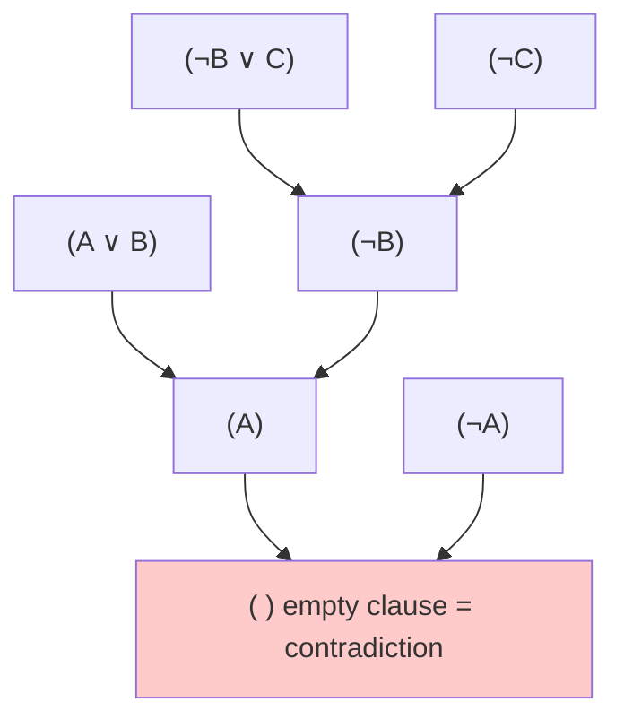

# Knowledge

**Knowledge-based agents** reason by operating on an internal representation of knowledge: from facts they know, they **draw conclusions**.

> **Lecture example.**
> 1. If it didn't rain, Harry visited Hagrid today.
> 2. Harry visited Hagrid or Dumbledore today, but not both.
> 3. Harry visited Dumbledore today.
>
> From 3 and 2 → Harry did **not** visit Hagrid. From 1 → if it hadn't rained he would have visited Hagrid, so **it rained**.

The goal of this lecture: make a computer do this reasoning automatically.

# Propositional logic

A **sentence** is an assertion about the world in a knowledge representation language. In propositional logic we use **proposition symbols** (`P`, `Q`, `R`, or names like `rain`) that are each **true** or **false**.

## Logical connectives

| Symbol | Name | Read as | True when |
|---|---|---|---|
| $\neg P$ | not | "not P" | `P` is false |
| $P \land Q$ | and | "P and Q" | both are true |
| $P \lor Q$ | or (inclusive) | "P or Q" | at least one is true |
| $P \to Q$ | implication | "if P then Q" | **false only when P true and Q false** |
| $P \leftrightarrow Q$ | biconditional | "P if and only if Q" | both have the same value |

### Truth table

| `P` | `Q` | $\neg P$ | $P \land Q$ | $P \lor Q$ | $P \to Q$ | $P \leftrightarrow Q$ |
|---|---|---|---|---|---|---|
| F | F | T | F | F | **T** | T |
| F | T | T | F | T | **T** | F |
| T | F | F | F | T | **F** | F |
| T | T | F | T | T | **T** | T |

About implication: "If it rains, I bring an umbrella." If it doesn't rain, I've broken no promise whatever I do → **true** ("vacuously true"). The only way to break it: it rains **and** I have no umbrella.

## Models and knowledge base

- **Model**: an assignment of true/false to **every** symbol, i.e. one possible world. With `n` symbols there are $2^n$ models.
- **Knowledge base (KB)**: the set of sentences the agent knows to be true.

Harry example as a KB:

$$
KB = (\neg rain \to hagrid) \land (hagrid \lor dumbledore) \land \neg(hagrid \land dumbledore) \land dumbledore
$$

# entailments

$$
\alpha \models \beta
$$

"α **entails** β": **in every model where α is true, β is also true.** If you know α, then β follows necessarily.

The central question of inference: **does `KB ⊨ query`?**

Entailment is not the same as implication: `α → β` is a **sentence inside** the logic; `α ⊨ β` is a **statement about** the logic (a relationship between sentences).

## Model checking

The simplest inference algorithm: **enumerate every model**.

```text
To decide whether KB ⊨ α:
    for every possible model:
        if KB is true in this model:
            α must also be true (otherwise KB does not entail α)
    if α was true in every model where KB was true → KB ⊨ α
```

**Worked example** (symbols `rain`, `hagrid`, `dumbledore` → 2³ = 8 models):

| rain | hagrid | dumbledore | KB true? |
|---|---|---|---|
| F | F | F | no |
| F | F | T | no — `¬rain → hagrid` fails |
| F | T | F | no — `dumbledore` is false |
| F | T | T | no — visited both |
| T | F | F | no — `hagrid ∨ dumbledore` fails |
| **T** | **F** | **T** | **yes** |
| T | T | F | no |
| T | T | T | no |

The KB is true in exactly one model, and in it `rain = T`. So **KB ⊨ rain**.

### Python implementation

```python
import itertools

class Symbol:
    def __init__(self, name): self.name = name
    def evaluate(self, model): return model[self.name]
    def symbols(self): return {self.name}

class Not:
    def __init__(self, op): self.op = op
    def evaluate(self, m): return not self.op.evaluate(m)
    def symbols(self): return self.op.symbols()

class And:
    def __init__(self, *ops): self.ops = ops
    def evaluate(self, m): return all(o.evaluate(m) for o in self.ops)
    def symbols(self): return set().union(*(o.symbols() for o in self.ops))

class Or(And):
    def evaluate(self, m): return any(o.evaluate(m) for o in self.ops)

class Implication:
    def __init__(self, a, b): self.a, self.b = a, b
    def evaluate(self, m): return (not self.a.evaluate(m)) or self.b.evaluate(m)
    def symbols(self): return self.a.symbols() | self.b.symbols()

def model_check(knowledge, query):
    symbols = sorted(knowledge.symbols() | query.symbols())
    for values in itertools.product([True, False], repeat=len(symbols)):
        model = dict(zip(symbols, values))
        if knowledge.evaluate(model) and not query.evaluate(model):
            return False            # found a model where KB true but query false
    return True

rain, hagrid, dumbledore = Symbol("rain"), Symbol("hagrid"), Symbol("dumbledore")
knowledge = And(
    Implication(Not(rain), hagrid),
    Or(hagrid, dumbledore),
    Not(And(hagrid, dumbledore)),
    dumbledore,
)
print(model_check(knowledge, rain))        # True
print(model_check(knowledge, hagrid))      # False
```

Correct, but $2^n$ models → with 100 symbols that's ~$10^{30}$ models. Doesn't scale.

## Knowledge engineering

Turning a real problem into logic.

**Clue** (who did it, in which room, with which weapon):

```python
people  = ["mustard", "plum", "scarlet"]
rooms   = ["ballroom", "kitchen", "library"]
weapons = ["knife", "revolver", "wrench"]
symbols = [Symbol(x) for x in people + rooms + weapons]

knowledge = And(
    Or(*[Symbol(p) for p in people]),     # one of them is the murderer
    Or(*[Symbol(r) for r in rooms]),      # it happened in one of the rooms
    Or(*[Symbol(w) for w in weapons]),    # with one of the weapons
)
# my cards: I hold mustard, kitchen, revolver → they are NOT the answer
knowledge.ops += (Not(Symbol("mustard")), Not(Symbol("kitchen")), Not(Symbol("revolver")))
# someone made a wrong guess: "scarlet, library, wrench" → at least one is false
knowledge.ops += (Or(Not(Symbol("scarlet")), Not(Symbol("library")), Not(Symbol("wrench"))),)
```

Then `model_check(knowledge, Symbol(x))` for each `x` tells you what you **know for sure**. Other lecture examples: the Hogwarts-house logic puzzle and Mastermind.

# Inference rules

Instead of enumerating models, **derive** new sentences directly from existing ones.

| Rule | From | Conclude |
|---|---|---|
| **Modus ponens** | $\alpha \to \beta$, $\alpha$ | $\beta$ |
| And elimination | $\alpha \land \beta$ | $\alpha$ |
| Double negation elimination | $\neg(\neg\alpha)$ | $\alpha$ |
| Implication elimination | $\alpha \to \beta$ | $\neg\alpha \lor \beta$ |
| Biconditional elimination | $\alpha \leftrightarrow \beta$ | $(\alpha \to \beta) \land (\beta \to \alpha)$ |
| **De Morgan's law** | $\neg(\alpha \land \beta)$ | $\neg\alpha \lor \neg\beta$ |
| **De Morgan's law** | $\neg(\alpha \lor \beta)$ | $\neg\alpha \land \neg\beta$ |
| Distributive | $\alpha \land (\beta \lor \gamma)$ | $(\alpha \land \beta) \lor (\alpha \land \gamma)$ |
| Distributive | $\alpha \lor (\beta \land \gamma)$ | $(\alpha \lor \beta) \land (\alpha \lor \gamma)$ |

Examples in plain words:

- Modus ponens: "If it is raining, Harry is inside" + "It is raining" → "Harry is inside".
- De Morgan: "It is **not** true that both Harry and Ron passed" → "Harry didn't pass **or** Ron didn't pass".

Proving a theorem can be seen as a **search problem**:

| Search concept | In theorem proving |
|---|---|
| initial state | the starting KB |
| actions | inference rules |
| transition model | new KB after applying a rule |
| goal test | does the KB contain the statement we want? |

## Resolution

**Unit resolution**: "Ron is in the Great Hall or the library" + "Ron is not in the Great Hall" → "Ron is in the library".

$$
\frac{P \lor Q \qquad \neg P}{Q}
\qquad\qquad
\frac{P \lor Q_1 \lor \dots \lor Q_n \qquad \neg P}{Q_1 \lor \dots \lor Q_n}
$$

**General resolution**: two clauses with complementary literals combine:

$$
\frac{P \lor Q \qquad \neg P \lor R}{Q \lor R}
$$

Resolving $P$ with $\neg P$ gives the **empty clause** `()`, which is always **false**: a contradiction.

Resolution only works on **CNF**.

- **Literal**: a symbol or its negation (`P`, `¬Q`).
- **Clause**: a disjunction (OR) of literals, e.g. $P \lor \neg Q \lor R$.
- **CNF (Conjunctive Normal Form)**: a conjunction (AND) of clauses, e.g. $(A \lor B \lor C) \land (D \lor \neg E) \land (F \lor G)$.

### Converting to CNF

1. Eliminate biconditionals: $\alpha \leftrightarrow \beta \Rightarrow (\alpha \to \beta) \land (\beta \to \alpha)$
2. Eliminate implications: $\alpha \to \beta \Rightarrow \neg\alpha \lor \beta$
3. Move $\neg$ inwards with De Morgan's laws.
4. Distribute $\lor$ over $\land$.

**Worked example**: convert $(P \lor Q) \to R$.

$$
\begin{aligned}
(P \lor Q) \to R &\equiv \neg(P \lor Q) \lor R && \text{implication elimination} \\
&\equiv (\neg P \land \neg Q) \lor R && \text{De Morgan} \\
&\equiv (\neg P \lor R) \land (\neg Q \lor R) && \text{distributive}
\end{aligned}
$$

### Inference by resolution (proof by contradiction)

To prove `KB ⊨ α`, assume the opposite and look for a contradiction:

```text
To determine whether KB ⊨ α:
    convert (KB ∧ ¬α) to CNF
    repeat:
        resolve pairs of clauses to produce new clauses
        if the empty clause () is produced → contradiction → KB ⊨ α  ✔
        if no new clause can be added      → KB does not entail α   ✘
```

**Worked example**: does $(A \lor B) \land (\neg B \lor C) \land \neg C$ entail $A$?

Add $\neg A$. Clauses: `(A ∨ B)`, `(¬B ∨ C)`, `(¬C)`, `(¬A)`.



Assuming ¬A gives a contradiction, so **the KB entails A**.

# First-order logic

Propositional logic needs one symbol per fact: `MinervaGryffindor`, `MinervaHufflepuff`, `PomonaGryffindor`… 4 people × 4 houses = 16 symbols, and many rules. **First-order logic** is more expressive:

- **Constant symbols** = objects: `Minerva`, `Pomona`, `Gryffindor`, `Hufflepuff`
- **Predicate symbols** = properties/relations, true or false: `Person(Minerva)`, `House(Gryffindor)`, `BelongsTo(Minerva, Gryffindor)`

**Universal quantification** $\forall$ ("for all"):

$$
\forall x.\ BelongsTo(x, Gryffindor) \to \neg BelongsTo(x, Hufflepuff)
$$

"Anyone in Gryffindor is not in Hufflepuff."

**Existential quantification** $\exists$ ("there exists"):

$$
\forall x.\ Person(x) \to (\exists y.\ House(y) \land BelongsTo(x, y))
$$

"Every person belongs to at least one house."

# Self-check

<details>
<summary>1. When is P → Q false?</summary>

Only when **P is true and Q is false**.
</details>

<details>
<summary>2. Define α ⊨ β in your own words.</summary>

In every possible world where α is true, β is also true. Knowing α guarantees β.
</details>

<details>
<summary>3. How many models are there with 5 symbols? Why is model checking impractical?</summary>

$2^5 = 32$. The number of models doubles with every new symbol (exponential), so large problems are impossible to enumerate.
</details>

<details>
<summary>4. Convert P ↔ Q to CNF.</summary>

$(P \to Q) \land (Q \to P) \equiv (\neg P \lor Q) \land (\neg Q \lor P)$
</details>

<details>
<summary>5. What does deriving the empty clause in resolution prove?</summary>

That `KB ∧ ¬α` is contradictory (unsatisfiable), so `KB ⊨ α`.
</details>

<details>
<summary>6. Write "Every student has a wand" in first-order logic.</summary>

$\forall x.\ Student(x) \to \exists y.\ (Wand(y) \land Has(x, y))$
</details>
