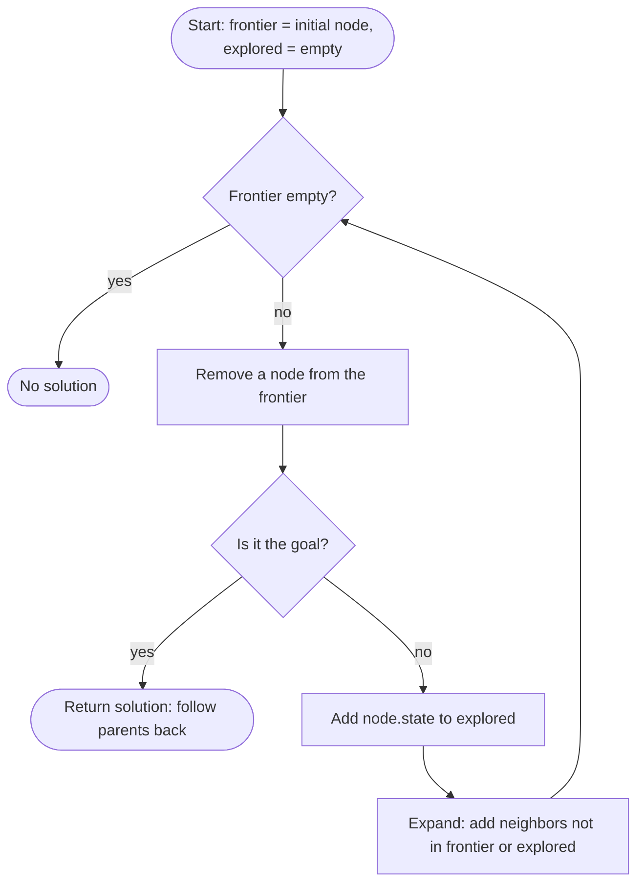
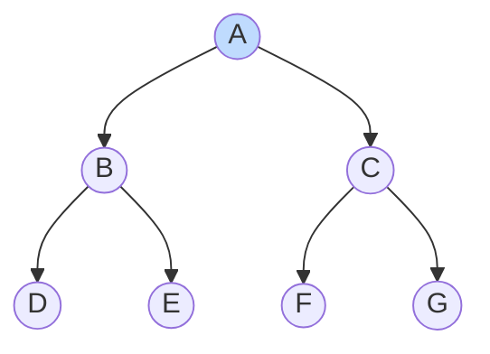
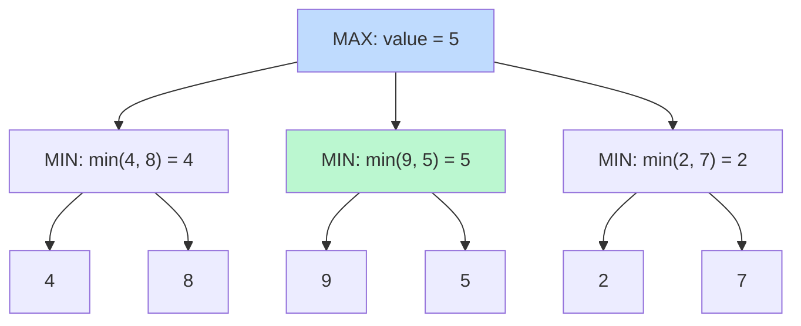

# Search

A **search problem**: an agent must find a sequence of actions that goes from an **initial state** to a **goal state**. Examples: solving a maze, driving directions, the 15-puzzle, tic-tac-toe.

## Terminology

| Term | Meaning | Maze example |
|---|---|---|
| **Agent** | Entity that perceives its environment and acts on it | the explorer |
| **State** | A configuration of the agent and environment | cell `(row, col)` |
| **Initial state** | Where the agent starts | cell A |
| **Actions** | `ACTIONS(s)` = actions executable in state `s` | up / down / left / right (if not a wall) |
| **Transition model** | `RESULT(s, a)` = state after doing `a` in `s` | `RESULT((2,3), "up") = (1,3)` |
| **State space** | All states reachable from the initial state (a graph) | all free cells |
| **Goal test** | Is this state a goal? | `state == B` |
| **Path cost** | Numeric cost of a path | number of steps |
| **Solution** | Actions from initial state to a goal; **optimal** = lowest cost | shortest path A → B |

A **node** is the data structure the algorithm stores:

```python
class Node:
    def __init__(self, state, parent, action, cost=0):
        self.state = state      # e.g. (row, col)
        self.parent = parent    # the Node that generated this one
        self.action = action    # action applied to parent to get here
        self.cost = cost        # path cost g(n) from the start
```

When we reach the goal, we walk the `parent` pointers back to the start to rebuild the path.

## The general search algorithm



The **explored set** prevents infinite loops (A → B → A → …). **The only difference between DFS and BFS is which node `remove()` returns.**

### Full runnable maze solver

```python
class StackFrontier:                      # DFS: last in, first out
    def __init__(self):
        self.frontier = []
    def add(self, node):
        self.frontier.append(node)
    def contains_state(self, state):
        return any(node.state == state for node in self.frontier)
    def empty(self):
        return len(self.frontier) == 0
    def remove(self):
        return self.frontier.pop()        # take the LAST added

class QueueFrontier(StackFrontier):       # BFS: first in, first out
    def remove(self):
        return self.frontier.pop(0)       # take the FIRST added


MAZE = """
#########
#A....#.#
#.##.##.#
#.#.....#
#.#.###.#
#...#..B#
#########
""".strip().splitlines()

def find(ch):
    for r, row in enumerate(MAZE):
        if ch in row:
            return (r, row.index(ch))

def neighbors(state):
    r, c = state
    moves = [("up", (r - 1, c)), ("down", (r + 1, c)), ("left", (r, c - 1)), ("right", (r, c + 1))]
    return [(a, (rr, cc)) for a, (rr, cc) in moves if MAZE[rr][cc] != "#"]

def solve(frontier):
    start, goal = find("A"), find("B")
    frontier.add(Node(start, None, None))
    explored = set()
    while not frontier.empty():
        node = frontier.remove()
        if node.state == goal:                       # goal test
            path = []
            while node.parent is not None:
                path.append(node.action)
                node = node.parent
            return path[::-1], len(explored)
        explored.add(node.state)
        for action, state in neighbors(node.state):
            if state not in explored and not frontier.contains_state(state):
                frontier.add(Node(state, node, action))
    raise Exception("no solution")

for name, f in [("DFS", StackFrontier()), ("BFS", QueueFrontier())]:
    path, n_explored = solve(f)
    print(f"{name}: {len(path)} steps, explored {n_explored} states")
```

## DFS

**Depth-first search**: the frontier is a **stack** (LIFO). It always expands the **deepest** node — it goes down one path until a dead end, then backtracks.



Expansion order on the tree above: **DFS** → `A, C, G, F, B, E, D` (it dives into one branch first, here the last child pushed). **BFS** → `A, B, C, D, E, F, G` (level by level).

- ✅ Memory: only stores the current path (plus siblings) → `O(b·m)` for branching factor `b`, max depth `m`.
- ✅ Can be very fast if it happens to choose the right branch.
- ❌ **Not optimal** — may return a long path.
- ❌ Can wander over a huge part of the state space.

## BFS

**Breadth-first search**: the frontier is a **queue** (FIFO). It expands the **shallowest** node first, exploring layer by layer.

- ✅ **Optimal** when every step costs the same — finds the shortest path.
- ✅ Complete: always finds a solution if one exists (finite branching).
- ❌ Memory heavy: stores the whole frontier layer, `O(b^d)` for solution depth `d`.

DFS and BFS are **uninformed search**: they use no knowledge about where the goal is.

# Informed search

Informed search uses **problem-specific knowledge** in the form of a **heuristic function** `h(n)`: an *estimate* of how far node `n` is from the goal.

For a grid maze the classic heuristic is the **Manhattan distance**:

$$
h(n) = |x_n - x_{goal}| + |y_n - y_{goal}|
$$

It ignores walls, so it's an *estimate*, not the true distance.


## Greedy best first search

**GBFS** always expands the node with the **smallest** `h(n)` — the one that *looks* closest to the goal. Frontier = **priority queue** ordered by `h(n)`.

```python
import heapq

def greedy_best_first(start, goal, h):
    frontier = [(h(start), start)]
    parent = {start: None}
    while frontier:
        _, state = heapq.heappop(frontier)        # smallest h first
        if state == goal:
            break
        for _, nxt in neighbors(state):
            if nxt not in parent:
                parent[nxt] = state
                heapq.heappush(frontier, (h(nxt), nxt))
    return parent
```

- Often explores far fewer states than BFS.
- ❌ **Not optimal**: it ignores how far it already travelled. In a maze where a wall forces a detour, it happily follows the low-`h` corridor into a dead end, or finds a long path.

## A *

A* expands the node with the lowest

$$
f(n) = g(n) + h(n)
$$

- `g(n)` = **actual** cost to reach `n` from the start
- `h(n)` = **estimated** cost from `n` to the goal

So `f(n)` estimates the total cost of the cheapest solution going through `n`.

**Worked example.** Two frontier nodes:

| Node | steps so far `g` | Manhattan `h` | `f = g + h` |
|---|---|---|---|
| P | 4 | 7 | 11 |
| Q | 10 | 3 | 13 |

GBFS picks **Q** (smaller `h`). A* picks **P** (smaller `f`): Q looks close, but we paid a lot to get there.

A* is **optimal** if `h` is:

1. **Admissible** — never *over*estimates the true cost: $h(n) \le h^*(n)$.
2. **Consistent** — for every node `n` and successor `n'` with step cost `c`:

$$
h(n) \le h(n') + c
$$

(The heuristic never drops by more than the step cost — like the triangle inequality.) Manhattan distance in a 4-direction grid is both.

```python
import heapq

def a_star(start, goal, h):
    frontier = [(h(start), 0, start)]          # (f, g, state)
    best_g = {start: 0}
    parent = {start: None}
    while frontier:
        f, g, state = heapq.heappop(frontier)
        if state == goal:
            path = []
            while state is not None:
                path.append(state)
                state = parent[state]
            return path[::-1]
        for _, nxt in neighbors(state):
            new_g = g + 1                       # each step costs 1
            if new_g < best_g.get(nxt, float("inf")):
                best_g[nxt] = new_g
                parent[nxt] = state
                heapq.heappush(frontier, (new_g + h(nxt), new_g, nxt))

goal = find("B")
manhattan = lambda s: abs(s[0] - goal[0]) + abs(s[1] - goal[1])
print(a_star(find("A"), goal, manhattan))
```

Note: with `h(n) = 0` A* becomes **uniform-cost search** (Dijkstra); with all step costs 1 that is BFS.

| Algorithm | Frontier | Picks node with | Optimal? | Memory |
|---|---|---|---|---|
| DFS | Stack | deepest | No | low |
| BFS | Queue | shallowest | Yes (equal step costs) | high |
| Greedy best-first | Priority queue | lowest `h(n)` | No | medium–high |
| A* | Priority queue | lowest `g(n) + h(n)` | Yes (admissible + consistent `h`) | high |

# Adversarial search

Now there is an **opponent** who wants us to lose (tic-tac-toe, chess, Nim).

## minimax

Two players: **MAX** wants the highest score, **MIN** wants the lowest. Tic-tac-toe utilities:

$$
\text{UTILITY}(s) = \begin{cases} 1 & \text{X wins} \\ 0 & \text{tie} \\ -1 & \text{O wins} \end{cases}
$$

A game is defined by:

| Function | Meaning |
|---|---|
| `S0` | initial state (empty board) |
| `PLAYER(s)` | whose turn it is in `s` |
| `ACTIONS(s)` | legal moves in `s` |
| `RESULT(s, a)` | state after move `a` |
| `TERMINAL(s)` | is the game over? |
| `UTILITY(s)` | final numeric value of a terminal state |

The **value** of a state assuming both players play perfectly:

$$
\text{MINIMAX}(s) = \begin{cases}
\text{UTILITY}(s) & \text{if TERMINAL}(s) \\
\max_{a} \text{MINIMAX}(\text{RESULT}(s,a)) & \text{if PLAYER}(s) = \text{MAX} \\
\min_{a} \text{MINIMAX}(\text{RESULT}(s,a)) & \text{if PLAYER}(s) = \text{MIN}
\end{cases}
$$

**Worked example** — MAX to move, 3 choices; MIN then replies:



MAX would love the 9, but MIN will never allow it. Assuming MIN replies optimally, the middle move guarantees **5**, so MAX picks it.

```python
import math

def max_value(state):
    if terminal(state):
        return utility(state)
    v = -math.inf
    for action in actions(state):
        v = max(v, min_value(result(state, action)))
    return v

def min_value(state):
    if terminal(state):
        return utility(state)
    v = math.inf
    for action in actions(state):
        v = min(v, max_value(result(state, action)))
    return v

def minimax(state):
    """Return the optimal action for the current player."""
    if player(state) == "X":                 # MAX
        return max(actions(state), key=lambda a: min_value(result(state, a)))
    return min(actions(state), key=lambda a: max_value(result(state, a)))
```

## Alpha-beta pruning

Minimax explores every node. **Alpha-beta** skips branches that **cannot** affect the decision.

- `α` = the best value MAX can already guarantee on this path (starts at −∞)
- `β` = the best value MIN can already guarantee on this path (starts at +∞)
- As soon as $\alpha \ge \beta$, stop exploring the remaining children: **prune**.

On the tree above: after the first two branches MAX knows it can get **5** (`α = 5`). In the third branch, MIN's first leaf is **2**, so that branch is worth **at most 2**, which is less than 5. MAX will never pick it, so we **skip the leaf 7** without looking at it.

```python
def alphabeta(state, alpha=-math.inf, beta=math.inf):
    if terminal(state):
        return utility(state)
    if player(state) == "X":                                 # MAX
        v = -math.inf
        for a in actions(state):
            v = max(v, alphabeta(result(state, a), alpha, beta))
            alpha = max(alpha, v)
            if alpha >= beta:
                break                                        # β cut-off
        return v
    v = math.inf
    for a in actions(state):
        v = min(v, alphabeta(result(state, a), alpha, beta))
        beta = min(beta, v)
        if alpha >= beta:
            break                                            # α cut-off
    return v
```

Same result as minimax. With good move ordering it explores about $O(b^{d/2})$ nodes instead of $O(b^d)$ — like searching twice as deep for free.

## depth-limited minimax

Tic-tac-toe has **255,168** possible games. Chess has around $10^{29000}$. We can't search to the end.

**Depth-limited minimax** stops after a fixed number of moves and calls an **evaluation function** that *estimates* the utility of a non-terminal state.

Chess example (material count):

$$
\text{EVAL}(s) = 9(Q - Q') + 5(R - R') + 3(B - B' + N - N') + (P - P')
$$

(uppercase = my pieces, primed = the opponent's). Real engines also add mobility, king safety, pawn structure…

```python
def max_value(state, depth):
    if terminal(state):
        return utility(state)
    if depth == 0:
        return evaluate(state)        # heuristic estimate instead of searching deeper
    return max(min_value(result(state, a), depth - 1) for a in actions(state))
```

The deeper you can search and the better your evaluation function, the stronger the AI.

# Self-check

<details>
<summary>1. What is the only difference between DFS and BFS in code?</summary>

The frontier data structure: a **stack** (pop last) for DFS, a **queue** (pop first) for BFS. Everything else is identical.
</details>

<details>
<summary>2. Why is greedy best-first search not optimal?</summary>

It only looks at `h(n)` (estimated distance left) and ignores `g(n)` (cost already paid). A path that looks close can turn out long, e.g. because of walls the heuristic ignores.
</details>

<details>
<summary>3. Which two properties of h(n) make A* optimal?</summary>

**Admissible** (never overestimates the true cost) and **consistent** (`h(n) ≤ h(n') + c` for every step).
</details>

<details>
<summary>4. Compute A*'s choice: node X has g=3, h=6; node Y has g=5, h=2.</summary>

`f(X) = 9`, `f(Y) = 7` → A* expands **Y**. (Greedy would also pick Y since h=2 is smaller.)
</details>

<details>
<summary>5. In minimax, what does MAX assume about MIN?</summary>

That MIN plays **optimally** and always picks the move that minimizes MAX's score.
</details>

<details>
<summary>6. Why does depth-limited minimax need an evaluation function?</summary>

When it stops at the depth limit the state is usually not terminal, so there is no true utility. The evaluation function gives an estimate of how good that state is.
</details>
