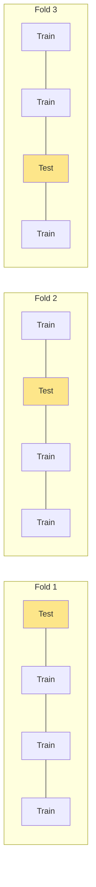
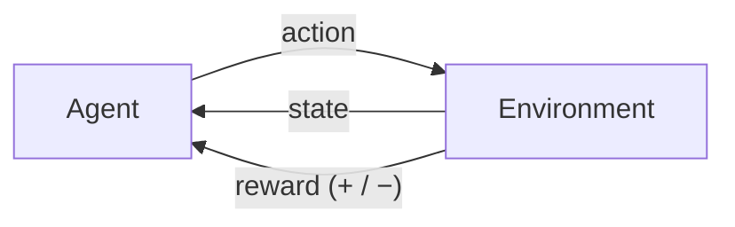

# Learning

**Machine learning**: instead of giving the computer explicit rules, we give it **data** and let it learn the patterns.

| Type | What the data looks like | Example |
|---|---|---|
| **Supervised** | inputs **with** labeled outputs | spam detection, predicting house prices |
| **Reinforcement** | rewards / punishments from acting in an environment | game playing, robot walking |
| **Unsupervised** | inputs **without** labels | grouping customers, finding topics |

# Supervised learning

Given a data set of input–output pairs, learn a function that maps inputs to outputs.

There is some unknown true function `f` (e.g. humidity, pressure → rain or not). We learn a **hypothesis** `h` that approximates it:

$$
f(\text{humidity}, \text{pressure}) = \text{rain} \;/\; \text{no rain} \qquad\Longrightarrow\qquad h(\text{humidity}, \text{pressure}) \approx f
$$

- **Classification**: output is a **discrete category** (rain / no rain, authentic / counterfeit banknote).
- **Regression**: output is a **continuous value** (sales given advertising budget).

## Nearest-neighbor classification

Assign the new point the class of the **nearest** training point. **k-nearest-neighbor**: majority vote among the `k` closest points.


Distance is usually Euclidean:

$$
d(\mathbf{p}, \mathbf{q}) = \sqrt{\sum_{i=1}^{n} (p_i - q_i)^2}
$$

```python
import math
from collections import Counter

def knn_predict(train_X, train_y, x, k=3):
    dists = sorted((math.dist(p, x), label) for p, label in zip(train_X, train_y))
    votes = Counter(label for _, label in dists[:k])
    return votes.most_common(1)[0][0]

train_X = [(1, 8), (2, 7), (3, 9), (7, 2), (8, 3), (6, 1)]
train_y = ["rain", "rain", "rain", "sun", "sun", "sun"]
print(knn_predict(train_X, train_y, (3, 6)))     # rain
```

- ✅ Simple, no training phase.
- ❌ Slow at prediction time with a lot of data (must compare against all points).
- ❌ Sensitive to feature scale → normalize features first.

# Vector

Represent each input as a **vector**, and the parameters as a **weight vector**:

$$
\mathbf{x} = (1, x_1, x_2) \qquad \mathbf{w} = (w_0, w_1, w_2)
$$

(The leading `1` lets $w_0$ act as the bias.) A linear classifier uses the **dot product**:

$$
\mathbf{w} \cdot \mathbf{x} = w_0 + w_1x_1 + w_2x_2
\qquad\qquad
h_{\mathbf{w}}(\mathbf{x}) = \begin{cases} 1 & \text{if } \mathbf{w} \cdot \mathbf{x} \ge 0 \\ 0 & \text{otherwise} \end{cases}
$$

The line $\mathbf{w} \cdot \mathbf{x} = 0$ is the **decision boundary**.

**Worked example**: $\mathbf{w} = (-5, 2, 1)$, input $x_1 = 2, x_2 = 3$ → $-5 + 2(2) + 1(3) = 2 \ge 0$ → class **1** (rain).

## Perceptron learning rule

For each data point `(x, y)`, update every weight:

$$
w_i \leftarrow w_i + \alpha\,\big(y - h_{\mathbf{w}}(\mathbf{x})\big)\, x_i
$$

- Correct prediction → $y - h = 0$ → no change.
- Predicted 0 but actually 1 → weights **increase** (push toward 1).
- Predicted 1 but actually 0 → weights **decrease**.

**Worked example** (`α = 1`): $\mathbf{w} = (0, 0, 0)$, point $\mathbf{x} = (1, 2, -1)$ with label $y = 0$.
$\mathbf{w}\cdot\mathbf{x} = 0 \ge 0$ → predict 1, wrong. Update: $\mathbf{w} = (0,0,0) + 1 \cdot (0 - 1)(1, 2, -1) = (-1, -2, 1)$.

```python
import numpy as np

def train_perceptron(X, y, alpha=0.1, epochs=20):
    X = np.c_[np.ones(len(X)), X]           # add the bias column of 1s
    w = np.zeros(X.shape[1])
    for _ in range(epochs):
        for xi, yi in zip(X, y):
            pred = 1 if w @ xi >= 0 else 0
            w += alpha * (yi - pred) * xi
    return w

X = np.array([[1, 8], [2, 7], [3, 9], [7, 2], [8, 3], [6, 1]])
y = np.array([1, 1, 1, 0, 0, 0])
w = train_perceptron(X, y)
print(w)   # a weight vector that separates the two groups
```

- **Hard threshold**: output is only 0 or 1, so there is no notion of confidence.
- **Soft threshold** — the logistic (sigmoid) function — gives a value between 0 and 1, which we can read as a probability.


## Support Vector Machines

Many lines separate the data. Which is best? SVM picks the **maximum margin separator**: the boundary that is as far as possible from the nearest points of each class.


- **Support vectors** = the points closest to the boundary; they alone determine it.
- A larger margin usually **generalizes** better to new data.
- With **kernels**, SVMs map data into higher dimensions to separate data that isn't linearly separable (e.g. one class forming a circle inside the other).

## Regression

Learn a function that outputs a **continuous** value, e.g. a line $h(x) = w_0 + w_1x$ mapping advertising spend to sales. See [ML Basics](./0.basic.md) for the full gradient-descent derivation.

# L2 loss function

A **loss function** measures how badly the hypothesis performs (lower is better).

| Loss | Formula | Use |
|---|---|---|
| **0–1 loss** | $L = 0$ if actual = predicted, else $1$ | classification: counts mistakes |
| **L1 loss** | $L = \lvert actual - predicted \rvert$ | regression; robust to outliers |
| **L2 loss** | $L = (actual - predicted)^2$ | regression; punishes big errors much more |

**Worked example**: predictions vs actual sales:

| actual | predicted | L1 | L2 |
|---|---|---|---|
| 10 | 12 | 2 | 4 |
| 20 | 19 | 1 | 1 |
| 30 | 24 | 6 | **36** |
| **total** | | **9** | **41** |

The 6-unit error counts 6× in L1 but **36×** in L2. L2 cares most about the largest errors.

```python
import numpy as np
actual, pred = np.array([10, 20, 30]), np.array([12, 19, 24])
print(np.abs(actual - pred).sum(), ((actual - pred) ** 2).sum())   # 9 41
```

## Overfitting & regularization

**Overfitting**: the model fits the training data too well (it memorizes the noise) and fails on new data.


**Regularization** penalizes complexity:

$$
\text{cost}(h) = \text{loss}(h) + \lambda\, \text{complexity}(h)
$$

- $\lambda$ large → strongly prefer simple hypotheses (risk underfitting).
- $\lambda = 0$ → only care about the training loss (risk overfitting).
- L2 regularization example: $\text{complexity}(h) = \sum_i w_i^2$.

## Evaluating: holdout & cross-validation

- **Holdout cross-validation**: split into a **training set** (learn) and a **test set** (evaluate on data never seen).
- **k-fold cross-validation**: split into `k` equal parts. Train on `k − 1` parts and test on the remaining one. Repeat `k` times so every part is the test set once, then average.



Metrics beyond accuracy (useful when classes are imbalanced):

$$
\text{sensitivity (TPR)} = \frac{TP}{TP + FN} \qquad \text{specificity (TNR)} = \frac{TN}{TN + FP}
$$

# scikit-learn

The lecture's banknote example: 4 features from an image of a banknote → authentic (0) or counterfeit (1).

```python
import csv
from sklearn.model_selection import train_test_split
from sklearn.linear_model import Perceptron
from sklearn import svm
from sklearn.neighbors import KNeighborsClassifier
from sklearn.naive_bayes import GaussianNB

# banknotes.csv columns: variance, skewness, curtosis, entropy, class
with open("banknotes.csv") as f:
    reader = csv.reader(f)
    next(reader)
    rows = list(reader)
evidence = [[float(c) for c in row[:4]] for row in rows]
labels = ["Authentic" if row[4] == "0" else "Counterfeit" for row in rows]

X_train, X_test, y_train, y_test = train_test_split(evidence, labels, test_size=0.4)

for model in [Perceptron(), svm.SVC(), KNeighborsClassifier(n_neighbors=1), GaussianNB()]:
    model.fit(X_train, y_train)                   # learn
    predictions = model.predict(X_test)           # predict on unseen data
    correct = sum(p == y for p, y in zip(predictions, y_test))
    print(f"{type(model).__name__:22} accuracy {100 * correct / len(y_test):.2f}%")
```

Every scikit-learn model has the same API (`fit`, then `predict`), so swapping algorithms is a one-line change. Typical result: Perceptron ~98%, SVC ~99%, kNN ~100%, Naive Bayes ~84%.

Other useful tools:

```python
from sklearn.preprocessing import StandardScaler        # feature scaling
from sklearn.model_selection import cross_val_score      # k-fold CV
from sklearn.metrics import confusion_matrix, classification_report

scores = cross_val_score(KNeighborsClassifier(3), evidence, labels, cv=5)
print(scores.mean())
```

# Reinforcement leanring

The agent acts in an **environment**, gets a new **state** and a **reward**, and learns which actions lead to high rewards over time.



## Markov Decision Process

The model behind RL:

| Element | Meaning |
|---|---|
| States $S$ | all situations the agent can be in |
| Actions $\text{ACTIONS}(s)$ | what the agent can do in state $s$ |
| Transition model $P(s' \mid s, a)$ | probability of landing in $s'$ after action $a$ in $s$ |
| Reward function $R(s, a, s')$ | reward for that transition |

Example: a grid world. The agent moves through cells; stepping on a red cell gives −1, reaching the green goal gives +1. At first it knows nothing, so it must learn by trial and error.

# Q-learning

Learn a function $Q(s, a)$: an estimate of the **value** (expected future reward) of taking action $a$ in state $s$.

$$
\boxed{Q(s, a) \leftarrow Q(s, a) + \alpha \Big( \underbrace{r + \gamma \max_{a'} Q(s', a')}_{\text{new value estimate}} - Q(s, a) \Big)}
$$

| Symbol | Meaning |
|---|---|
| $\alpha$ | **learning rate**: how much new information overrides the old (1 = only new, 0 = never learn) |
| $r$ | reward received now |
| $\gamma$ | **discount factor**: how much future rewards matter compared to immediate ones (0…1) |
| $\max_{a'} Q(s', a')$ | best value we believe is possible from the next state |

**Worked example**: $Q(s, a) = 0.5$, $\alpha = 0.5$, $\gamma = 0.9$. We take `a`, get $r = 1$, and the best Q in the next state is 0.4.

$$
Q(s,a) \leftarrow 0.5 + 0.5\,\big(1 + 0.9 \times 0.4 - 0.5\big) = 0.5 + 0.5 \times 0.86 = 0.93
$$

### Nim (lecture project)

Piles of objects; players take turns removing any number from one pile. **Whoever takes the last object loses.** The AI plays thousands of games against itself; the move that loses gets reward −1, the move that wins +1, all others 0.

```python
import random

class NimAI:
    def __init__(self, alpha=0.5, epsilon=0.1):
        self.q = {}                     # (tuple(state), action) -> value
        self.alpha, self.epsilon = alpha, epsilon

    def get_q(self, state, action):
        return self.q.get((tuple(state), action), 0)

    def best_future(self, state):
        acts = available_actions(state)
        return max((self.get_q(state, a) for a in acts), default=0)

    def update(self, old_state, action, new_state, reward):
        old = self.get_q(old_state, action)
        target = reward + self.best_future(new_state)          # gamma = 1 here
        self.q[(tuple(old_state), action)] = old + self.alpha * (target - old)

    def choose_action(self, state, epsilon=True):
        acts = list(available_actions(state))
        if epsilon and random.random() < self.epsilon:
            return random.choice(acts)                           # explore
        return max(acts, key=lambda a: self.get_q(state, a))     # exploit

def available_actions(piles):
    return {(i, j) for i, pile in enumerate(piles) for j in range(1, pile + 1)}
```

## greedy descision making

**Greedy**: always pick $\arg\max_a Q(s, a)$, the best action known so far. Problem: the **explore vs. exploit** trade-off. If the agent always exploits, it never discovers a better path it hasn't tried yet.

**ε-greedy**:

$$
\text{action} = \begin{cases}
\text{random action} & \text{with probability } \varepsilon \quad (\text{explore}) \\
\arg\max_a Q(s, a) & \text{with probability } 1 - \varepsilon \quad (\text{exploit})
\end{cases}
$$

Often $\varepsilon$ starts high (explore a lot) and decays over training.

When there are too many states for a table (chess, images), use **function approximation**: estimate $Q(s, a)$ from features of the state, for example with a neural network (Deep Q-Networks).

# Unsupervised learning

No labels: find structure in the data on its own.

## k-means clustering

Group the data into `k` clusters:

1. Place `k` cluster centers (centroids) randomly.
2. **Assign** each point to the nearest center.
3. **Update** each center to the mean of its points.
4. Repeat 2–3 until the assignments stop changing.


$$
\mu_j = \frac{1}{|C_j|} \sum_{x \in C_j} x
\qquad\qquad
\text{minimize } \sum_{j=1}^{k} \sum_{x \in C_j} \lVert x - \mu_j \rVert^2
$$

```python
import numpy as np

def kmeans(X, k, iters=100, seed=0):
    rng = np.random.default_rng(seed)
    centers = X[rng.choice(len(X), k, replace=False)]
    for _ in range(iters):
        labels = np.argmin(((X[:, None] - centers) ** 2).sum(-1), axis=1)    # assign
        new = np.array([X[labels == j].mean(0) for j in range(k)])          # update
        if np.allclose(new, centers):
            break
        centers = new
    return centers, labels

X = np.vstack([np.random.randn(50, 2) + c for c in [(0, 5), (5, 5), (2.5, 0)]])
centers, labels = kmeans(X, 3)
print(centers.round(2))
```

# Self-check

<details>
<summary>1. Classification vs regression: give an example of each.</summary>

Classification: email → spam / not spam. Regression: house features → price.
</details>

<details>
<summary>2. w = (−3, 1, 2), x₁ = 1, x₂ = 0.5. What does the perceptron output?</summary>

$-3 + 1 + 1 = -1 \lt 0$ → **0**.
</details>

<details>
<summary>3. When would you prefer L1 over L2 loss?</summary>

When the data has **outliers** you don't want to dominate. L2 squares big errors, so a single outlier can pull the model a lot.
</details>

<details>
<summary>4. Why do we keep a separate test set?</summary>

To measure how well the model **generalizes** to unseen data. Training accuracy can look perfect even when the model overfits.
</details>

<details>
<summary>5. Q(s,a)=0, α=1, γ=0.5, r=0, best next Q = 0.8. New Q(s,a)?</summary>

$0 + 1 \times (0 + 0.5 \times 0.8 - 0) = 0.4$
</details>

<details>
<summary>6. Why does a purely greedy agent learn poorly? How does ε-greedy fix it?</summary>

It keeps repeating the first actions that looked OK and never tries alternatives. ε-greedy takes a random action with probability ε, so it keeps exploring.
</details>
