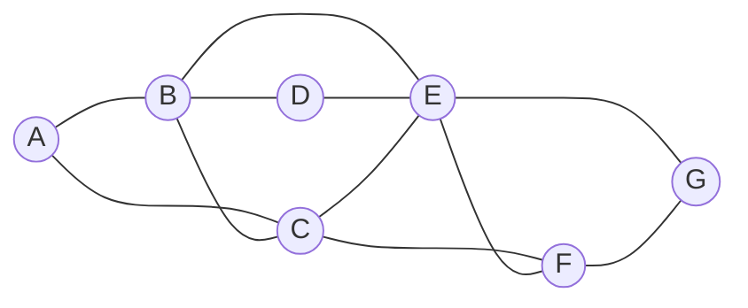

# Optimization

**Optimization** = choosing the **best option** from a set of possible options. Unlike classic search, we usually don't care about the path, only the final state.

# Local search

Keep a single **current state** and repeatedly move to a **neighbor** state. It uses very little memory and works on huge (even infinite) state spaces, but it doesn't guarantee the best answer.


| Term | Meaning |
|---|---|
| **Objective function** | value to **maximize** → look for the **global maximum** |
| **Cost function** | value to **minimize** → look for the **global minimum** |
| **Local maximum / minimum** | better than all neighbors, but not the best overall |
| **Flat local maximum** / **shoulder** | neighbors all have the same value, so the search can't tell which way to go |

**Lecture example — placing hospitals.** Houses `H` and `k` hospitals on a grid. Cost = sum over houses of the Manhattan distance to the **nearest** hospital:

$$
\text{cost} = \sum_{h \in houses} \min_{p \in hospitals} \big(|x_h - x_p| + |y_h - y_p|\big)
$$

A **neighbor** state = move one hospital one cell in any direction.

## Hill climbing

```text
function HILL-CLIMB(problem):
    current = initial state
    repeat:
        neighbor = highest-valued neighbor of current
        if neighbor is not better than current:
            return current          # stuck: a (local) optimum
        current = neighbor
```

```python
import random

def manhattan(a, b):
    return abs(a[0] - b[0]) + abs(a[1] - b[1])

def cost(hospitals, houses):
    return sum(min(manhattan(h, p) for p in hospitals) for h in houses)

def neighbors(hospitals, width, height):
    result = []
    for i, (r, c) in enumerate(hospitals):
        for dr, dc in [(-1, 0), (1, 0), (0, -1), (0, 1)]:
            nr, nc = r + dr, c + dc
            if 0 <= nr < height and 0 <= nc < width and (nr, nc) not in hospitals:
                new = list(hospitals)
                new[i] = (nr, nc)
                result.append(new)
    return result

def hill_climb(houses, k=2, width=10, height=6):
    cells = [(r, c) for r in range(height) for c in range(width)]
    current = random.sample(cells, k)
    while True:
        best = min(neighbors(current, width, height), key=lambda n: cost(n, houses))
        if cost(best, houses) >= cost(current, houses):
            return current, cost(current, houses)
        current = best

houses = [(0, 1), (1, 7), (2, 3), (3, 9), (4, 0), (5, 5)]
print(hill_climb(houses))
```

Problem: it stops at the **first** local optimum it reaches, which may be bad.

# Hill Climbing variants

| Variant | Behavior |
|---|---|
| **Steepest-ascent** | choose the **best** neighbor (the default above) |
| **Stochastic** | choose **randomly** among the better neighbors |
| **First-choice** | take the **first** better neighbor found (good when there are many neighbors) |
| **Random-restart** | run hill climbing many times from random starts and keep the best result |
| **Local beam search** | keep the `k` best states at each step instead of one |

```python
def random_restart(houses, restarts=20):
    return min((hill_climb(houses) for _ in range(restarts)), key=lambda t: t[1])
```

None of these *guarantee* the global optimum, but random restart is simple and often works very well.

## Simulated annealing

Idea from metallurgy: heat metal and cool it slowly so atoms settle into a low-energy state. In search: **early on, sometimes accept worse moves** to escape local optima, and accept them less and less as the "temperature" falls.

```text
function SIMULATED-ANNEALING(problem, max):
    current = initial state
    for t = 1 to max:
        T = TEMPERATURE(t)                   # decreases over time
        neighbor = random neighbor of current
        ΔE = how much better neighbor is than current
        if ΔE > 0:
            current = neighbor               # always accept improvements
        else with probability e^(ΔE / T):
            current = neighbor               # sometimes accept worse
    return current
```

Acceptance probability of a worse move ($\Delta E \lt 0$):

$$
P(\text{accept}) = e^{\Delta E / T}
$$


**Worked example**: a neighbor is 2 units worse ($\Delta E = -2$).

| Temperature `T` | $e^{-2/T}$ | Interpretation |
|---|---|---|
| 10 | 0.82 | early: usually accept |
| 2 | 0.37 | middle |
| 0.5 | 0.018 | late: almost never |

```python
import math, random

def simulated_annealing(state, cost, random_neighbor, T0=10.0, steps=10_000):
    current, best = state, state
    for t in range(1, steps + 1):
        T = T0 * (1 - t / steps) + 1e-9           # linear cooling schedule
        nxt = random_neighbor(current)
        delta = cost(current) - cost(nxt)         # > 0 means nxt is better (we minimize)
        if delta > 0 or random.random() < math.exp(delta / T):
            current = nxt
            if cost(current) < cost(best):
                best = current
    return best
```

**Traveling Salesman Problem (TSP)**: visit all cities once and return home with minimum total distance. With `n` cities there are $(n-1)!/2$ possible tours, way too many to try. Local search: a neighbor = reverse a segment of the tour (a "2-opt" swap of two edges).

```python
def tour_length(tour, pts):
    return sum(math.dist(pts[tour[i]], pts[tour[i - 1]]) for i in range(len(tour)))

def two_opt_neighbor(tour):
    i, j = sorted(random.sample(range(len(tour)), 2))
    return tour[:i] + tour[i:j + 1][::-1] + tour[j + 1:]

pts = [(random.random(), random.random()) for _ in range(30)]
best = simulated_annealing(list(range(30)), lambda t: tour_length(t, pts), two_opt_neighbor,
                           T0=0.5, steps=50_000)       # T0 ~ size of a typical ΔE
print(round(tour_length(best, pts), 3))
```

# Linear programing

Optimize a **linear** function subject to **linear** constraints:

$$
\begin{aligned}
\text{minimize} \quad & c_1x_1 + c_2x_2 + \dots + c_nx_n \\
\text{subject to} \quad & a_{1}x_1 + a_{2}x_2 + \dots + a_{n}x_n \le b \quad (\text{or} = b) \\
& l_i \le x_i \le u_i
\end{aligned}
$$

**Lecture example.**

- Machine X₁ costs **50/hour**, needs **5** units of labor per hour, produces **10** units of output per hour.
- Machine X₂ costs **80/hour**, needs **2** units of labor per hour, produces **12** units of output per hour.
- Total labor available: **20** units. Required output: at least **90** units.

$$
\begin{aligned}
\text{minimize} \quad & 50x_1 + 80x_2 \\
\text{subject to} \quad & 5x_1 + 2x_2 \le 20 \\
& 10x_1 + 12x_2 \ge 90 \quad\Longleftrightarrow\quad -10x_1 - 12x_2 \le -90
\end{aligned}
$$


The optimum of a linear program is always at a **vertex** of the feasible region. Here it is where both constraints are tight:

$$
5x_1 + 2x_2 = 20,\quad 10x_1 + 12x_2 = 90 \;\Rightarrow\; x_1 = 1.5,\ x_2 = 6.25,\ \text{cost} = 50(1.5) + 80(6.25) = 575
$$

```python
import scipy.optimize

result = scipy.optimize.linprog(
    [50, 80],                       # cost function: 50x1 + 80x2
    A_ub=[[5, 2], [-10, -12]],      # constraint coefficients (all as <=)
    b_ub=[20, -90],                 # constraint bounds
)
if result.success:
    print(f"X1: {round(result.x[0], 2)} hours")    # 1.5
    print(f"X2: {round(result.x[1], 2)} hours")    # 6.25
    print(f"cost: {result.fun}")                   # 575.0
```

Tip: a `≥` constraint becomes `≤` by multiplying both sides by −1. Algorithms: **Simplex** and **Interior-point**.

# Constaint satisfaction

A **Constraint Satisfaction Problem (CSP)** has:

- a set of **variables** $\{X_1, \dots, X_n\}$
- a **domain** for each variable $\{D_1, \dots, D_n\}$
- a set of **constraints** `C`

| Problem | Variables | Domain | Constraints |
|---|---|---|---|
| Sudoku | each empty cell | `{1, …, 9}` | all different in each row, column, 3×3 box |
| Exam scheduling | each course | `{Mon, Tue, Wed}` | two courses that share a student get different days |
| Map coloring | each region | `{red, green, blue}` | adjacent regions get different colors |

**Exam scheduling example** (from lecture). Students take courses: 1: A, B, C · 2: B, D, E · 3: C, E, F · 4: E, F, G. Courses that share a student can't be on the same day, which gives a **constraint graph** (edge = "must differ"):



Constraint types:

| Type | Meaning | Example |
|---|---|---|
| **Hard** | must be satisfied | two exams can't be at the same time |
| **Soft** | a preference | "I'd prefer my exam isn't on Monday" |
| **Unary** | one variable | `A ≠ Monday` |
| **Binary** | two variables | `A ≠ B` |

## Node consistency

Every value in a variable's domain satisfies its **unary** constraints. Just delete the bad values:

```text
A ∈ {Mon, Tue, Wed}, constraint A ≠ Mon   →   A ∈ {Tue, Wed}
```

## Arc consistency

Every value in a variable's domain satisfies its **binary** constraints. `X` is **arc-consistent with respect to** `Y` if for **every** value `x` in `X`'s domain there exists **some** value `y` in `Y`'s domain that satisfies the constraint between them.

```text
A ∈ {Tue, Wed},  B ∈ {Wed},  constraint A ≠ B
    A = Wed has no partner in B  →  remove Wed  →  A ∈ {Tue}
```

```text
function REVISE(csp, X, Y):            # make X arc-consistent with Y
    revised = false
    for x in X.domain:
        if no y in Y.domain satisfies constraint(X, Y):
            delete x from X.domain
            revised = true
    return revised

function AC-3(csp):
    queue = all arcs in csp
    while queue non-empty:
        (X, Y) = DEQUEUE(queue)
        if REVISE(csp, X, Y):
            if size of X.domain == 0:
                return false           # no solution possible
            for each Z in X.neighbors - {Y}:
                ENQUEUE(queue, (Z, X)) # X changed → recheck its neighbors
    return true
```

# Backtracking search

A CSP as a search problem: state = a partial assignment, action = assign a value to one variable, goal = every variable assigned and every constraint satisfied. **Backtracking** = DFS that **undoes** an assignment as soon as it causes a conflict.

```text
function BACKTRACK(assignment, csp):
    if assignment is complete: return assignment
    var = SELECT-UNASSIGNED-VAR(assignment, csp)
    for value in DOMAIN-VALUES(var, assignment, csp):
        if value is consistent with assignment:
            add {var = value} to assignment
            result = BACKTRACK(assignment, csp)
            if result ≠ failure: return result
            remove {var = value} from assignment      # backtrack
    return failure
```

Runnable version for the exam scheduling problem:

```python
VARIABLES = ["A", "B", "C", "D", "E", "F", "G"]
DOMAIN = ["Monday", "Tuesday", "Wednesday"]
CONSTRAINTS = [("A", "B"), ("A", "C"), ("B", "C"), ("B", "D"), ("B", "E"), ("C", "E"),
               ("C", "F"), ("D", "E"), ("E", "F"), ("E", "G"), ("F", "G")]

def consistent(assignment):
    return all(assignment[x] != assignment[y]
               for x, y in CONSTRAINTS if x in assignment and y in assignment)

def backtrack(assignment):
    if len(assignment) == len(VARIABLES):
        return assignment
    var = next(v for v in VARIABLES if v not in assignment)
    for value in DOMAIN:
        assignment[var] = value
        if consistent(assignment):
            result = backtrack(assignment)
            if result is not None:
                return result
        del assignment[var]
    return None

print(backtrack({}))
# {'A': 'Monday', 'B': 'Tuesday', 'C': 'Wednesday', 'D': 'Wednesday',
#  'E': 'Monday', 'F': 'Tuesday', 'G': 'Wednesday'}
```

Or with a library:

```python
from constraint import Problem          # pip install python-constraint

problem = Problem()
problem.addVariables(VARIABLES, DOMAIN)
for x, y in CONSTRAINTS:
    problem.addConstraint(lambda x, y: x != y, (x, y))
for solution in problem.getSolutions():
    print(solution)
```

## Making backtracking faster

**1. Inference — maintaining arc-consistency.** After each assignment `X = x`, run AC-3 starting with the arcs `(Y, X)` for every neighbor `Y` of `X`. Domains shrink early, and sometimes a variable is left with one value and gets assigned for free.

**2. Which variable next?**

- **Minimum Remaining Values (MRV)**: pick the variable with the **fewest** legal values left. It's most likely to fail, so fail early.
- **Degree heuristic** (tie-breaker): pick the variable involved in the **most** constraints. In the graph above, `E` has 5 neighbors, so choosing it first prunes the most.

**3. Which value first?**

- **Least-constraining value**: try the value that rules out the **fewest** options for the neighbors, leaving the most flexibility.

```python
def select_unassigned_var(assignment, domains):
    unassigned = [v for v in VARIABLES if v not in assignment]
    degree = lambda v: sum(v in c for c in CONSTRAINTS)
    return min(unassigned, key=lambda v: (len(domains[v]), -degree(v)))   # MRV, then degree
```

# Self-check

<details>
<summary>1. Why can hill climbing get stuck? Name two variants that help.</summary>

It only accepts improvements, so it stops at any local optimum or plateau. **Random-restart** and **simulated annealing** (also local beam search) help escape.
</details>

<details>
<summary>2. In simulated annealing with ΔE = −1, what's the acceptance probability at T = 1 and T = 0.1?</summary>

$e^{-1} \approx 0.37$ and $e^{-10} \approx 0.000045$.
</details>

<details>
<summary>3. How do you give the constraint x₁ + x₂ ≥ 5 to linprog?</summary>

Multiply by −1: `A_ub` row `[-1, -1]`, `b_ub` value `-5`.
</details>

<details>
<summary>4. What is the difference between node consistency and arc consistency?</summary>

Node consistency deals with **unary** constraints (one variable). Arc consistency deals with **binary** constraints: every value of X must have a compatible value in Y.
</details>

<details>
<summary>5. Explain MRV and least-constraining value. Why do they point in "opposite" directions?</summary>

MRV picks the **most constrained variable** (fail fast, prune early). LCV picks the **least constraining value** (keep options open so this variable succeeds). We want to find failures quickly, but give each choice the best chance of working.
</details>
