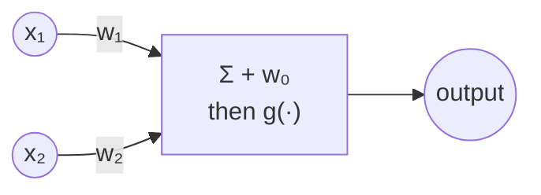
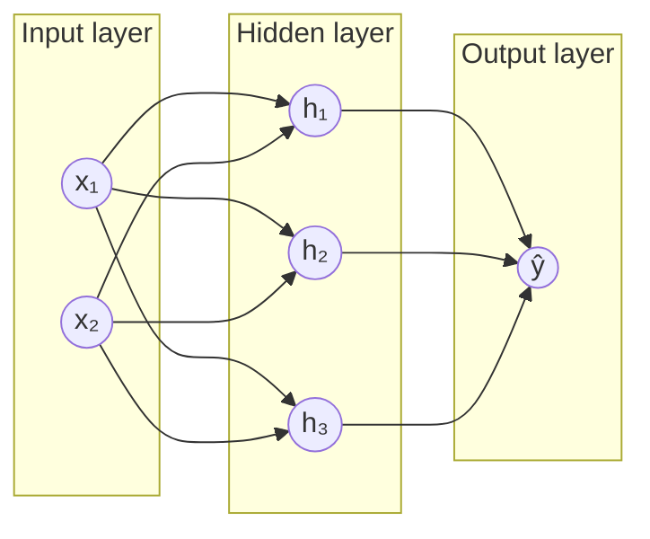
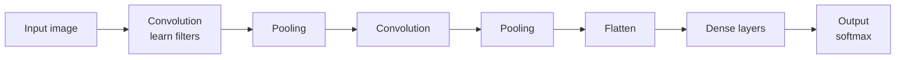
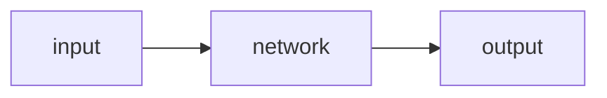
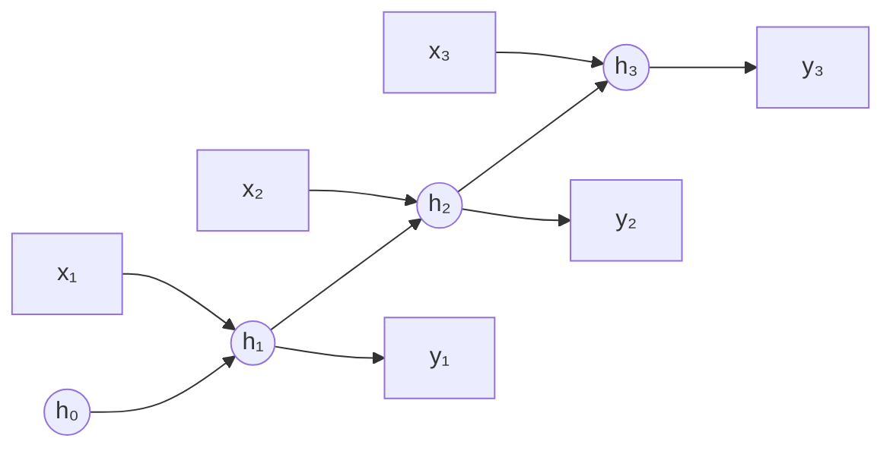

# Neural Networks

**Artificial neural networks (ANNs)** are mathematical models for learning, inspired by biological neural networks: neurons connected to each other, where a neuron's output depends on the signals it receives.

## A single unit

One unit takes inputs, multiplies each by a **weight**, adds a **bias**, and applies an **activation function** `g`:

$$
h(x_1, x_2) = g(w_0 + w_1x_1 + w_2x_2) \qquad\text{in general}\qquad h(\mathbf{x}) = g\Big(w_0 + \sum_{i=1}^{n} w_ix_i\Big)
$$



**Worked example — logic gates** with the step function $g(z) = 1$ if $z \ge 0$, else 0:

| gate | $w_0$ | $w_1$ | $w_2$ | (0,0) | (0,1) | (1,0) | (1,1) |
|---|---|---|---|---|---|---|---|
| **OR** | −1 | 1 | 1 | g(−1)=0 | g(0)=1 | g(0)=1 | g(1)=1 |
| **AND** | −2 | 1 | 1 | g(−2)=0 | g(−1)=0 | g(−1)=0 | g(0)=1 |

## Activation functions


| Function | Formula | Range | Typical use |
|---|---|---|---|
| Step | $g(z) = 1$ if $z \ge 0$ else $0$ | {0, 1} | historical perceptron |
| **Sigmoid** | $g(z) = \dfrac{1}{1 + e^{-z}}$ | (0, 1) | output for binary classification |
| tanh | $g(z) = \dfrac{e^{z} - e^{-z}}{e^{z} + e^{-z}}$ | (−1, 1) | hidden layers (older nets, RNNs) |
| **ReLU** | $g(z) = \max(0, z)$ | [0, ∞) | **default** for hidden layers |
| **Softmax** | $g(\mathbf{z})_k = \dfrac{e^{z_k}}{\sum_j e^{z_j}}$ | probabilities summing to 1 | output for multi-class |

**Softmax example**: scores `z = [2.0, 1.0, 0.1]` → $e^{z} = [7.39, 2.72, 1.11]$, sum 11.22 → **[0.66, 0.24, 0.10]**.

```python
import numpy as np
z = np.array([2.0, 1.0, 0.1])
print((np.exp(z) / np.exp(z).sum()).round(2))     # [0.66 0.24 0.1 ]
```

Why non-linear activations? Without them, stacking layers is still just one linear function: $W_2(W_1x) = (W_2W_1)x$.

## Gradient descent (for networks)

Minimize the **loss** over all weights:

```text
start with a random choice of weights
repeat:
    calculate the gradient of the loss with respect to every weight
    move every weight a small step in the direction that reduces the loss:
        w ← w − α · ∂Loss/∂w
```

| Variant | Gradient computed from | Trade-off |
|---|---|---|
| (Batch) gradient descent | **all** data points | accurate but slow per step |
| **Stochastic** GD | **one** random data point | fast, noisy |
| **Mini-batch** GD | a small batch (e.g. 32) | the usual compromise |

## Multilayer networks

A single unit only learns a **linear** decision boundary. It **cannot** compute XOR: no straight line separates (0,1), (1,0) from (0,0), (1,1).

Add a **hidden layer** between inputs and outputs:



**XOR with one hidden layer** (step activation): $h_1 = \text{OR}(x_1, x_2)$, $h_2 = \text{AND}(x_1, x_2)$, then $y = g(-1 + 2h_1 - 3h_2)$ → "OR but not AND" = XOR.

```python
step = lambda z: (z >= 0).astype(int)
X = np.array([[0, 0], [0, 1], [1, 0], [1, 1]])
h1 = step(-1 + X @ [1, 1])        # OR
h2 = step(-2 + X @ [1, 1])        # AND
print(step(-1 + 2 * h1 - 3 * h2)) # [0 1 1 0]  = XOR
```

In matrix form, a layer computes $\mathbf{a}^{[l]} = g\big(W^{[l]}\mathbf{a}^{[l-1]} + \mathbf{b}^{[l]}\big)$.

## Backpropagation

The algorithm for training networks with hidden layers. We know the error at the **output**, and use the **chain rule** to work out how much each earlier weight contributed to it.

```text
start with a random choice of weights
repeat:
    forward pass: compute the outputs and the loss
    calculate the error for the output layer
    for each layer, starting with the output layer, moving back to the earliest hidden layer:
        propagate the error back one layer
        update the weights
```

For a weight $w$ feeding a unit with pre-activation $z$ and activation $a = g(z)$:

$$
\frac{\partial L}{\partial w} = \frac{\partial L}{\partial a} \cdot \frac{\partial a}{\partial z} \cdot \frac{\partial z}{\partial w}
$$

### A tiny network from scratch (learns XOR)

```python
import numpy as np

rng = np.random.default_rng(1)
X = np.array([[0, 0], [0, 1], [1, 0], [1, 1]], dtype=float)
y = np.array([[0], [1], [1], [0]], dtype=float)

sigmoid = lambda z: 1 / (1 + np.exp(-z))
W1, b1 = rng.normal(size=(2, 4)), np.zeros(4)      # 2 inputs → 4 hidden units
W2, b2 = rng.normal(size=(4, 1)), np.zeros(1)      # 4 hidden → 1 output
lr = 1.0

for epoch in range(10_000):
    # forward pass
    a1 = sigmoid(X @ W1 + b1)
    a2 = sigmoid(a1 @ W2 + b2)
    # backward pass (binary cross-entropy + sigmoid → output error is a2 - y)
    d2 = a2 - y                                    # error at output
    d1 = (d2 @ W2.T) * a1 * (1 - a1)               # propagate back; sigmoid' = a(1-a)
    # update
    W2 -= lr * a1.T @ d2 / 4;  b2 -= lr * d2.mean(0)
    W1 -= lr * X.T @ d1 / 4;   b1 -= lr * d1.mean(0)

print(a2.round(3).ravel())     # ≈ [0, 1, 1, 0]
```

**Deep neural networks** = networks with **multiple** hidden layers. Each layer can learn more abstract features from the previous one.

## Overfitting: dropout

Neural networks overfit easily. **Dropout**: during training, temporarily remove units at random (e.g. 50% of them in each step), so the network can't rely too much on any single unit and learns more robust features. At test time all units are used.

# tensorflow

TensorFlow with its high-level **Keras** API builds and trains networks in a few lines. Lecture example: banknote authentication (4 inputs → authentic / counterfeit).

```python
import csv
import tensorflow as tf
from sklearn.model_selection import train_test_split

with open("banknotes.csv") as f:
    reader = csv.reader(f); next(reader)
    data = [([float(c) for c in row[:4]], 1 if row[4] == "0" else 0) for row in reader]

evidence = [row[0] for row in data]
labels = [row[1] for row in data]
X_training, X_testing, y_training, y_testing = train_test_split(evidence, labels, test_size=0.4)

model = tf.keras.models.Sequential([
    tf.keras.layers.Input(shape=(4,)),                    # 4 input features
    tf.keras.layers.Dense(8, activation="relu"),          # hidden layer, 8 units
    tf.keras.layers.Dense(1, activation="sigmoid"),       # output: P(authentic)
])

model.compile(optimizer="adam", loss="binary_crossentropy", metrics=["accuracy"])
model.fit(X_training, y_training, epochs=20)
model.evaluate(X_testing, y_testing, verbose=2)          # ~99% accuracy
```

| Keras concept | Meaning |
|---|---|
| `Sequential` | layers stacked one after another |
| `Dense(n)` | fully connected layer with `n` units |
| `optimizer="adam"` | a smarter gradient descent (adaptive learning rates) |
| `loss` | `binary_crossentropy` (2 classes), `categorical_crossentropy` (one-hot, many classes), `mse` (regression) |
| **epoch** | one pass over the entire training set |

Number of parameters in a `Dense` layer = inputs × units + units (biases). Above: 4×8+8 = 40, then 8×1+1 = 9 → **49** parameters.

# Computer vision

Computational methods for analyzing and understanding images. An image is a grid of pixels: grayscale = 1 value (0–255) per pixel, color = 3 values (R, G, B).

A Dense network on raw pixels has two problems: **too many weights** (a 600×400 RGB image has 720,000 inputs), and it **ignores structure**: nearby pixels are related, and an object should be recognized wherever it appears.

## Image convolution

Apply a **filter (kernel)**, a small matrix of weights, across the image. At each position, multiply element-wise and sum to get one output pixel. The result is a **feature map**.


$$
(I * K)(i, j) = \sum_{m}\sum_{n} I(i + m,\ j + n)\, K(m, n)
$$

Output size for an $n \times n$ image and $f \times f$ kernel (stride 1, no padding): $(n - f + 1) \times (n - f + 1)$.

Different kernels detect different features, e.g. an **edge detector**:

$$
K_{edge} = \begin{bmatrix} -1 & -1 & -1 \\ -1 & 8 & -1 \\ -1 & -1 & -1 \end{bmatrix}
$$

In a uniform area the values cancel to 0; at an edge they don't → bright output.

```python
from PIL import Image, ImageFilter

image = Image.open("bridge.png").convert("RGB")
filtered = image.filter(ImageFilter.Kernel(
    size=(3, 3),
    kernel=[-1, -1, -1, -1, 8, -1, -1, -1, -1],
    scale=1,
))
filtered.show()        # edges light up, flat regions go black
```

```python
# convolution by hand with numpy
def convolve(img, k):
    f = k.shape[0]
    out = np.zeros((img.shape[0] - f + 1, img.shape[1] - f + 1))
    for i in range(out.shape[0]):
        for j in range(out.shape[1]):
            out[i, j] = (img[i:i + f, j:j + f] * k).sum()
    return out

img = np.array([[10, 20, 30, 30], [10, 20, 30, 30], [20, 30, 40, 40], [20, 30, 40, 40]])
print(convolve(img, np.array([[0, -1, 0], [-1, 5, -1], [0, -1, 0]])))   # [[10 30] [40 60]]
```

## Pooling

Reduce the size of the input by summarizing regions. **Max-pooling**: keep the **maximum** of each region (e.g. 2×2).


- Fewer values → faster, fewer parameters downstream.
- More robust to small shifts: a feature that moves by one pixel gives the same max.

## Convolutional neural network (CNN)

A neural network that uses convolution, usually for analyzing images.



- The **filter weights are learned** by backpropagation; we don't design them by hand.
- Early conv layers learn **low-level** features (edges, curves, textures); later ones learn **high-level** features (eyes, wheels, letters).

**Handwritten digits (MNIST)**, 28×28 grayscale → digit 0–9:

```python
import tensorflow as tf

mnist = tf.keras.datasets.mnist
(x_train, y_train), (x_test, y_test) = mnist.load_data()
x_train, x_test = x_train / 255.0, x_test / 255.0                     # scale pixels to 0..1
y_train = tf.keras.utils.to_categorical(y_train)                      # one-hot labels
y_test = tf.keras.utils.to_categorical(y_test)
x_train = x_train.reshape(-1, 28, 28, 1); x_test = x_test.reshape(-1, 28, 28, 1)

model = tf.keras.models.Sequential([
    tf.keras.layers.Input(shape=(28, 28, 1)),
    tf.keras.layers.Conv2D(32, (3, 3), activation="relu"),           # 32 filters, 3×3 → 26×26×32
    tf.keras.layers.MaxPooling2D(pool_size=(2, 2)),                    # → 13×13×32
    tf.keras.layers.Flatten(),                                          # → 5408
    tf.keras.layers.Dense(128, activation="relu"),
    tf.keras.layers.Dropout(0.5),                                       # fight overfitting
    tf.keras.layers.Dense(10, activation="softmax"),                   # one output per digit
])
model.compile(optimizer="adam", loss="categorical_crossentropy", metrics=["accuracy"])
model.fit(x_train, y_train, epochs=10)
model.evaluate(x_test, y_test, verbose=2)                              # ~98–99%
model.save("model.keras")
```

The CS50 project **traffic** uses the same structure to classify 43 kinds of German traffic signs.

# Fead-Forward neural network

Connections go in **one direction only**: input → hidden → output. No loops, no memory.



- Each input is processed **independently**.
- Input and output sizes are **fixed**.
- Good for fixed-size inputs: tabular data, a single image.

# Recurretn netral network

A **recurrent neural network (RNN)** feeds its **own output (hidden state) back** in as input at the next step, so it carries information from earlier in a sequence.

$$
\mathbf{h}_t = g\big(W_h\,\mathbf{h}_{t-1} + W_x\,\mathbf{x}_t + \mathbf{b}\big) \qquad \hat{\mathbf{y}}_t = W_y\,\mathbf{h}_t
$$

Unrolled over time (the **same** weights are reused at each step):



| Shape | Example |
|---|---|
| one → many | **image captioning** (Microsoft CaptionBot): image → sequence of words |
| many → one | **video classification**, sentiment of a review |
| many → many | **machine translation** (sentence → sentence), speech recognition |

- Plain RNNs struggle to remember things from far back (the gradient shrinks at each step: **vanishing gradients**).
- **LSTM (Long Short-Term Memory)** adds **gates** (forget, input, output) that decide what to keep in a memory cell, which makes it much better at long dependencies. GRU is a simpler variant.

```python
model = tf.keras.models.Sequential([
    tf.keras.layers.Input(shape=(None,)),                         # sequence of word ids, any length
    tf.keras.layers.Embedding(input_dim=10_000, output_dim=64),
    tf.keras.layers.LSTM(64),                                     # reads the sequence step by step
    tf.keras.layers.Dense(1, activation="sigmoid"),               # positive / negative review
])
```

# Self-check

<details>
<summary>1. Find weights for a unit computing NOT x (step activation).</summary>

$w_0 = 0, w_1 = -1$: x=0 → g(0)=1, x=1 → g(−1)=0. (Any $w_0 \ge 0$ with $w_0 + w_1 \lt 0$ works.)
</details>

<details>
<summary>2. Why can't a single perceptron compute XOR?</summary>

A single unit's decision boundary is a straight line, and no straight line separates {(0,1),(1,0)} from {(0,0),(1,1)}. A hidden layer is needed.
</details>

<details>
<summary>3. Softmax of [1, 1]? Of [0, ln 3]?</summary>

[0.5, 0.5] and [1/4, 3/4] (since $e^0 = 1$ and $e^{\ln 3} = 3$).
</details>

<details>
<summary>4. What does backpropagation do?</summary>

It computes the gradient of the loss with respect to **every** weight by applying the chain rule backwards from the output layer, so gradient descent can update hidden-layer weights.
</details>

<details>
<summary>5. 32×32 image, 5×5 kernel, stride 1, no padding: feature map size? After 2×2 max-pool?</summary>

28×28, then 14×14.
</details>

<details>
<summary>6. What problem does dropout address?</summary>

Overfitting: the network can't over-rely on particular units, because they may be switched off during training.
</details>

<details>
<summary>7. Feed-forward vs recurrent: when do you need an RNN?</summary>

When the input or output is a **sequence** of variable length and order matters (text, speech, video, time series).
</details>
