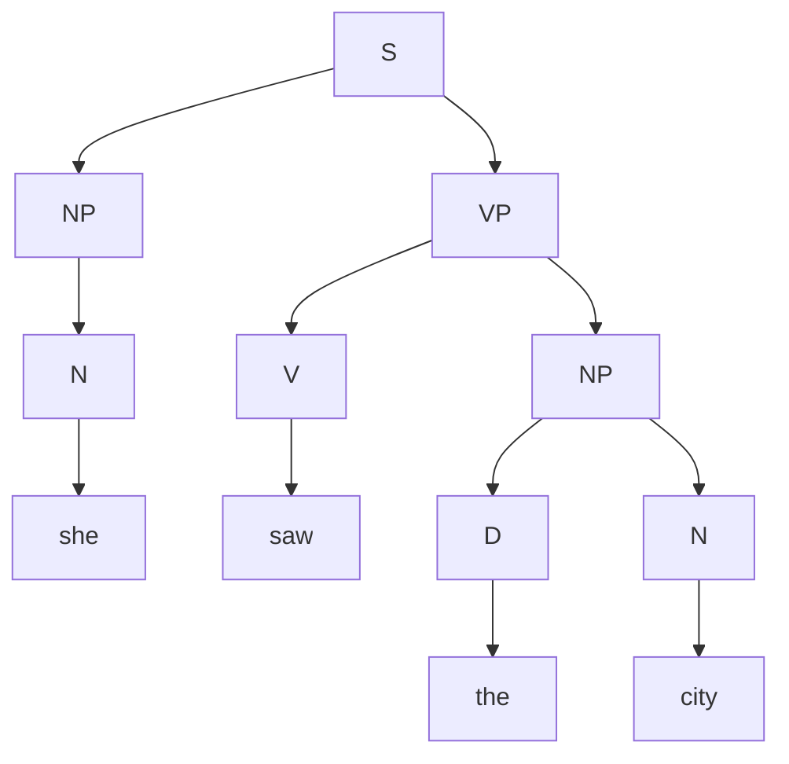
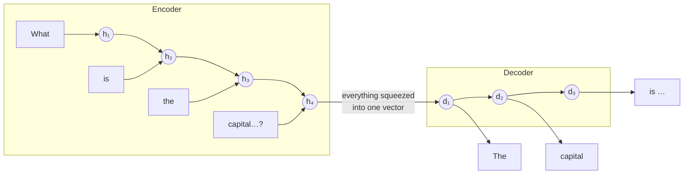
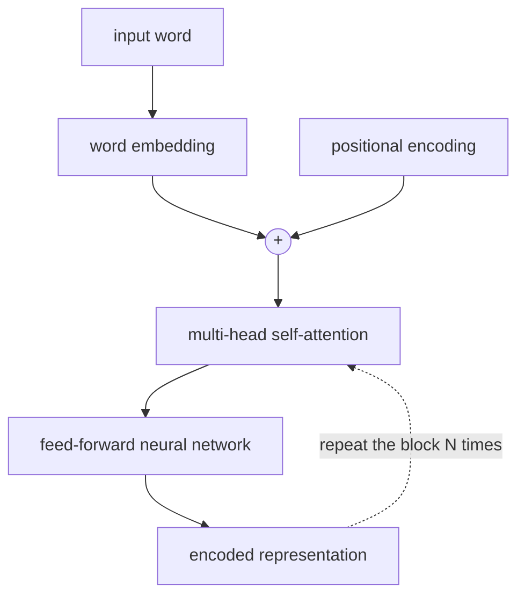
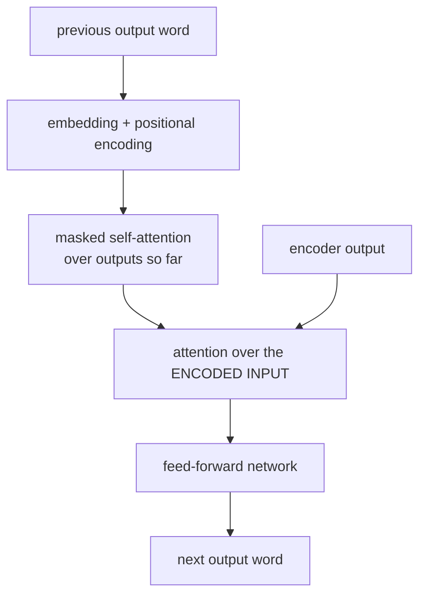

# NLP

**Natural Language Processing**: getting computers to understand and produce human language.

Typical tasks: automatic summarization, information extraction, language identification, machine translation, **named entity recognition** (find names, places, dates), speech recognition, **text classification** (spam, sentiment), word sense disambiguation ("bank" = river or money?).

## Syntax and semantics

- **Syntax**: the **structure** of a sentence.
  - ✅ "Just before nine o'clock Sherlock Holmes stepped briskly into the room."
  - ❌ "Just before Sherlock Holmes nine o'clock stepped briskly the room." (ungrammatical)
  - Ambiguous: "I saw the man on the mountain with a telescope." Who has the telescope?
- **Semantics**: the **meaning**.
  - Same meaning, different syntax: "Just before nine o'clock Sherlock Holmes stepped briskly into the room" ≈ "Sherlock Holmes stepped briskly into the room just before nine o'clock."
  - Correct syntax, no meaning: "Colorless green ideas sleep furiously." (Chomsky)

## Context-free grammar

**Formal grammar**: a system of rules for generating the sentences of a language. A **context-free grammar** rewrites **non-terminal** symbols (`S`, `NP`, `V`…) into other symbols until only **terminal** symbols (words) remain.

```text
S  → NP VP                 S  = sentence
NP → N | D N | D AP N      NP = noun phrase
VP → V | V NP              VP = verb phrase
AP → A | A AP              AP = adjective phrase
N  → she | city | car | Harry
D  → the | a | an
V  → saw | ate | walked
A  → big | blue | small
```

Parse tree for **"she saw the city"**:



```python
import nltk

grammar = nltk.CFG.fromstring("""
    S -> NP VP
    NP -> D N | N | D AP N
    AP -> A | A AP
    VP -> V | V NP
    D -> "the" | "a"
    N -> "she" | "city" | "car"
    V -> "saw" | "walked"
    A -> "big" | "blue"
""")
parser = nltk.ChartParser(grammar)
for tree in parser.parse("she saw the big blue city".split()):
    tree.pretty_print()
```

## n-grams

An **n-gram** is a contiguous sequence of `n` items from a text. Items can be characters or words.

"How often have I said to you that…" →

| n | name | first n-grams |
|---|---|---|
| 1 | unigram | `how`, `often`, `have`, … |
| 2 | **bigram** | `how often`, `often have`, `have I`, … |
| 3 | **trigram** | `how often have`, `often have I`, `have I said`, … |

- **Tokenization**: splitting a sequence of characters into pieces (word tokens, sentence tokens). It's harder than splitting on spaces: punctuation, "Mr.", "o'clock"…
- **Markov chain on n-grams**: from the last word(s), predict the next one using n-gram counts.

$$
P(w_t \mid w_{t-1}) = \frac{\text{count}(w_{t-1}, w_t)}{\text{count}(w_{t-1})}
$$

```python
import nltk
from collections import Counter

text = open("holmes.txt").read().lower()
words = [w for w in nltk.word_tokenize(text) if any(c.isalpha() for c in w)]
for gram, count in Counter(nltk.ngrams(words, 3)).most_common(5):
    print(count, " ".join(gram))

# generate text with a Markov chain (pip install markovify)
import markovify
model = markovify.Text(open("shakespeare.txt").read())
for _ in range(3):
    print(model.make_sentence())
```

The output looks locally plausible but has no real meaning.

## Bag-of-words & Naive Bayes

**Bag-of-words**: represent a text as an **unordered** collection of its words. Order and grammar are ignored, only which words appear (and how often).

**Sentiment classification**: is "My grandson loved it! So much fun!" positive or negative? Using Bayes' rule:

$$
P(\text{positive} \mid w_1, \dots, w_n) = \frac{P(w_1, \dots, w_n \mid \text{positive})\,P(\text{positive})}{P(w_1, \dots, w_n)}
$$

The **naive** assumption: words are **independent** given the class. Then:

$$
P(\text{positive} \mid w_1, \dots, w_n) \;\propto\; P(\text{positive}) \prod_{i=1}^{n} P(w_i \mid \text{positive})
$$

**Worked example**: "my grandson loved it"

| | positive | negative |
|---|---|---|
| prior P(class) | 0.49 | 0.51 |
| P("my" \| class) | 0.30 | 0.20 |
| P("grandson" \| class) | 0.01 | 0.02 |
| P("loved" \| class) | 0.32 | 0.08 |
| P("it" \| class) | 0.30 | 0.40 |

$$
\begin{aligned}
\text{positive} &\propto 0.49 \times 0.30 \times 0.01 \times 0.32 \times 0.30 = 0.0001411 \\
\text{negative} &\propto 0.51 \times 0.20 \times 0.02 \times 0.08 \times 0.40 = 0.0000653 \\
P(\text{positive} \mid \text{text}) &= \frac{0.0001411}{0.0001411 + 0.0000653} \approx \mathbf{0.684}
\end{aligned}
$$

where each probability is estimated by counting, e.g. P("loved" | positive) = (# positive reviews containing "loved") / (# positive reviews).

**Problem**: if a word never appears in positive reviews, its probability is 0 and the whole product becomes 0.
**Additive (Laplace) smoothing**: add a value α (often 1) to every count:

$$
P(w \mid c) = \frac{\text{count}(w, c) + 1}{\text{count}(c) + 2}
$$

(for "does the word appear or not", which has 2 possible outcomes)

```python
import nltk

def features(words, vocab):
    return {w: (w in words) for w in vocab}      # bag-of-words, presence only

pos = ["my grandson loved it so much fun", "great product", "loved it"]
neg = ["product broke after a day", "not worth it", "kind of cheap"]
vocab = set(" ".join(pos + neg).split())
training = ([(features(set(t.split()), vocab), "Positive") for t in pos] +
            [(features(set(t.split()), vocab), "Negative") for t in neg])

classifier = nltk.NaiveBayesClassifier.train(training)
print(classifier.prob_classify(features({"loved", "it"}, vocab)).prob("Positive"))
```

## Word representation

How do we feed words into a neural network?

**One-hot representation**: one dimension per word in the vocabulary.

```text
he     [1, 0, 0, 0]
wrote  [0, 1, 0, 0]
a      [0, 0, 1, 0]
book   [0, 0, 0, 1]
```

❌ 50,000-word vocabulary → 50,000-dimensional vectors. ❌ No notion of similarity: "wrote" and "authored" are as different as "wrote" and "banana".

**Distributed representation**: each word is a **dense** vector of real numbers (e.g. 100–300 dimensions). Meaning is spread across the dimensions, and similar words get similar vectors.

```text
he     [-0.34, -0.08,  0.02, -0.18, ...]
wrote  [-0.27,  0.40,  0.00, -0.65, ...]
```

**word2vec**: learns word vectors from a huge corpus by predicting a word from its **context** (neighboring words). Words used in similar contexts end up close together. "You shall know a word by the company it keeps" (J. R. Firth).


Similarity is usually measured with **cosine similarity**:

$$
\cos(\mathbf{u}, \mathbf{v}) = \frac{\mathbf{u} \cdot \mathbf{v}}{\lVert\mathbf{u}\rVert\,\lVert\mathbf{v}\rVert}
$$

and analogies work by vector arithmetic: $\text{king} - \text{man} + \text{woman} \approx \text{queen}$.

```python
import numpy as np

def cosine(u, v):
    return u @ v / (np.linalg.norm(u) * np.linalg.norm(v))

# words: dict word -> vector (e.g. loaded from a pretrained words.txt)
def closest(vec, words, n=5):
    return sorted(words, key=lambda w: -cosine(vec, words[w]))[:n]

# closest(words["king"] - words["man"] + words["woman"], words)  →  ['king', 'queen', ...]
```

## Sequence to sequence with RNNs

Translation: an **encoder** RNN reads the input sentence and produces a final hidden state. A **decoder** RNN starts from that state and generates the output one word at a time, until it emits `<end>`.



**Problems**:

1. The whole input must be squeezed into **one** final hidden state, a bottleneck for long sentences.
2. Words are processed **one at a time** (sequential), so training can't be parallelized.

## Attention

Let the decoder look back at **all** encoder hidden states and decide, for each output word, **which input words matter most**.

$$
\text{score}_i = \mathbf{d}_t \cdot \mathbf{h}_i
\qquad
a_i = \frac{e^{\text{score}_i}}{\sum_j e^{\text{score}_j}}
\qquad
\mathbf{c}_t = \sum_i a_i\,\mathbf{h}_i
$$

The **context vector** $\mathbf{c}_t$ is a weighted average of the encoder states, with weights (the **attention scores**) computed by softmax. When outputting "capital", the attention is concentrated on the input word "capital".

# Transformer

Architecture from *"Attention Is All You Need"* (Vaswani et al., 2017). It **drops recurrence entirely** and relies only on attention, so all words are processed **in parallel**. This is the architecture behind GPT, BERT, Claude and other large language models.

## Encoder



- **Positional encoding**: the words go in all at once, so the model wouldn't know the word order. Add a vector that encodes each word's **position**:

$$
PE_{(pos, 2i)} = \sin\!\left(\frac{pos}{10000^{2i/d}}\right)
\qquad
PE_{(pos, 2i+1)} = \cos\!\left(\frac{pos}{10000^{2i/d}}\right)
$$

- **Self-attention**: each word looks at the other words of the input (see below).
- **Multi-head attention**: several self-attention computations run in parallel, each with its own weights, so one head might track grammar while another tracks what pronouns refer to.
- The block (self-attention + feed-forward) is **stacked** many times. Each repetition builds a deeper understanding.

## Decoder



The decoder's attention over the encoder output plays the role of the attention in the RNN version. GPT-style models are **decoder-only**: trained to predict the next token on huge amounts of text.

# Self attention

Each word computes how much it should "pay attention" to **every other word in the same sequence**, and builds a new, context-aware representation from them.


"The animal didn't cross the street because **it** was too tired": self-attention lets `it` attend strongly to `animal`. (Change "tired" to "wide" and `it` should attend to `street`.)

## How it's computed

Each word's embedding $\mathbf{x}$ is multiplied by three learned matrices:

| Vector | Formula | Intuition |
|---|---|---|
| **Query** | $\mathbf{q} = \mathbf{x}W^Q$ | "what am I looking for?" |
| **Key** | $\mathbf{k} = \mathbf{x}W^K$ | "what do I contain?" |
| **Value** | $\mathbf{v} = \mathbf{x}W^V$ | "what information do I pass on?" |

$$
\boxed{\text{Attention}(Q, K, V) = \text{softmax}\!\left(\frac{QK^\top}{\sqrt{d_k}}\right)V}
$$

1. **Scores**: dot product of a word's query with every word's key → how relevant each word is.
2. **Scale** by $\sqrt{d_k}$ (keeps values from getting too big, which would make softmax too peaky).
3. **Softmax** → weights that sum to 1.
4. **Output**: the weighted sum of the value vectors.

**Worked example** (3 words, $d_k = 2$). Query of word 1: $\mathbf{q}_1 = [1, 0]$. Keys: $\mathbf{k}_1 = [1, 0]$, $\mathbf{k}_2 = [0, 1]$, $\mathbf{k}_3 = [1, 1]$.

$$
\begin{aligned}
\text{scores} &= [\,1,\ 0,\ 1\,] / \sqrt{2} = [0.71,\ 0,\ 0.71] \\
\text{softmax} &= [0.40,\ 0.20,\ 0.40] \\
\text{output}_1 &= 0.40\,\mathbf{v}_1 + 0.20\,\mathbf{v}_2 + 0.40\,\mathbf{v}_3
\end{aligned}
$$

```python
import numpy as np

def softmax(x, axis=-1):
    e = np.exp(x - x.max(axis=axis, keepdims=True))
    return e / e.sum(axis=axis, keepdims=True)

def self_attention(X, Wq, Wk, Wv):
    Q, K, V = X @ Wq, X @ Wk, X @ Wv          # (seq, d_k)
    scores = Q @ K.T / np.sqrt(K.shape[1])    # (seq, seq): every word vs every word
    weights = softmax(scores)                 # each row sums to 1
    return weights @ V, weights

rng = np.random.default_rng(0)
seq_len, d_model, d_k = 4, 8, 4
X = rng.normal(size=(seq_len, d_model))       # 4 word embeddings
out, w = self_attention(X, *(rng.normal(size=(d_model, d_k)) for _ in range(3)))
print(w.round(2))                             # 4×4 attention matrix
print(out.shape)                              # (4, 4) new representation per word
```

## RNN vs Transformer

| | RNN / LSTM | Transformer (self-attention) |
|---|---|---|
| Processing | sequential, word by word | **all words in parallel** |
| Long-range dependencies | hard: information fades over steps | direct connection between any two words |
| Word order | built in (the order it reads) | needs **positional encoding** |
| Cost for sequence length $n$ | $O(n)$ steps | $O(n^2)$ attention pairs |
| Training on GPUs | slow | very fast, which made LLMs possible |

## Using a pretrained transformer

```python
# pip install transformers torch
from transformers import pipeline

unmasker = pipeline("fill-mask", model="bert-base-uncased")
for r in unmasker("Then I picked up a [MASK] from the table."):
    print(f"{r['token_str']:>10}  {r['score']:.3f}")
```

The CS50 project **attention** does exactly this with BERT, and visualizes each attention head as a grid of word-to-word weights.

# Self-check

<details>
<summary>1. Difference between syntax and semantics, with an example.</summary>

Syntax = structure/grammar, semantics = meaning. "Colorless green ideas sleep furiously" has valid syntax but no sensible meaning.
</details>

<details>
<summary>2. List the bigrams of "the cat sat".</summary>

`the cat`, `cat sat`.
</details>

<details>
<summary>3. Why does Naive Bayes need additive smoothing?</summary>

A word never seen with a class would get probability 0, which zeroes out the entire product regardless of the other words.
</details>

<details>
<summary>4. One-hot vs distributed word representation?</summary>

One-hot: huge sparse vectors, all words equally different. Distributed (word2vec): small dense vectors where similar words are close, and relationships appear as vector offsets.
</details>

<details>
<summary>5. What problem did attention solve for encoder–decoder RNNs?</summary>

The bottleneck of squeezing the whole input into one vector: the decoder can look directly at every input position and focus on the relevant ones.
</details>

<details>
<summary>6. Why do transformers need positional encoding?</summary>

They process all words in parallel with no recurrence, so without it "dog bites man" and "man bites dog" would look identical.
</details>

<details>
<summary>7. In Attention(Q,K,V), what does softmax(QKᵀ/√d) represent?</summary>

The attention weights: for each word (row), how much it attends to every other word (columns). Each row sums to 1.
</details>
