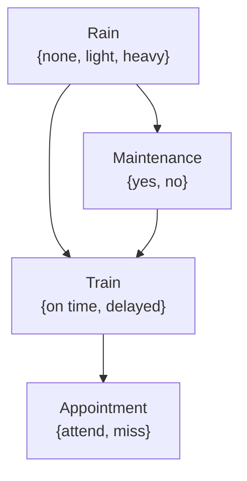
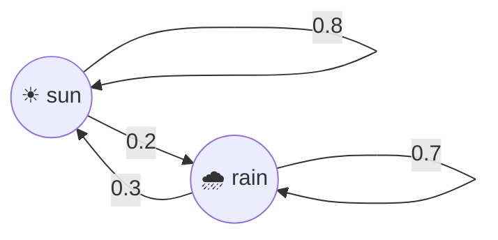
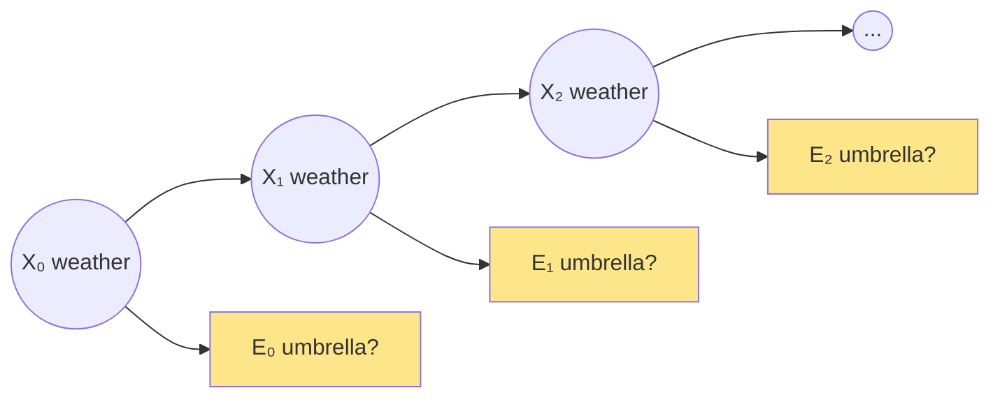

# Uncertainty

Real agents rarely know things for certain: sensors are noisy, the future is unknown. Instead of true/false we use **probabilities**, and we reason about how likely things are.

# Probability basics

A **possible world** $\omega$ is one outcome (a die shows 3). For each world:

$$
0 \le P(\omega) \le 1 \qquad\qquad \sum_{\omega \in \Omega} P(\omega) = 1
$$

**Example — rolling two dice.** 36 equally likely worlds. The sum is 7 for `(1,6) (2,5) (3,4) (4,3) (5,2) (6,1)`:

$$
P(\text{sum} = 7) = \frac{6}{36} = \frac{1}{6} \qquad P(\text{sum} = 12) = \frac{1}{36}
$$

| Sum | 2 | 3 | 4 | 5 | 6 | **7** | 8 | 9 | 10 | 11 | 12 |
|---|---|---|---|---|---|---|---|---|---|---|---|
| Ways | 1 | 2 | 3 | 4 | 5 | **6** | 5 | 4 | 3 | 2 | 1 |

- **Unconditional (prior) probability** $P(a)$: belief with no other evidence.
- **Conditional probability** $P(a \mid b)$: belief in `a` **given** that `b` is known to be true.

$$
P(a \mid b) = \frac{P(a \land b)}{P(b)}
$$

**Example**: P(sum = 12 | the red die shows 6)? Among the 6 worlds where red = 6, only one gives 12:

$$
P(\text{sum}=12 \mid r=6) = \frac{P(\text{sum}=12 \land r=6)}{P(r=6)} = \frac{1/36}{1/6} = \frac{1}{6}
$$

Rearranged (the **product rule**):

$$
P(a \land b) = P(b)\,P(a \mid b) = P(a)\,P(b \mid a)
$$

## Random variables

A variable with a **domain** of possible values:

```text
Roll    ∈ {1, 2, 3, 4, 5, 6}
Weather ∈ {sun, cloud, rain, wind, snow}
Flight  ∈ {on time, delayed, cancelled}
```

Its **probability distribution**, written as a vector:

$$
\mathbf{P}(Flight) = \langle 0.6,\ 0.3,\ 0.1 \rangle
$$

**Independence**: knowing `a` tells you nothing about `b`:

$$
P(a \land b) = P(a)\,P(b) \quad\Longleftrightarrow\quad P(a \mid b) = P(a)
$$

Two dice are independent. "Clouds" and "rain" are **not**.

## Bayes' rule

From the product rule, $P(a)P(b \mid a) = P(b)P(a \mid b)$, so:

$$
\boxed{P(b \mid a) = \frac{P(a \mid b)\, P(b)}{P(a)}}
$$

It lets us go from **P(effect | cause)**, which is often easy to measure, to **P(cause | effect)**, which is what we want.

**Example 1 — clouds and rain.** 80% of rainy afternoons start with cloudy mornings; 40% of days have cloudy mornings; 10% of days have rainy afternoons.

$$
P(rain \mid clouds) = \frac{P(clouds \mid rain)\,P(rain)}{P(clouds)} = \frac{0.8 \times 0.1}{0.4} = 0.2
$$

**Example 2 — a medical test.** A disease affects 1% of people. The test detects it 90% of the time (sensitivity), and gives a false positive 9% of the time. You test positive. What's the chance you're sick?

$$
\begin{aligned}
P(+) &= P(+ \mid sick)P(sick) + P(+ \mid \neg sick)P(\neg sick) = 0.9(0.01) + 0.09(0.99) = 0.0981 \\
P(sick \mid +) &= \frac{0.9 \times 0.01}{0.0981} \approx 0.092
\end{aligned}
$$

Only **≈ 9%**! The disease is rare, so most positive results are false positives.

```python
p_sick, sens, false_pos = 0.01, 0.9, 0.09
p_pos = sens * p_sick + false_pos * (1 - p_sick)
print(sens * p_sick / p_pos)   # 0.0917...
```

## Joint probability & rules

**Joint distribution** of `C` (cloudy morning) and `R` (rainy afternoon):

| | `R = rain` | `R = ¬rain` |
|---|---|---|
| `C = cloud` | 0.08 | 0.32 |
| `C = ¬cloud` | 0.02 | 0.58 |

| Rule | Formula |
|---|---|
| Negation | $P(\neg a) = 1 - P(a)$ |
| Inclusion–exclusion | $P(a \lor b) = P(a) + P(b) - P(a \land b)$ |
| **Marginalization** | $P(a) = P(a, b) + P(a, \neg b)$ |
| **Conditioning** | $P(a) = P(a \mid b)P(b) + P(a \mid \neg b)P(\neg b)$ |

Marginalization from the table: $P(cloud) = 0.08 + 0.32 = 0.40$.

**Conditioning on evidence with normalization.** We want $\mathbf{P}(C \mid rain)$. Take the `rain` column, then scale it so it sums to 1 (the constant $\alpha$):

$$
\mathbf{P}(C \mid rain) = \alpha\, \mathbf{P}(C, rain) = \alpha \langle 0.08, 0.02 \rangle = \langle 0.8, 0.2 \rangle
$$

($\alpha = 1 / (0.08 + 0.02) = 10$.)

# Bayesian networks

A **Bayesian network** is a **directed acyclic graph** in which:

- each node is a **random variable**,
- an arrow `X → Y` means X is a **parent** of Y (X directly influences Y),
- each node stores $\mathbf{P}(X \mid Parents(X))$.

Lecture example:



Probability tables:

| Rain | none | light | heavy |
|---|---|---|---|
| | 0.7 | 0.2 | 0.1 |

| Rain → Maintenance | yes | no |
|---|---|---|
| none | 0.4 | 0.6 |
| light | 0.2 | 0.8 |
| heavy | 0.1 | 0.9 |

| Rain, Maint. → Train | on time | delayed |
|---|---|---|
| none, yes | 0.8 | 0.2 |
| none, no | 0.9 | 0.1 |
| light, yes | 0.6 | 0.4 |
| light, no | 0.7 | 0.3 |
| heavy, yes | 0.4 | 0.6 |
| heavy, no | 0.5 | 0.5 |

| Train → Appointment | attend | miss |
|---|---|---|
| on time | 0.9 | 0.1 |
| delayed | 0.6 | 0.4 |

**Joint probability = product of each node given its parents:**

$$
P(x_1, \dots, x_n) = \prod_{i} P(x_i \mid Parents(X_i))
$$

$$
\begin{aligned}
P(light, no, delayed, miss) &= P(light)\,P(no \mid light)\,P(delayed \mid light, no)\,P(miss \mid delayed) \\
&= 0.2 \times 0.8 \times 0.3 \times 0.4 = 0.0192
\end{aligned}
$$

## Inference

- **Query** `X`: the variable we want the distribution of.
- **Evidence** `E`: observed variables, with values `e`.
- **Hidden** `Y`: neither query nor evidence.
- Goal: $\mathbf{P}(X \mid e)$.

**Inference by enumeration** — sum out the hidden variables:

$$
\mathbf{P}(X \mid e) = \alpha\, \mathbf{P}(X, e) = \alpha \sum_{y} \mathbf{P}(X, e, y)
$$

Example: $\mathbf{P}(Appointment \mid light, no)$ — `Train` is hidden:

$$
\mathbf{P}(A \mid light, no) = \alpha \left[ \mathbf{P}(A, light, no, on\ time) + \mathbf{P}(A, light, no, delayed) \right]
$$

### With pomegranate (as in lecture)

```python
from pomegranate import *        # pomegranate < 1.0 API, as used in CS50

rain = Node(DiscreteDistribution({"none": 0.7, "light": 0.2, "heavy": 0.1}), name="rain")
maintenance = Node(ConditionalProbabilityTable([
    ["none", "yes", 0.4], ["none", "no", 0.6],
    ["light", "yes", 0.2], ["light", "no", 0.8],
    ["heavy", "yes", 0.1], ["heavy", "no", 0.9],
], [rain.distribution]), name="maintenance")
# ... train and appointment defined the same way ...

model = BayesianNetwork()
model.add_states(rain, maintenance, train, appointment)
model.add_edge(rain, maintenance); model.add_edge(rain, train)
model.add_edge(maintenance, train); model.add_edge(train, appointment)
model.bake()

print(model.probability([["none", "no", "on time", "attend"]]))   # joint probability
predictions = model.predict_proba({"train": "delayed"})           # inference given evidence
```

### Pure-Python enumeration (no library)

```python
import itertools

P_rain = {"none": 0.7, "light": 0.2, "heavy": 0.1}
P_maint = {"none": {"yes": 0.4, "no": 0.6}, "light": {"yes": 0.2, "no": 0.8}, "heavy": {"yes": 0.1, "no": 0.9}}
P_train = {("none", "yes"): 0.8, ("none", "no"): 0.9, ("light", "yes"): 0.6,
           ("light", "no"): 0.7, ("heavy", "yes"): 0.4, ("heavy", "no"): 0.5}   # P(on time | ...)
P_appt = {"on time": 0.9, "delayed": 0.6}                                         # P(attend | train)

def joint(r, m, t, a):
    pt = P_train[(r, m)] if t == "on time" else 1 - P_train[(r, m)]
    pa = P_appt[t] if a == "attend" else 1 - P_appt[t]
    return P_rain[r] * P_maint[r][m] * pt * pa

# P(Appointment | train = delayed): sum out rain and maintenance, then normalize
dist = {a: sum(joint(r, m, "delayed", a) for r in P_rain for m in ("yes", "no"))
        for a in ("attend", "miss")}
total = sum(dist.values())
print({a: round(p / total, 3) for a, p in dist.items()})     # {'attend': 0.6, 'miss': 0.4}
```

Enumeration is exact but **exponential** in the number of variables.

## Sampling (approximate inference)

Generate many random samples that follow the network's probabilities (**parents first**), then count.

```python
import random

def sample():
    r = random.choices(list(P_rain), weights=P_rain.values())[0]
    m = "yes" if random.random() < P_maint[r]["yes"] else "no"
    t = "on time" if random.random() < P_train[(r, m)] else "delayed"
    a = "attend" if random.random() < P_appt[t] else "miss"
    return {"rain": r, "maintenance": m, "train": t, "appointment": a}

# Rejection sampling: P(Train | appointment = miss)
N, counts = 10_000, {"on time": 0, "delayed": 0}
for _ in range(N):
    s = sample()
    if s["appointment"] == "miss":          # keep only samples that match the evidence
        counts[s["train"]] += 1
total = sum(counts.values())
print({k: v / total for k, v in counts.items()})
```

- **Rejection sampling**: throw away samples that don't match the evidence. Simple, but wasteful when the evidence is rare.
- **Likelihood weighting**:
  1. **Fix** the evidence variables to their observed values.
  2. Sample the other variables using the network.
  3. **Weight** each sample by the probability of the evidence given its parents: $w = \prod_{e_i} P(e_i \mid parents)$.

  No sample is wasted.

# Uncertainty over time

## Markov models

A variable that changes over time: $X_t$ = weather on day `t`.

- **Markov assumption**: the current state depends only on a finite number of previous states (usually just the last one): $P(X_t \mid X_{t-1}, X_{t-2}, \dots) = P(X_t \mid X_{t-1})$.
- **Markov chain**: a sequence of random variables that follows the Markov assumption.
- **Transition model**: $P(X_{t+1} \mid X_t)$.



**Worked example**: today is sunny. P(rain the day after tomorrow)?

$$
P(X_2 = rain) = \underbrace{0.8 \times 0.2}_{sun \to sun \to rain} + \underbrace{0.2 \times 0.7}_{sun \to rain \to rain} = 0.16 + 0.14 = 0.30
$$

```python
import numpy as np

T = np.array([[0.8, 0.2],    # from sun  → [sun, rain]
              [0.3, 0.7]])   # from rain → [sun, rain]
state = np.array([1.0, 0.0]) # today: sun
for day in range(1, 6):
    state = state @ T
    print(day, state.round(3))   # day 2 → [0.7, 0.3]
# long run converges to the stationary distribution [0.6, 0.4]

# sample a 10-day weather sequence
rng = np.random.default_rng(0)
s, seq = 0, []
for _ in range(10):
    s = rng.choice(2, p=T[s]); seq.append("SR"[s])     # S = sun, R = rain
print("".join(seq))
```

## Hidden Markov models

Often we **can't observe** the state directly, only something it causes. E.g. a security camera sees whether people bring umbrellas, not the weather.



- **Hidden state** $X_t$ (weather) and **observation** $E_t$ (umbrella).
- **Sensor model / emission probabilities** $P(E_t \mid X_t)$, e.g. P(umbrella | rain) = 0.9, P(umbrella | sun) = 0.2.
- **Sensor Markov assumption**: the observation depends only on the current state.

| Task | Meaning | Example |
|---|---|---|
| **Filtering** | distribution of the **current** state, given observations so far | is it raining now? |
| **Prediction** | distribution of a **future** state | will it rain tomorrow? |
| **Smoothing** | distribution of a **past** state | did it rain on Tuesday? |
| **Most likely explanation** | most likely **sequence** of states (Viterbi algorithm) | weather for the whole week |

```python
# Filtering by hand (forward algorithm), umbrella seen on days 1 and 2
T = np.array([[0.8, 0.2], [0.3, 0.7]])          # transitions sun/rain
E = {"umbrella": np.array([0.2, 0.9]),           # P(umbrella | sun), P(umbrella | rain)
     "none":     np.array([0.8, 0.1])}
belief = np.array([0.5, 0.5])                    # day 0: no idea
for obs in ["umbrella", "umbrella", "none"]:
    belief = (belief @ T) * E[obs]               # predict, then weight by evidence
    belief /= belief.sum()                       # normalize (the α)
    print(obs, belief.round(3))
```

# Self-check

<details>
<summary>1. Write P(a | b) in terms of joint and marginal probability.</summary>

$P(a \mid b) = P(a \land b) / P(b)$
</details>

<details>
<summary>2. P(rain)=0.1, P(traffic | rain)=0.7, P(traffic)=0.2. What is P(rain | traffic)?</summary>

Bayes: $0.7 \times 0.1 / 0.2 = 0.35$.
</details>

<details>
<summary>3. Why is a positive result for a rare disease often a false alarm?</summary>

The prior P(sick) is tiny. Even a small false-positive rate applied to the many healthy people gives more false positives than true positives.
</details>

<details>
<summary>4. Using the network above, compute P(none, yes, on time, attend).</summary>

$0.7 \times 0.4 \times 0.8 \times 0.9 = 0.2016$
</details>

<details>
<summary>5. Why is likelihood weighting better than rejection sampling?</summary>

Rejection sampling discards every sample that disagrees with the evidence, a huge waste if the evidence is rare. Likelihood weighting fixes the evidence and weights samples instead, so nothing is thrown away.
</details>

<details>
<summary>6. What is "hidden" in a hidden Markov model?</summary>

The true state (e.g. the weather). We only see observations (umbrellas) that depend on it.
</details>
