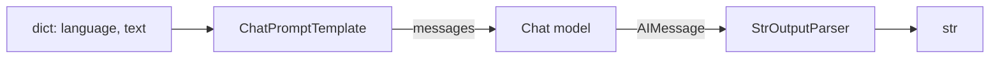
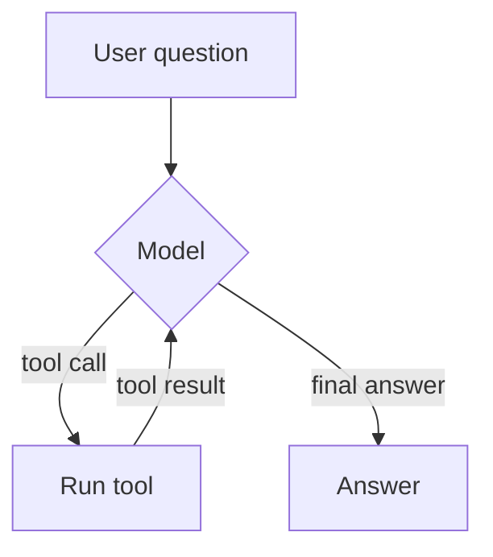
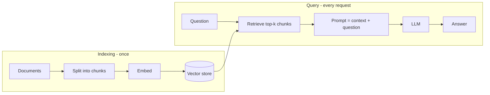

# LangChain

**LangChain** is a Python (and JS) framework for building applications on top of LLMs. It gives you one interface for many model providers, plus building blocks you keep reaching for: prompt templates, output parsers, tools, retrievers, and agents.

| Package | What it contains |
|---|---|
| `langchain-core` | base abstractions: `Runnable`, messages, prompts, output parsers, tools |
| `langchain` | high-level helpers: `init_chat_model`, `create_agent` |
| `langchain-anthropic`, `langchain-openai`, ... | provider integrations (one package per provider) |
| `langchain-text-splitters` | splitting documents into chunks |
| `langgraph` | low-level graph/state-machine runtime that agents run on |

```bash
pip install -U langchain langchain-anthropic
export ANTHROPIC_API_KEY=...
```

# Chat models

Every chat model exposes the same methods, so you can swap providers without touching the rest of the code.

```python
from langchain.chat_models import init_chat_model

model = init_chat_model("anthropic:claude-opus-5-5", temperature=0)

reply = model.invoke("Explain Kubernetes in one sentence.")
print(reply.content)
```

| Method | Use |
|---|---|
| `invoke(input)` | one input → one output |
| `batch([inputs])` | many inputs in parallel |
| `stream(input)` | yield chunks as they are generated |
| `ainvoke` / `abatch` / `astream` | async versions |

## Messages

A conversation is a list of messages with a **role**:

```python
from langchain_core.messages import SystemMessage, HumanMessage, AIMessage

messages = [
    SystemMessage("You are a senior DevOps engineer. Be concise."),
    HumanMessage("What is a Helm chart?"),
    AIMessage("A package of Kubernetes manifests with templating."),
    HumanMessage("And a release?"),
]
print(model.invoke(messages).content)
```

The model is **stateless**: to "remember" earlier turns, you send them again.

## Streaming

```python
for chunk in model.stream("Write a haiku about containers."):
    print(chunk.content, end="", flush=True)
```

# Prompt templates

A template is a prompt with **variables**, filled in at run time.

```python
from langchain_core.prompts import ChatPromptTemplate

prompt = ChatPromptTemplate.from_messages([
    ("system", "You translate technical text into {language}."),
    ("human", "{text}"),
])

prompt.invoke({"language": "French", "text": "The pod is in CrashLoopBackOff."})
```

Use `MessagesPlaceholder("history")` inside a template to inject a whole list of earlier messages.

# LCEL: chaining with `|`

The **LangChain Expression Language** composes any `Runnable`s with the pipe operator. The output of each step becomes the input of the next.



```python
from langchain_core.output_parsers import StrOutputParser

chain = prompt | model | StrOutputParser()

print(chain.invoke({"language": "Chinese", "text": "Roll back the deployment."}))
```

The chain is itself a `Runnable`, so it also gets `batch`, `stream` and the async methods for free.

| Building block | Purpose |
|---|---|
| `RunnablePassthrough()` | pass the input through unchanged |
| `RunnableParallel(a=..., b=...)` | run several branches on the same input, return a dict |
| `RunnableLambda(fn)` | wrap a plain Python function |
| `.with_retry()` / `.with_fallbacks([...])` | resilience |

# Structured output

Ask the model for data that matches a schema instead of free text. LangChain uses the provider's tool-calling / JSON mode under the hood and gives you a validated object back.

```python
from pydantic import BaseModel, Field

class Incident(BaseModel):
    service: str = Field(description="affected service name")
    severity: int = Field(description="1 (low) to 5 (critical)")
    summary: str

extractor = model.with_structured_output(Incident)

log = "payment-api returning 500s for all EU users since 09:12, checkout is down"
incident = extractor.invoke(log)
print(incident.service, incident.severity)   # payment-api 5
```

# Tools

A **tool** is a function the model can decide to call. The docstring and type hints become the description the model sees, so write them carefully.

```python
from langchain.tools import tool

@tool
def get_pod_status(namespace: str, pod: str) -> str:
    """Return the status of a Kubernetes pod."""
    # in real life: call the Kubernetes API
    return f"{namespace}/{pod}: Running (restarts=0)"

model_with_tools = model.bind_tools([get_pod_status])
msg = model_with_tools.invoke("Is the pod web-1 in prod healthy?")
print(msg.tool_calls)
# [{'name': 'get_pod_status', 'args': {'namespace': 'prod', 'pod': 'web-1'}, 'id': '...'}]
```

The model only **requests** the call. Your code must run it and send the result back. Agents automate that loop.

# Agents

An **agent** is a loop: the model reasons, picks a tool, observes the result, and repeats until it can answer.



```python
from langchain.agents import create_agent

@tool
def get_logs(namespace: str, pod: str, lines: int = 20) -> str:
    """Return the last lines of a pod's logs."""
    return "ERROR could not connect to db:5432 (connection refused)"

agent = create_agent(
    model="anthropic:claude-opus-5-5",
    tools=[get_pod_status, get_logs],
    system_prompt="You are an SRE assistant. Investigate before answering.",
)

result = agent.invoke(
    {"messages": [{"role": "user", "content": "Why is api-7 in staging failing?"}]}
)
print(result["messages"][-1].content)
```

`create_agent` is built on **LangGraph**, so it supports checkpointers (memory across turns), streaming of intermediate steps, and human-in-the-loop interrupts.

## Memory across turns

```python
from langgraph.checkpoint.memory import InMemorySaver

agent = create_agent(model="anthropic:claude-opus-5-5", tools=[get_logs],
                     checkpointer=InMemorySaver())

config = {"configurable": {"thread_id": "incident-42"}}
agent.invoke({"messages": [{"role": "user", "content": "Check api-7 in staging."}]}, config)
agent.invoke({"messages": [{"role": "user", "content": "And what should I do next?"}]}, config)
```

The same `thread_id` loads the previous messages; a new id starts a fresh conversation.

# RAG: Retrieval-Augmented Generation

LLMs don't know your private documents. **RAG** finds the relevant chunks first, then puts them in the prompt.



| Step | Component |
|---|---|
| Load | document loaders (PDF, web, Git, Notion, ...) |
| Split | `RecursiveCharacterTextSplitter`: chunks of ~500–1000 characters with overlap |
| Embed | an embedding model turns text into a vector |
| Store | vector store: in-memory, Chroma, pgvector, Qdrant, ... |
| Retrieve | similarity search: the chunks whose vectors are closest to the question's |

Similarity is usually **cosine similarity** between the question vector $q$ and a chunk vector $d$:

$$
\cos(q, d) = \frac{q \cdot d}{\lVert q \rVert \, \lVert d \rVert}
$$

```python
# pip install langchain-text-splitters langchain-huggingface sentence-transformers
from langchain_text_splitters import RecursiveCharacterTextSplitter
from langchain_huggingface import HuggingFaceEmbeddings
from langchain_core.vectorstores import InMemoryVectorStore
from langchain_core.runnables import RunnablePassthrough

docs_text = open("runbook.md").read()
splitter = RecursiveCharacterTextSplitter(chunk_size=800, chunk_overlap=100)
chunks = splitter.create_documents([docs_text])

embeddings = HuggingFaceEmbeddings(model_name="sentence-transformers/all-MiniLM-L6-v2")
store = InMemoryVectorStore.from_documents(chunks, embeddings)
retriever = store.as_retriever(search_kwargs={"k": 4})

rag_prompt = ChatPromptTemplate.from_messages([
    ("system", "Answer using only this context. If it is not there, say so.\n\n{context}"),
    ("human", "{question}"),
])

def format_docs(docs):
    return "\n\n".join(d.page_content for d in docs)

rag_chain = (
    {"context": retriever | format_docs, "question": RunnablePassthrough()}
    | rag_prompt
    | model
    | StrOutputParser()
)

print(rag_chain.invoke("How do I rotate the etcd encryption key?"))
```

**Tuning tips**

- Chunks too small → missing context; too big → noise and higher cost.
- Keep an overlap so a sentence cut in two still appears whole in one chunk.
- Store metadata (source file, section) and show it in the answer, so users can check it.
- Evaluate retrieval on its own first: if the right chunk isn't in the top-k, no prompt will save you.

# Observability

Set these to trace every run (prompts, tool calls, latency, tokens) in **LangSmith**:

```bash
export LANGSMITH_TRACING=true
export LANGSMITH_API_KEY=...
```

# Cheat sheet

| I want to... | Use |
|---|---|
| call a model | `init_chat_model("provider:model").invoke(...)` |
| reuse a prompt with variables | `ChatPromptTemplate.from_messages` |
| get a string back | `prompt \| model \| StrOutputParser()` |
| get typed data back | `model.with_structured_output(PydanticModel)` |
| let the model call functions | `@tool` + `model.bind_tools([...])` |
| run the tool loop for me | `create_agent(model, tools)` |
| answer from my documents | splitter → embeddings → vector store → retriever chain |
| custom multi-step workflows | `langgraph` `StateGraph` |
