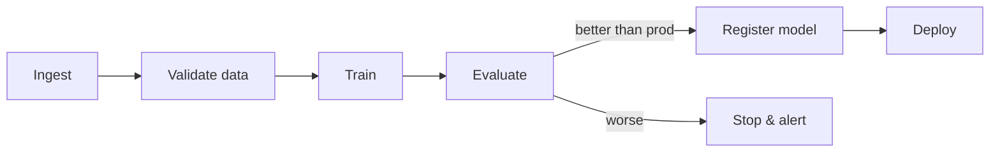
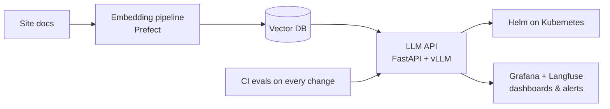

# MLOps Roadmap

A 6-month plan to go from CS50 AI to MLOps, at about **6–8 hours a week**. It builds on what I already know (Kubernetes, Helm, Linux, backend). MLOps is mostly DevOps applied to models, so the infrastructure half is familiar ground.

To track progress, change `- [ ]` to `- [x]` in this file.

| Phase | Weeks | Focus | Key tools |
|---|---|---|---|
| **0** | 1–4 | ML fundamentals | scikit-learn, pandas |
| **1** | 5–8 | Deep learning | PyTorch, Hugging Face |
| **2** | 9–11 | Reproducible ML | MLflow, DVC, pytest |
| **3** ⭐ | 12–14 | Serving & deployment | FastAPI, Docker, Helm, KServe |
| **4** | 15–17 | Pipelines & CI/CD | Prefect / Airflow, GitHub Actions |
| **5** | 18–19 | Monitoring & retraining | Evidently, Prometheus, Grafana |
| **6** | 20–23 | LLMOps | vLLM, vector DB, Langfuse |
| **Capstone** | 24–26 | "Ask my notes" | everything above |

⭐ = my strong area (Kubernetes / Helm).

## Phase 0: Finish the fundamentals (weeks 1–4)

**Goal:** understand models well enough to run them in production.

- [ ] Finish [CS50 AI](./cs50/2.search.md) lectures
- [ ] Do the CS50 projects: *degrees*, *tictactoe*, *heredity*, *shopping*, *traffic*, *attention*
- [ ] Andrew Ng, *Machine Learning Specialization* (Coursera), course 1
- [ ] Andrew Ng, *Machine Learning Specialization*, course 2
- [ ] Python data stack: numpy, pandas, scikit-learn, matplotlib

**Concepts to know cold:** train/validation/test splits, overfitting, metrics (precision, recall, F1, ROC-AUC), feature engineering, data leakage.

- [ ] **Build:** a scikit-learn model on a Kaggle tabular dataset (house prices or churn) in a clean notebook

## Phase 1: Deep learning with PyTorch (weeks 5–8)

CS50 uses TensorFlow, but most industry and research code is **PyTorch**.

- [ ] fast.ai, *Practical Deep Learning for Coders* (free), **or** Andrej Karpathy, *Neural Networks: Zero to Hero*
- [ ] PyTorch training loop, `Dataset` / `DataLoader`, GPU basics
- [ ] Saving / loading weights, exporting to ONNX
- [ ] Transfer learning with Hugging Face
- [ ] **Build:** fine-tune a small pretrained image or text model and export it

## Phase 2: Reproducible ML (weeks 9–11)

This is where MLOps starts: *which data, code and parameters produced this model?*

| Topic | Tool to learn |
|---|---|
| Experiment tracking | **MLflow** (or Weights & Biases) |
| Data and model versioning | **DVC** |
| Model registry | MLflow Model Registry |
| Project structure, config | `pyproject.toml`, Hydra or YAML configs |
| Testing ML code | pytest, data validation (Pandera / Great Expectations) |

- [ ] Work through **Made With ML** (Goku Mohandas, free)
- [ ] Track experiments with MLflow
- [ ] Version data with DVC
- [ ] Write tests for data and model code
- [ ] **Build:** turn the Phase 0 notebook into a repo with `train.py`, MLflow tracking, DVC and tests

## Phase 3: Serving and deployment (weeks 12–14)

- [ ] Wrap the model in a **FastAPI** endpoint with Pydantic request validation
- [ ] Containerize it with **Docker**
- [ ] Understand batch vs. online inference, latency budgets
- [ ] Deploy on Kubernetes: Deployment + Service + HPA, packaged as a **Helm** chart
- [ ] Try **KServe** (or BentoML / Seldon)
- [ ] Learn rollout strategies: canary, shadow, A/B testing of models
- [ ] **Build:** Helm chart deploying the model API to a local cluster (kind / minikube) with autoscaling

## Phase 4: Pipelines and CI/CD for ML (weeks 15–17)

- [ ] Orchestration with **Prefect** (easy) or **Airflow** (the industry standard)
- [ ] Try **Kubeflow Pipelines** on the cluster
- [ ] **GitHub Actions** CI: tests, retrain on a sample, compare metrics with the production model, promote only if better
- [ ] Feature stores at the concept level: **Feast**
- [ ] **Build:** pipeline running ingest → validate → train → evaluate → register → deploy, triggered by CI or a schedule

## Phase 5: Monitoring and retraining (weeks 18–19)

Models degrade silently, which is the big difference from normal software.

- [ ] Data drift vs. concept drift, and how to detect them (PSI, KS test)
- [ ] Drift reports with **Evidently AI**
- [ ] Service metrics with **Prometheus + Grafana**
- [ ] Log predictions for auditing, set up alerts and retraining triggers
- [ ] **Build:** a Grafana dashboard for the model, and a drift check that triggers the Phase 4 pipeline

## Phase 6: LLMOps (weeks 20–23)

Most teams hire for this today. See also [LangChain](./langchain.md).

- [ ] Serve open models with **vLLM** or Ollama; quantization and GPU cost
- [ ] RAG pipelines: chunking, embeddings, vector databases (pgvector, Qdrant)
- [ ] **Evaluation**: test sets, LLM-as-judge, regression tests for prompts
- [ ] Observability with **Langfuse** or LangSmith (traces, tokens, cost, latency)
- [ ] Guardrails, prompt versioning, caching
- [ ] **Build:** a RAG app over this site's docs, on Kubernetes, with Langfuse tracing and an eval suite in CI

## Capstone: "Ask my notes" (weeks 24–26)

One end-to-end portfolio project combining every phase:

- [ ] Build the pipeline and API
- [ ] Deploy with Helm, add CI evals
- [ ] Add dashboards and quality alerts
- [ ] Publish on GitHub with an architecture diagram, and write it up on this site

## Reference shelf

| Type | Resource |
|---|---|
| Free course, end to end | **DataTalksClub *MLOps Zoomcamp*** (cohort-based, very practical) |
| Free course | **Made With ML** |
| Free course | **Full Stack Deep Learning** (lectures online) |
| Book | **Chip Huyen, *Designing Machine Learning Systems*** (O'Reilly). If I read one book, this one. |
| Book (later) | Chip Huyen, *AI Engineering* (for LLMOps) |
| Optional certification | AWS *Machine Learning Engineer – Associate* or Google *Professional ML Engineer* |

## Rules for myself

1. **One repo, growing.** Reuse the same project from Phase 2 to the capstone instead of many small demos.
2. **Write a page per phase** here, as with CS50. Explaining it is the best review.
3. **Prioritize building over watching.** If a week was only videos, push the next phase back.
4. **Don't over-tool.** Learn one tool per category well before comparing alternatives.
