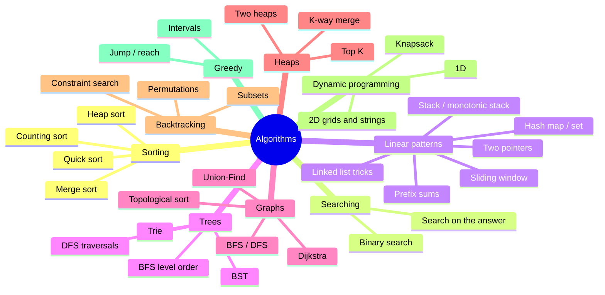
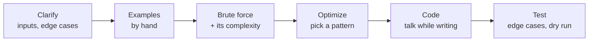

# Algorithms for Tech Interviews

Notes to prepare coding interviews. Each page explains one family of algorithms, then gives **practice problems**. Try each problem first: the **hint** and the **implementation** are hidden until you click them.

All code is Python 3 and ends with a few `assert`s so you can paste it and run it.

# Map of the topics

| Page | Key idea |
|---|---|
| [Sorting](./1.sorting.md) | divide and conquer, partitioning, stability |
| [Binary Search](./2.binary-search.md) | halve the search space each step |
| [Two Pointers & Sliding Window](./3.two-pointers-sliding-window.md) | one pass with two indices instead of nested loops |
| [Hashing, Stacks & Linked Lists](./4.hashing-stacks-lists.md) | O(1) lookups, last-in-first-out, pointer rewiring |
| [Trees](./5.trees.md) | recursion on left / right subtrees |
| [Graphs](./6.graphs.md) | visit nodes with BFS/DFS, order with topological sort |
| [Heaps](./7.heaps.md) | always get the smallest / largest in O(log n) |
| [Backtracking](./8.backtracking.md) | build a choice, recurse, undo |
| [Dynamic Programming](./9.dynamic-programming.md) | reuse answers to overlapping subproblems |
| [Greedy & Intervals](./10.greedy-intervals.md) | take the locally best choice when it is provably safe |

# Big-O cheat sheet

| Complexity | Name | Example | n = 10⁶ is... |
|---|---|---|---|
| $O(1)$ | constant | hash lookup | instant |
| $O(\log n)$ | logarithmic | binary search | ~20 steps |
| $O(n)$ | linear | one loop | fast |
| $O(n \log n)$ | linearithmic | sorting | fast (~2·10⁷) |
| $O(n^2)$ | quadratic | nested loops | too slow (10¹²) |
| $O(2^n)$ | exponential | all subsets | only n ≤ ~20 |
| $O(n!)$ | factorial | all permutations | only n ≤ ~10 |

**Guess the expected complexity from the input size** (about 10⁸ simple operations per second):

| n up to | Target |
|---|---|
| 10–12 | $O(n!)$, backtracking |
| 20–25 | $O(2^n)$, bitmask / subsets |
| 500 | $O(n^3)$ |
| 5 000 | $O(n^2)$ |
| 10⁶ | $O(n \log n)$ or $O(n)$ |
| 10⁹+ | $O(\log n)$ or $O(1)$, math / binary search |

## Python data structure costs

| Operation | `list` | `dict` / `set` | `deque` | `heapq` |
|---|---|---|---|---|
| access by index | $O(1)$ | | $O(n)$ | |
| `x in` | $O(n)$ | $O(1)$ | $O(n)$ | |
| append / pop at end | $O(1)$ | | $O(1)$ | |
| insert / pop at front | $O(n)$ | | $O(1)$ | |
| add / remove key | | $O(1)$ | | |
| push / pop min | | | | $O(\log n)$ |
| sort | $O(n \log n)$ | | | |

# Which pattern? (recognition table)

| The problem says... | Try |
|---|---|
| sorted array, "find" / "minimum value that works" | binary search |
| contiguous subarray / substring, "longest" / "at most k" | sliding window |
| pair / triplet in a sorted array | two pointers |
| "have I seen this before?", counts, duplicates | hash map / set |
| matching brackets, "next greater element" | stack / monotonic stack |
| "top k", "k-th largest", merge sorted lists | heap |
| tree or nested structure | recursion (DFS) |
| shortest path in an unweighted grid / graph | BFS |
| dependencies, "order of courses" | topological sort |
| shortest path with weights ≥ 0 | Dijkstra |
| "connected?", grouping, merging sets | Union-Find |
| "all combinations / permutations / ways to place" | backtracking |
| "number of ways", "min cost", choices that overlap | dynamic programming |
| intervals, schedules | sort + greedy |

# How to answer in an interview

1. **Clarify**: input size, empty input, duplicates, negatives, sorted or not, what to return.
2. **Work an example** by hand; it often reveals the pattern.
3. **State a brute force** and its complexity first. It shows you can solve it at all.
4. **Optimize**: what work is repeated? Could a hash map, sorting, or two pointers remove a loop?
5. **Code** cleanly with good names, explaining as you go.
6. **Test**: walk through your example, then empty input, one element, all equal, very large values.

Common edge cases checklist

- empty input, one element, two elements
- all elements equal, already sorted, reverse sorted
- negative numbers, zero, integer overflow (in Java/C++)
- duplicates in the input or in the answer
- disconnected graph, cycles, self-loops
- string with spaces, upper/lower case, unicode

