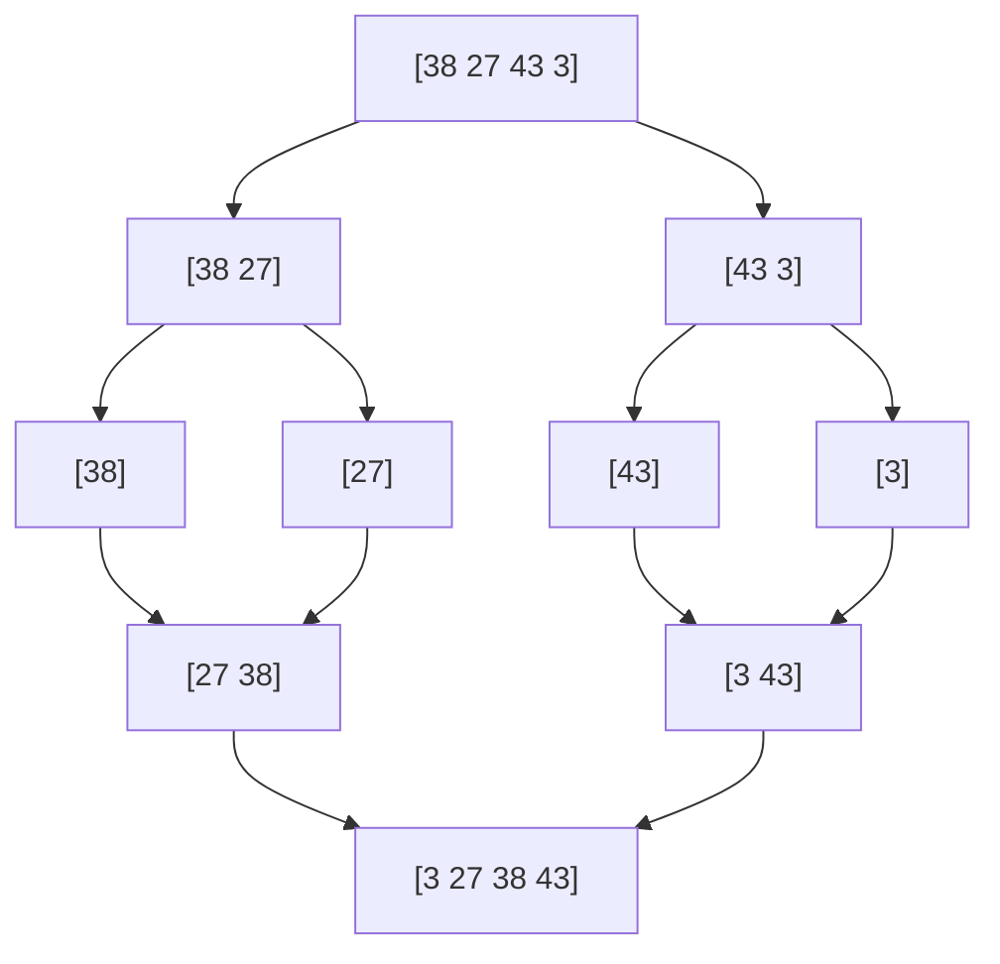

# Sorting

In interviews you rarely write a sort from scratch (`sorted()` is $O(n \log n)$), but you are expected to **explain** how the classic sorts work and to reuse their ideas: merging, partitioning, counting.

| Algorithm | Best | Average | Worst | Extra space | Stable |
|---|---|---|---|---|---|
| Bubble / insertion | $O(n)$ | $O(n^2)$ | $O(n^2)$ | $O(1)$ | yes |
| Selection | $O(n^2)$ | $O(n^2)$ | $O(n^2)$ | $O(1)$ | no |
| **Merge sort** | $O(n \log n)$ | $O(n \log n)$ | $O(n \log n)$ | $O(n)$ | yes |
| **Quick sort** | $O(n \log n)$ | $O(n \log n)$ | $O(n^2)$ | $O(\log n)$ | no |
| **Heap sort** | $O(n \log n)$ | $O(n \log n)$ | $O(n \log n)$ | $O(1)$ | no |
| Counting sort | $O(n + k)$ | $O(n + k)$ | $O(n + k)$ | $O(k)$ | yes |

**Stable** = equal elements keep their original order (matters when sorting records by one key after another). Python's built-in sort (**Timsort**, a merge + insertion hybrid) is stable.

# Insertion sort

Grow a sorted prefix; insert each new element at its place by shifting larger ones right. Fast on small or **almost sorted** arrays.

```text
[5 | 2 4 6 1]  → [2 5 | 4 6 1] → [2 4 5 | 6 1] → [2 4 5 6 | 1] → [1 2 4 5 6]
```

<details>
<summary>Implementation</summary>

```python
def insertion_sort(a):
    for i in range(1, len(a)):
        key = a[i]
        j = i - 1
        while j >= 0 and a[j] > key:
            a[j + 1] = a[j]      # shift right
            j -= 1
        a[j + 1] = key
    return a

assert insertion_sort([5, 2, 4, 6, 1]) == [1, 2, 4, 5, 6]
assert insertion_sort([]) == []
```

</details>

# Merge sort

**Divide and conquer**: split in two halves, sort each recursively, then **merge** the two sorted halves in linear time.



There are $\log n$ levels and each level does $O(n)$ merging work:

$$
T(n) = 2\,T(n/2) + O(n) = O(n \log n)
$$

<details>
<summary>Implementation</summary>

```python
def merge_sort(a):
    if len(a) <= 1:
        return a
    mid = len(a) // 2
    left, right = merge_sort(a[:mid]), merge_sort(a[mid:])
    return merge(left, right)

def merge(left, right):
    out, i, j = [], 0, 0
    while i < len(left) and j < len(right):
        if left[i] <= right[j]:      # <= keeps it stable
            out.append(left[i]); i += 1
        else:
            out.append(right[j]); j += 1
    out.extend(left[i:])
    out.extend(right[j:])
    return out

assert merge_sort([38, 27, 43, 3, 9, 82, 10]) == [3, 9, 10, 27, 38, 43, 82]
assert merge_sort([1]) == [1]
```

</details>

# Quick sort

Pick a **pivot**, **partition** the array so smaller elements go left and larger go right, then recurse on both sides. In place and very fast in practice; a random pivot makes the $O(n^2)$ worst case (already sorted input + bad pivot) very unlikely.

```text
pivot = 4
[7 2 1 6 8 5 3 4]  →  [2 1 3 | 4 | 7 6 8 5]
```

<details>
<summary>Implementation (Lomuto partition)</summary>

```python
import random

def quick_sort(a, lo=0, hi=None):
    if hi is None:
        hi = len(a) - 1
    if lo < hi:
        p = partition(a, lo, hi)
        quick_sort(a, lo, p - 1)
        quick_sort(a, p + 1, hi)
    return a

def partition(a, lo, hi):
    r = random.randint(lo, hi)
    a[r], a[hi] = a[hi], a[r]        # random pivot moved to the end
    pivot = a[hi]
    i = lo                           # a[lo:i] holds elements < pivot
    for j in range(lo, hi):
        if a[j] < pivot:
            a[i], a[j] = a[j], a[i]
            i += 1
    a[i], a[hi] = a[hi], a[i]
    return i

assert quick_sort([7, 2, 1, 6, 8, 5, 3, 4]) == [1, 2, 3, 4, 5, 6, 7, 8]
assert quick_sort([3, 3, 1, 3]) == [1, 3, 3, 3]
```

</details>

# Heap sort

Build a **max-heap** in $O(n)$, then repeatedly swap the max (root) to the end and restore the heap on the rest. See [Heaps](./7.heaps.md) for how a heap works.

<details>
<summary>Implementation</summary>

```python
def heap_sort(a):
    n = len(a)

    def sift_down(i, size):
        while True:
            largest, l, r = i, 2 * i + 1, 2 * i + 2
            if l < size and a[l] > a[largest]:
                largest = l
            if r < size and a[r] > a[largest]:
                largest = r
            if largest == i:
                return
            a[i], a[largest] = a[largest], a[i]
            i = largest

    for i in range(n // 2 - 1, -1, -1):   # build max-heap
        sift_down(i, n)
    for end in range(n - 1, 0, -1):
        a[0], a[end] = a[end], a[0]       # max goes to the end
        sift_down(0, end)
    return a

assert heap_sort([4, 10, 3, 5, 1]) == [1, 3, 4, 5, 10]
```

</details>

# Counting sort

When values are small integers in a range $[0, k)$, count each value instead of comparing: $O(n + k)$, faster than any comparison sort (which can't beat $O(n \log n)$).

<details>
<summary>Implementation</summary>

```python
def counting_sort(a, k):
    count = [0] * k
    for x in a:
        count[x] += 1
    out = []
    for value, c in enumerate(count):
        out.extend([value] * c)
    return out

assert counting_sort([3, 0, 2, 3, 1, 0], k=4) == [0, 0, 1, 2, 3, 3]
```

</details>

# Practice

## 1. Sort Colors (Dutch national flag) — Medium

An array contains only `0`, `1` and `2`. Sort it **in place in one pass**, without calling a sort.

```text
Input:  [2, 0, 2, 1, 1, 0]
Output: [0, 0, 1, 1, 2, 2]
```

<details>
<summary>Hint</summary>

Keep three regions with three pointers: `low` (end of the 0s), `mid` (current element) and `high` (start of the 2s). Swap 0s to the front and 2s to the back.

</details>

<details>
<summary>Implementation — O(n) time, O(1) space</summary>

```python
def sort_colors(nums):
    low, mid, high = 0, 0, len(nums) - 1
    while mid <= high:
        if nums[mid] == 0:
            nums[low], nums[mid] = nums[mid], nums[low]
            low += 1; mid += 1
        elif nums[mid] == 1:
            mid += 1
        else:
            nums[mid], nums[high] = nums[high], nums[mid]
            high -= 1                # don't move mid: the swapped value is unchecked
    return nums

assert sort_colors([2, 0, 2, 1, 1, 0]) == [0, 0, 1, 1, 2, 2]
assert sort_colors([2, 0, 1]) == [0, 1, 2]
```

</details>

## 2. Kth Largest Element (Quickselect) — Medium

Return the `k`-th largest element of an unsorted array, in average linear time.

```text
Input:  nums = [3, 2, 1, 5, 6, 4], k = 2
Output: 5
```

<details>
<summary>Hint</summary>

After one partition (as in quick sort), the pivot is at its final sorted index. Recurse only into the side that contains index `n - k`. Average $O(n)$ because you keep only one side.

</details>

<details>
<summary>Implementation — O(n) average</summary>

```python
import random

def find_kth_largest(nums, k):
    target = len(nums) - k           # index in ascending order
    lo, hi = 0, len(nums) - 1
    while True:
        r = random.randint(lo, hi)
        nums[r], nums[hi] = nums[hi], nums[r]
        pivot, i = nums[hi], lo
        for j in range(lo, hi):
            if nums[j] < pivot:
                nums[i], nums[j] = nums[j], nums[i]
                i += 1
        nums[i], nums[hi] = nums[hi], nums[i]
        if i == target:
            return nums[i]
        if i < target:
            lo = i + 1
        else:
            hi = i - 1

assert find_kth_largest([3, 2, 1, 5, 6, 4], 2) == 5
assert find_kth_largest([3, 2, 3, 1, 2, 4, 5, 5, 6], 4) == 4
```

</details>

## 3. Count Inversions — Hard

Count pairs `i < j` with `a[i] > a[j]` (how "unsorted" an array is) in $O(n \log n)$.

```text
Input:  [8, 4, 2, 1]
Output: 6
```

<details>
<summary>Hint</summary>

Modify merge sort. While merging, when you take an element from the **right** half, it is smaller than **every remaining element** of the left half: add that many inversions.

</details>

<details>
<summary>Implementation — O(n log n)</summary>

```python
def count_inversions(a):
    def sort(arr):
        if len(arr) <= 1:
            return arr, 0
        mid = len(arr) // 2
        left, x = sort(arr[:mid])
        right, y = sort(arr[mid:])
        merged, inv, i, j = [], x + y, 0, 0
        while i < len(left) and j < len(right):
            if left[i] <= right[j]:
                merged.append(left[i]); i += 1
            else:
                merged.append(right[j]); j += 1
                inv += len(left) - i     # all remaining left items are bigger
        merged += left[i:] + right[j:]
        return merged, inv
    return sort(a)[1]

assert count_inversions([8, 4, 2, 1]) == 6
assert count_inversions([1, 20, 6, 4, 5]) == 5
assert count_inversions([1, 2, 3]) == 0
```

</details>

# Self-check

<details>
<summary>Why is quick sort usually preferred over merge sort for arrays, and merge sort for linked lists?</summary>

Quick sort works in place with good cache locality, so it is faster on arrays. Merge sort needs $O(n)$ extra memory on arrays, but on linked lists merging only rewires pointers (no extra memory) and there is no random access needed, which quick sort's partitioning relies on.

</details>

<details>
<summary>What makes quick sort O(n²) and how do you avoid it?</summary>

Always picking a bad pivot (the smallest or largest element, e.g. the first element on already sorted input) makes one side empty at each step, so there are $n$ levels instead of $\log n$. Use a random pivot or median-of-three.

</details>
