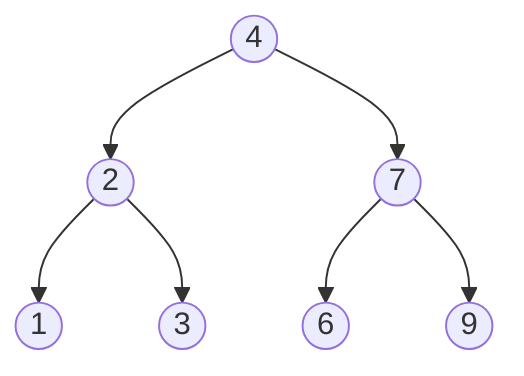
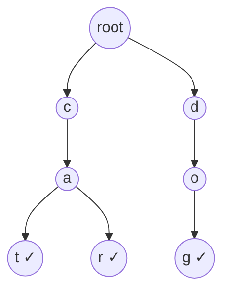

# Trees

A **binary tree** node has a value and up to two children. Almost every tree problem is solved by asking: *"if I knew the answer for the left and right subtrees, how do I get the answer for this node?"*



| Term | Meaning |
|---|---|
| **depth** of a node | edges from the root to it |
| **height** of the tree | longest root-to-leaf path |
| **balanced** | heights of left and right differ by at most 1 everywhere → height $O(\log n)$ |
| **BST** | left subtree < node < right subtree, everywhere |

# Traversals

| Order | Visit | For the tree above | Typical use |
|---|---|---|---|
| **Pre-order** | node, left, right | 4 2 1 3 7 6 9 | copy / serialize a tree |
| **In-order** | left, node, right | 1 2 3 4 6 7 9 | **BST → sorted order** |
| **Post-order** | left, right, node | 1 3 2 6 9 7 4 | compute from children (height, delete) |
| **Level-order** (BFS) | level by level | 4 · 2 7 · 1 3 6 9 | shortest depth, views by level |

<details>
<summary>TreeNode helper used below</summary>

```python
from collections import deque

class TreeNode:
    def __init__(self, val=0, left=None, right=None):
        self.val, self.left, self.right = val, left, right

def build(values):
    """Build from level-order list with None for missing nodes, like LeetCode."""
    if not values or values[0] is None:
        return None
    root = TreeNode(values[0])
    queue, i = deque([root]), 1
    while queue and i < len(values):
        node = queue.popleft()
        if i < len(values) and values[i] is not None:
            node.left = TreeNode(values[i]); queue.append(node.left)
        i += 1
        if i < len(values) and values[i] is not None:
            node.right = TreeNode(values[i]); queue.append(node.right)
        i += 1
    return root
```

</details>

<details>
<summary>Implementation — recursive and iterative traversals</summary>

```python
from collections import deque

class TreeNode:
    def __init__(self, val=0, left=None, right=None):
        self.val, self.left, self.right = val, left, right

def preorder(node):
    return [node.val] + preorder(node.left) + preorder(node.right) if node else []

def inorder(node):
    return inorder(node.left) + [node.val] + inorder(node.right) if node else []

def postorder(node):
    return postorder(node.left) + postorder(node.right) + [node.val] if node else []

def inorder_iterative(root):
    out, stack, node = [], [], root
    while stack or node:
        while node:                 # go as far left as possible
            stack.append(node)
            node = node.left
        node = stack.pop()
        out.append(node.val)
        node = node.right
    return out

def level_order(root):
    if not root:
        return []
    out, queue = [], deque([root])
    while queue:
        level = []
        for _ in range(len(queue)):   # exactly the nodes of this level
            node = queue.popleft()
            level.append(node.val)
            if node.left: queue.append(node.left)
            if node.right: queue.append(node.right)
        out.append(level)
    return out

T = TreeNode
root = T(4, T(2, T(1), T(3)), T(7, T(6), T(9)))
assert preorder(root) == [4, 2, 1, 3, 7, 6, 9]
assert inorder(root) == inorder_iterative(root) == [1, 2, 3, 4, 6, 7, 9]
assert postorder(root) == [1, 3, 2, 6, 9, 7, 4]
assert level_order(root) == [[4], [2, 7], [1, 3, 6, 9]]
```

</details>

# Binary Search Tree

Search, insert and delete cost $O(h)$: $O(\log n)$ when balanced, $O(n)$ when the tree degenerates into a line (e.g. inserting sorted values). Self-balancing trees (AVL, red-black: Java's `TreeMap`) keep $h = O(\log n)$.

<details>
<summary>Implementation — BST search and insert</summary>

```python
class TreeNode:
    def __init__(self, val=0, left=None, right=None):
        self.val, self.left, self.right = val, left, right

def bst_insert(root, val):
    if not root:
        return TreeNode(val)
    if val < root.val:
        root.left = bst_insert(root.left, val)
    else:
        root.right = bst_insert(root.right, val)
    return root

def bst_search(root, val):
    while root and root.val != val:
        root = root.left if val < root.val else root.right
    return root

root = None
for v in [5, 3, 8, 1, 4]:
    root = bst_insert(root, v)
assert bst_search(root, 4).val == 4
assert bst_search(root, 7) is None
```

</details>

# Trie (prefix tree)

Each node is one character; a path from the root spells a prefix. Insert and search cost $O(\text{word length})$, independent of how many words are stored. Used for autocomplete and word games.



<details>
<summary>Implementation — Trie</summary>

```python
class Trie:
    def __init__(self):
        self.root = {}

    def insert(self, word):
        node = self.root
        for ch in word:
            node = node.setdefault(ch, {})
        node["$"] = True                     # end-of-word marker

    def _walk(self, prefix):
        node = self.root
        for ch in prefix:
            if ch not in node:
                return None
            node = node[ch]
        return node

    def search(self, word):
        node = self._walk(word)
        return node is not None and "$" in node

    def starts_with(self, prefix):
        return self._walk(prefix) is not None

t = Trie()
for w in ["cat", "car", "dog"]:
    t.insert(w)
assert t.search("car") and not t.search("ca")
assert t.starts_with("ca") and not t.starts_with("x")
```

</details>

# Practice

## 1. Maximum Depth — Easy

<details>
<summary>Hint</summary>

Depth of a node = 1 + max(depth of left, depth of right); an empty tree has depth 0.

</details>

<details>
<summary>Implementation — O(n)</summary>

```python
class TreeNode:
    def __init__(self, val=0, left=None, right=None):
        self.val, self.left, self.right = val, left, right

def max_depth(root):
    if not root:
        return 0
    return 1 + max(max_depth(root.left), max_depth(root.right))

T = TreeNode
assert max_depth(T(3, T(9), T(20, T(15), T(7)))) == 3
assert max_depth(None) == 0
```

</details>

## 2. Invert Binary Tree — Easy

Mirror the tree: swap left and right children everywhere.

<details>
<summary>Implementation — O(n)</summary>

```python
class TreeNode:
    def __init__(self, val=0, left=None, right=None):
        self.val, self.left, self.right = val, left, right

def invert(root):
    if root:
        root.left, root.right = invert(root.right), invert(root.left)
    return root

def inorder(n):
    return inorder(n.left) + [n.val] + inorder(n.right) if n else []

T = TreeNode
assert inorder(invert(T(4, T(2, T(1), T(3)), T(7, T(6), T(9))))) == [9, 7, 6, 4, 3, 2, 1]
```

</details>

## 3. Validate a BST — Medium

```text
    5
   / \
  1   4        ← not a BST: 4 is in the right subtree of 5 but smaller
     / \
    3   6
```

<details>
<summary>Hint</summary>

Checking only `left.val < node.val < right.val` is **not enough**. Pass down the allowed range `(low, high)`: going left tightens `high`, going right tightens `low`.

</details>

<details>
<summary>Implementation — O(n)</summary>

```python
class TreeNode:
    def __init__(self, val=0, left=None, right=None):
        self.val, self.left, self.right = val, left, right

def is_valid_bst(node, low=float("-inf"), high=float("inf")):
    if not node:
        return True
    if not (low < node.val < high):
        return False
    return (is_valid_bst(node.left, low, node.val)
            and is_valid_bst(node.right, node.val, high))

T = TreeNode
assert is_valid_bst(T(2, T(1), T(3)))
assert not is_valid_bst(T(5, T(1), T(4, T(3), T(6))))
assert not is_valid_bst(T(5, T(4), T(6, T(3), T(7))))   # 3 < 5 deep on the right
```

</details>

## 4. Lowest Common Ancestor — Medium

Deepest node that has both `p` and `q` as descendants (a node is a descendant of itself).

<details>
<summary>Hint</summary>

Recurse: if the current node is `p` or `q`, return it. If both left and right return something, the current node is the LCA; otherwise pass up whichever side found something.

</details>

<details>
<summary>Implementation — O(n)</summary>

```python
class TreeNode:
    def __init__(self, val=0, left=None, right=None):
        self.val, self.left, self.right = val, left, right

def lca(root, p, q):
    if root is None or root is p or root is q:
        return root
    left = lca(root.left, p, q)
    right = lca(root.right, p, q)
    if left and right:
        return root
    return left or right

T = TreeNode
n7, n4 = T(7), T(4)
n2 = T(2, n7, n4)
n5 = T(5, T(6), n2)
n1 = T(1, T(0), T(8))
root = T(3, n5, n1)
assert lca(root, n5, n1) is root
assert lca(root, n5, n4) is n5
assert lca(root, n7, n4) is n2
```

</details>

## 5. Binary Tree Right Side View — Medium

Values you see looking at the tree from the right, top to bottom.

```text
    1            → [1, 3, 4]
   / \
  2   3
   \   \
    5   4
```

<details>
<summary>Hint</summary>

Level-order BFS; keep the last node of each level.

</details>

<details>
<summary>Implementation — O(n)</summary>

```python
from collections import deque

class TreeNode:
    def __init__(self, val=0, left=None, right=None):
        self.val, self.left, self.right = val, left, right

def right_side_view(root):
    if not root:
        return []
    out, queue = [], deque([root])
    while queue:
        for i in range(len(queue)):
            node = queue.popleft()
            if node.left: queue.append(node.left)
            if node.right: queue.append(node.right)
        out.append(node.val)          # last node popped on this level
    return out

T = TreeNode
assert right_side_view(T(1, T(2, None, T(5)), T(3, None, T(4)))) == [1, 3, 4]
assert right_side_view(T(1, T(2))) == [1, 2]
```

</details>

## 6. Binary Tree Maximum Path Sum — Hard

A path goes between any two nodes (not necessarily through the root). Return the maximum sum of node values on a path.

```text
   -10
   /  \
  9    20      → 42  (15 + 20 + 7)
      /  \
     15   7
```

<details>
<summary>Hint</summary>

For each node compute the best **downward** path starting there: `node.val + max(0, left_gain, right_gain)` (that is what a parent can use). The best path **bending** at this node is `node.val + max(0, left) + max(0, right)`; track the global max.

</details>

<details>
<summary>Implementation — O(n)</summary>

```python
class TreeNode:
    def __init__(self, val=0, left=None, right=None):
        self.val, self.left, self.right = val, left, right

def max_path_sum(root):
    best = float("-inf")

    def gain(node):
        nonlocal best
        if not node:
            return 0
        left = max(gain(node.left), 0)       # negative branch: don't take it
        right = max(gain(node.right), 0)
        best = max(best, node.val + left + right)
        return node.val + max(left, right)

    gain(root)
    return best

T = TreeNode
assert max_path_sum(T(-10, T(9), T(20, T(15), T(7)))) == 42
assert max_path_sum(T(-3)) == -3
```

</details>

# Self-check

<details>
<summary>What is the space complexity of a recursive DFS on a tree?</summary>

$O(h)$ for the call stack, where $h$ is the height: $O(\log n)$ for a balanced tree, $O(n)$ for a skewed one. In Python, very deep trees can hit the recursion limit (about 1000), so switch to an explicit stack.

</details>

<details>
<summary>Which traversal gives the values of a BST in sorted order?</summary>

In-order (left, node, right). That is also how you find the k-th smallest element of a BST: stop after the k-th visited node.

</details>
