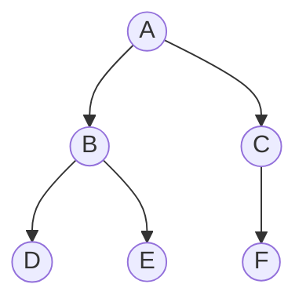
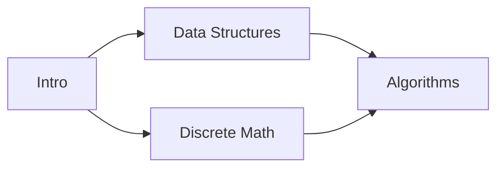

# Graphs

A graph is a set of **nodes** (vertices, $V$) connected by **edges** ($E$). Trees, grids, social networks, dependencies and road maps are all graphs.

| Kind | Meaning |
|---|---|
| directed / undirected | edges have a direction or not |
| weighted / unweighted | edges have a cost or not |
| cyclic / acyclic | **DAG** = directed acyclic graph (dependencies) |
| connected | every node reachable from every other (undirected) |

## Representations

```python
# adjacency list: best for most problems, O(V + E) memory
graph = {
    "A": ["B", "C"],
    "B": ["D"],
    "C": ["D"],
    "D": [],
}

# from an edge list
from collections import defaultdict
edges = [(0, 1), (1, 2), (2, 0)]
adj = defaultdict(list)
for u, v in edges:
    adj[u].append(v)
    adj[v].append(u)          # undirected: add both directions
```

A **grid** is an implicit graph: each cell's neighbours are up, down, left, right.

```python
DIRS = [(1, 0), (-1, 0), (0, 1), (0, -1)]
```

# BFS vs DFS



| | BFS | DFS |
|---|---|---|
| Structure | **queue** | **stack** / recursion |
| Order above | A B C D E F | A B D E C F |
| Finds | **shortest path** in unweighted graphs | any path, cycles, components, topological order |
| Complexity | $O(V + E)$ | $O(V + E)$ |

Always keep a **visited** set, or cycles make you loop forever.

<details>
<summary>Implementation — BFS and DFS templates</summary>

```python
from collections import deque

def bfs(graph, start):
    order, visited, queue = [], {start}, deque([start])
    while queue:
        node = queue.popleft()
        order.append(node)
        for nxt in graph[node]:
            if nxt not in visited:
                visited.add(nxt)          # mark when pushing, not when popping
                queue.append(nxt)
    return order

def dfs(graph, start, visited=None):
    if visited is None:
        visited = set()
    visited.add(start)
    order = [start]
    for nxt in graph[start]:
        if nxt not in visited:
            order += dfs(graph, nxt, visited)
    return order

g = {"A": ["B", "C"], "B": ["D", "E"], "C": ["F"], "D": [], "E": [], "F": []}
assert bfs(g, "A") == ["A", "B", "C", "D", "E", "F"]
assert dfs(g, "A") == ["A", "B", "D", "E", "C", "F"]
```

</details>

# Topological sort

An ordering of a DAG where every edge `u → v` puts `u` before `v` (take courses only after their prerequisites). **Kahn's algorithm**: repeatedly take nodes with no remaining incoming edges. If some nodes are never taken, there is a **cycle**.



# Dijkstra: shortest paths with weights

For non-negative weights. Like BFS, but the queue is a **min-heap** ordered by distance so far: the closest unfinished node is always finalized next. $O((V + E) \log V)$.

$$
\text{dist}[v] = \min\big(\text{dist}[v],\ \text{dist}[u] + w(u, v)\big)
$$

With negative weights use **Bellman-Ford** ($O(VE)$).

# Union-Find (Disjoint Set Union)

Keeps groups of elements and answers "are `a` and `b` in the same group?". With **path compression** and **union by size**, each operation is almost $O(1)$ (inverse Ackermann).

<details>
<summary>Implementation — Union-Find</summary>

```python
class UnionFind:
    def __init__(self, n):
        self.parent = list(range(n))
        self.size = [1] * n

    def find(self, x):
        while self.parent[x] != x:
            self.parent[x] = self.parent[self.parent[x]]   # path compression
            x = self.parent[x]
        return x

    def union(self, a, b):
        ra, rb = self.find(a), self.find(b)
        if ra == rb:
            return False                                   # already connected
        if self.size[ra] < self.size[rb]:
            ra, rb = rb, ra
        self.parent[rb] = ra                               # small under big
        self.size[ra] += self.size[rb]
        return True

uf = UnionFind(5)
uf.union(0, 1); uf.union(3, 4)
assert uf.find(0) == uf.find(1)
assert uf.find(1) != uf.find(3)
assert not uf.union(1, 0)
```

</details>

# Practice

## 1. Number of Islands — Medium

Count groups of `"1"` cells connected up/down/left/right.

```text
1 1 0 0 0
1 1 0 0 0
0 0 1 0 0      → 3
0 0 0 1 1
```

<details>
<summary>Hint</summary>

Scan the grid; each time you find an unvisited land cell, count an island and flood-fill (DFS/BFS) all cells connected to it.

</details>

<details>
<summary>Implementation — O(rows · cols)</summary>

```python
from collections import deque

def num_islands(grid):
    rows, cols = len(grid), len(grid[0])
    seen = set()
    count = 0
    for r in range(rows):
        for c in range(cols):
            if grid[r][c] == "1" and (r, c) not in seen:
                count += 1
                queue = deque([(r, c)])
                seen.add((r, c))
                while queue:
                    x, y = queue.popleft()
                    for dx, dy in [(1, 0), (-1, 0), (0, 1), (0, -1)]:
                        nx, ny = x + dx, y + dy
                        if (0 <= nx < rows and 0 <= ny < cols
                                and grid[nx][ny] == "1" and (nx, ny) not in seen):
                            seen.add((nx, ny))
                            queue.append((nx, ny))
    return count

grid = [list("11000"), list("11000"), list("00100"), list("00011")]
assert num_islands(grid) == 3
assert num_islands([["0"]]) == 0
```

</details>

## 2. Shortest Path in a Binary Maze — Medium

Grid of `0` (free) and `1` (wall). Fewest steps from top-left to bottom-right moving in 4 directions, or `-1`.

<details>
<summary>Hint</summary>

Unweighted shortest path → BFS. Store the distance with each cell in the queue; the first time you reach the target is the shortest.

</details>

<details>
<summary>Implementation — O(rows · cols)</summary>

```python
from collections import deque

def shortest_path(grid):
    rows, cols = len(grid), len(grid[0])
    if grid[0][0] or grid[-1][-1]:
        return -1
    queue = deque([(0, 0, 0)])
    seen = {(0, 0)}
    while queue:
        r, c, d = queue.popleft()
        if (r, c) == (rows - 1, cols - 1):
            return d
        for dr, dc in [(1, 0), (-1, 0), (0, 1), (0, -1)]:
            nr, nc = r + dr, c + dc
            if 0 <= nr < rows and 0 <= nc < cols and not grid[nr][nc] and (nr, nc) not in seen:
                seen.add((nr, nc))
                queue.append((nr, nc, d + 1))
    return -1

maze = [[0, 0, 0],
        [1, 1, 0],
        [0, 0, 0]]
assert shortest_path(maze) == 4
assert shortest_path([[0, 1], [1, 0]]) == -1
```

</details>

## 3. Course Schedule (topological sort) — Medium

`n` courses and pairs `[a, b]` meaning "take `b` before `a`". Return a valid order, or `[]` if impossible.

```text
Input:  n = 4, prereqs = [[1, 0], [2, 0], [3, 1], [3, 2]]
Output: [0, 1, 2, 3]
```

<details>
<summary>Hint</summary>

Kahn's algorithm: count incoming edges (`indegree`). Start with all courses with indegree 0; when you take one, decrement its dependents and enqueue those that reach 0. If you took fewer than `n`, there is a cycle.

</details>

<details>
<summary>Implementation — O(V + E)</summary>

```python
from collections import deque, defaultdict

def find_order(n, prereqs):
    adj = defaultdict(list)
    indegree = [0] * n
    for course, before in prereqs:
        adj[before].append(course)
        indegree[course] += 1
    queue = deque(i for i in range(n) if indegree[i] == 0)
    order = []
    while queue:
        node = queue.popleft()
        order.append(node)
        for nxt in adj[node]:
            indegree[nxt] -= 1
            if indegree[nxt] == 0:
                queue.append(nxt)
    return order if len(order) == n else []

assert find_order(4, [[1, 0], [2, 0], [3, 1], [3, 2]]) == [0, 1, 2, 3]
assert find_order(2, [[0, 1], [1, 0]]) == []        # cycle
```

</details>

## 4. Network Delay Time (Dijkstra) — Medium

`times[i] = (u, v, w)`: a signal takes `w` to go from `u` to `v`. Sent from node `k`, how long until all `n` nodes receive it? `-1` if some never do.

```text
Input:  times = [(2,1,1), (2,3,1), (3,4,1)], n = 4, k = 2
Output: 2
```

<details>
<summary>Hint</summary>

Dijkstra from `k`. The answer is the **largest** shortest distance.

</details>

<details>
<summary>Implementation — O(E log V)</summary>

```python
import heapq
from collections import defaultdict

def network_delay(times, n, k):
    adj = defaultdict(list)
    for u, v, w in times:
        adj[u].append((v, w))
    dist = {}
    heap = [(0, k)]
    while heap:
        d, node = heapq.heappop(heap)
        if node in dist:
            continue                      # already finalized with a shorter d
        dist[node] = d
        for nxt, w in adj[node]:
            if nxt not in dist:
                heapq.heappush(heap, (d + w, nxt))
    return max(dist.values()) if len(dist) == n else -1

assert network_delay([(2, 1, 1), (2, 3, 1), (3, 4, 1)], 4, 2) == 2
assert network_delay([(1, 2, 1)], 2, 2) == -1
assert network_delay([(1, 2, 4), (1, 3, 1), (3, 2, 1)], 3, 1) == 2
```

</details>

## 5. Redundant Connection (Union-Find) — Medium

A tree with one extra edge added. Return the edge that, when removed, leaves a tree (the last such edge in the input).

```text
Input:  [[1, 2], [1, 3], [2, 3]]
Output: [2, 3]
```

<details>
<summary>Hint</summary>

Add edges one by one with Union-Find. The first edge whose two ends are **already connected** closes a cycle.

</details>

<details>
<summary>Implementation — O(n α(n))</summary>

```python
def find_redundant(edges):
    parent = list(range(len(edges) + 1))

    def find(x):
        while parent[x] != x:
            parent[x] = parent[parent[x]]
            x = parent[x]
        return x

    for a, b in edges:
        ra, rb = find(a), find(b)
        if ra == rb:
            return [a, b]
        parent[ra] = rb
    return []

assert find_redundant([[1, 2], [1, 3], [2, 3]]) == [2, 3]
assert find_redundant([[1, 2], [2, 3], [3, 4], [1, 4], [1, 5]]) == [1, 4]
```

</details>

## 6. Word Ladder — Hard

Shortest transformation from `begin` to `end`, changing one letter at a time, each intermediate word in `words`. Return the number of words in the sequence (0 if none).

```text
begin = "hit", end = "cog", words = ["hot","dot","dog","lot","log","cog"]
hit → hot → dot → dog → cog      → 5
```

<details>
<summary>Hint</summary>

Words are nodes; an edge joins words differing by one letter. BFS from `begin`. Generate neighbours by trying every letter at every position and keeping those in the word set ($O(L \cdot 26)$ per word).

</details>

<details>
<summary>Implementation — O(N · L · 26)</summary>

```python
from collections import deque
from string import ascii_lowercase

def ladder_length(begin, end, words):
    words = set(words)
    if end not in words:
        return 0
    queue = deque([(begin, 1)])
    seen = {begin}
    while queue:
        word, steps = queue.popleft()
        if word == end:
            return steps
        for i in range(len(word)):
            for ch in ascii_lowercase:
                nxt = word[:i] + ch + word[i + 1:]
                if nxt in words and nxt not in seen:
                    seen.add(nxt)
                    queue.append((nxt, steps + 1))
    return 0

assert ladder_length("hit", "cog", ["hot", "dot", "dog", "lot", "log", "cog"]) == 5
assert ladder_length("hit", "cog", ["hot", "dot", "dog", "lot", "log"]) == 0
```

</details>

# Self-check

<details>
<summary>Why mark nodes visited when pushing them in BFS instead of when popping?</summary>

If you mark on pop, the same node can be pushed many times by different neighbours before it is popped. That wastes time and memory (worst case much more than $O(V + E)$ queue entries). Marking on push guarantees each node enters the queue once.

</details>

<details>
<summary>Why does Dijkstra fail with negative edge weights?</summary>

Dijkstra finalizes a node as soon as it is popped, assuming no later path can be shorter. A negative edge discovered later could make a shorter path to an already finalized node. Use Bellman-Ford instead.

</details>
