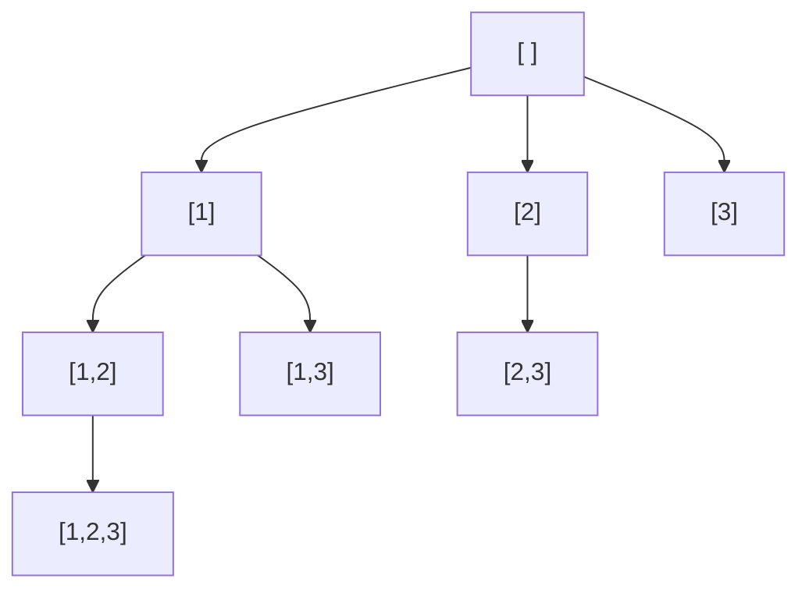

# Backtracking

Backtracking explores **all candidate solutions** by building them one choice at a time: **choose**, **explore** (recurse), **un-choose**. If a partial solution can't lead to a valid one, stop early (**prune**).



*The decision tree for subsets of `[1, 2, 3]`: every node is a subset.*

| Problem type | Number of results | Complexity |
|---|---|---|
| subsets | $2^n$ | $O(n \cdot 2^n)$ |
| permutations | $n!$ | $O(n \cdot n!)$ |
| combinations of size k | $\binom{n}{k}$ | $O(k \cdot \binom{n}{k})$ |

<details>
<summary>Implementation — the template</summary>

```python
def backtrack_template(candidates):
    results = []
    path = []

    def backtrack(start):
        results.append(path[:])            # copy! path keeps changing
        for i in range(start, len(candidates)):
            path.append(candidates[i])     # choose
            backtrack(i + 1)               # explore
            path.pop()                     # un-choose

    backtrack(0)
    return results

assert backtrack_template([1, 2]) == [[], [1], [1, 2], [2]]
```

</details>

**Questions to ask yourself**

1. What is a **choice** at each step?
2. When is a path **complete** (record it)?
3. When can I **prune** (stop exploring)?
4. How do I avoid **duplicate** results (sort + skip equal neighbours, or a `start` index)?

# Practice

## 1. Subsets — Medium

All subsets of distinct numbers.

```text
Input:  [1, 2, 3]
Output: [[], [1], [1,2], [1,2,3], [1,3], [2], [2,3], [3]]
```

<details>
<summary>Hint</summary>

Every node of the decision tree is an answer. Use a `start` index so each number is only considered after the previous ones (no `[2, 1]` after `[1, 2]`).

</details>

<details>
<summary>Implementation — O(n · 2ⁿ)</summary>

```python
def subsets(nums):
    res, path = [], []

    def backtrack(start):
        res.append(path[:])
        for i in range(start, len(nums)):
            path.append(nums[i])
            backtrack(i + 1)
            path.pop()

    backtrack(0)
    return res

assert subsets([1, 2, 3]) == [[], [1], [1, 2], [1, 2, 3], [1, 3], [2], [2, 3], [3]]
assert subsets([]) == [[]]
```

</details>

## 2. Permutations — Medium

```text
Input:  [1, 2, 3]
Output: [[1,2,3], [1,3,2], [2,1,3], [2,3,1], [3,1,2], [3,2,1]]
```

<details>
<summary>Hint</summary>

Any unused number can come next: keep a `used` set. A path is complete when its length is `n`.

</details>

<details>
<summary>Implementation — O(n · n!)</summary>

```python
def permutations(nums):
    res, path, used = [], [], [False] * len(nums)

    def backtrack():
        if len(path) == len(nums):
            res.append(path[:])
            return
        for i, x in enumerate(nums):
            if used[i]:
                continue
            used[i] = True; path.append(x)
            backtrack()
            used[i] = False; path.pop()

    backtrack()
    return res

assert permutations([1, 2, 3]) == [[1, 2, 3], [1, 3, 2], [2, 1, 3], [2, 3, 1], [3, 1, 2], [3, 2, 1]]
assert len(permutations([1, 2, 3, 4])) == 24
```

</details>

## 3. Combination Sum — Medium

Distinct positive `candidates`; find all unique combinations that sum to `target`. A number **may be reused**.

```text
Input:  candidates = [2, 3, 6, 7], target = 7
Output: [[2, 2, 3], [7]]
```

<details>
<summary>Hint</summary>

Recurse with `backtrack(i, remaining)`; passing `i` (not `i + 1`) lets you reuse the same number. Sort first so you can `break` as soon as a candidate exceeds `remaining`.

</details>

<details>
<summary>Implementation</summary>

```python
def combination_sum(candidates, target):
    candidates.sort()
    res, path = [], []

    def backtrack(start, remaining):
        if remaining == 0:
            res.append(path[:])
            return
        for i in range(start, len(candidates)):
            c = candidates[i]
            if c > remaining:
                break                      # prune: the rest are even bigger
            path.append(c)
            backtrack(i, remaining - c)    # i: same number allowed again
            path.pop()

    backtrack(0, target)
    return res

assert combination_sum([2, 3, 6, 7], 7) == [[2, 2, 3], [7]]
assert combination_sum([2, 3, 5], 8) == [[2, 2, 2, 2], [2, 3, 3], [3, 5]]
assert combination_sum([2], 1) == []
```

</details>

## 4. Subsets II (with duplicates) — Medium

```text
Input:  [1, 2, 2]
Output: [[], [1], [1,2], [1,2,2], [2], [2,2]]
```

<details>
<summary>Hint</summary>

Sort, then at the same recursion level skip a number equal to the previous one (`i > start and nums[i] == nums[i - 1]`).

</details>

<details>
<summary>Implementation</summary>

```python
def subsets_with_dup(nums):
    nums.sort()
    res, path = [], []

    def backtrack(start):
        res.append(path[:])
        for i in range(start, len(nums)):
            if i > start and nums[i] == nums[i - 1]:
                continue                   # same choice at this level → duplicate
            path.append(nums[i])
            backtrack(i + 1)
            path.pop()

    backtrack(0)
    return res

assert subsets_with_dup([1, 2, 2]) == [[], [1], [1, 2], [1, 2, 2], [2], [2, 2]]
```

</details>

## 5. Word Search — Medium

Does the word exist in the grid, built from adjacent (up/down/left/right) cells, each cell used once?

```text
A B C E
S F C S       "ABCCED" → True,  "ABCB" → False
A D E E
```

<details>
<summary>Hint</summary>

DFS from every cell. Mark the cell as used (e.g. replace it with `#`) before recursing and restore it afterwards: that's the backtracking step.

</details>

<details>
<summary>Implementation — O(rows · cols · 4^L)</summary>

```python
def exist(board, word):
    rows, cols = len(board), len(board[0])

    def dfs(r, c, i):
        if i == len(word):
            return True
        if not (0 <= r < rows and 0 <= c < cols) or board[r][c] != word[i]:
            return False
        saved, board[r][c] = board[r][c], "#"          # choose
        found = any(dfs(r + dr, c + dc, i + 1)
                    for dr, dc in [(1, 0), (-1, 0), (0, 1), (0, -1)])
        board[r][c] = saved                            # un-choose
        return found

    return any(dfs(r, c, 0) for r in range(rows) for c in range(cols))

board = [list("ABCE"), list("SFCS"), list("ADEE")]
assert exist(board, "ABCCED")
assert exist(board, "SEE")
assert not exist(board, "ABCB")
```

</details>

## 6. N-Queens — Hard

Place `n` queens on an `n × n` board so no two attack each other. Return the number of solutions.

```text
n = 4  →  2 solutions
. Q . .     . . Q .
. . . Q     Q . . .
Q . . .     . . . Q
. . Q .     . Q . .
```

<details>
<summary>Hint</summary>

Place one queen per row. A square `(r, c)` is attacked if its column, its diagonal `r - c` or its anti-diagonal `r + c` is already used: keep three sets.

</details>

<details>
<summary>Implementation</summary>

```python
def total_n_queens(n):
    cols, diag, anti = set(), set(), set()

    def place(r):
        if r == n:
            return 1
        count = 0
        for c in range(n):
            if c in cols or r - c in diag or r + c in anti:
                continue
            cols.add(c); diag.add(r - c); anti.add(r + c)
            count += place(r + 1)
            cols.remove(c); diag.remove(r - c); anti.remove(r + c)
        return count

    return place(0)

assert total_n_queens(4) == 2
assert total_n_queens(8) == 92
assert total_n_queens(1) == 1
```

</details>

## 7. Sudoku Solver — Hard

Fill a 9×9 Sudoku (`"."` = empty) in place.

<details>
<summary>Hint</summary>

Track the digits used in each row, column and 3×3 box with sets. Fill empty cells in order; try each allowed digit, recurse, undo if it leads to a dead end.

</details>

<details>
<summary>Implementation</summary>

```python
def solve_sudoku(board):
    rows = [set() for _ in range(9)]
    cols = [set() for _ in range(9)]
    boxes = [set() for _ in range(9)]
    empty = []
    for r in range(9):
        for c in range(9):
            v = board[r][c]
            if v == ".":
                empty.append((r, c))
            else:
                rows[r].add(v); cols[c].add(v); boxes[r // 3 * 3 + c // 3].add(v)

    def fill(k):
        if k == len(empty):
            return True
        r, c = empty[k]
        b = r // 3 * 3 + c // 3
        for v in "123456789":
            if v in rows[r] or v in cols[c] or v in boxes[b]:
                continue
            board[r][c] = v
            rows[r].add(v); cols[c].add(v); boxes[b].add(v)
            if fill(k + 1):
                return True
            rows[r].remove(v); cols[c].remove(v); boxes[b].remove(v)
        board[r][c] = "."
        return False

    fill(0)
    return board

puzzle = [list(row) for row in [
    "53..7....", "6..195...", ".98....6.",
    "8...6...3", "4..8.3..1", "7...2...6",
    ".6....28.", "...419..5", "....8..79"]]
solved = solve_sudoku(puzzle)
assert "".join(solved[0]) == "534678912"
assert all(sorted(row) == list("123456789") for row in solved)
assert all(sorted(col) == list("123456789") for col in zip(*solved))
```

</details>

# Self-check

<details>
<summary>Why append path[:] instead of path?</summary>

`path` is one list that keeps being modified. Appending it directly stores a reference, so every saved result ends up showing the final (usually empty) state. `path[:]` stores a copy of the current state.

</details>

<details>
<summary>What is the difference between backtracking and dynamic programming?</summary>

Backtracking enumerates **all** solutions (it must visit each one). DP is used when you only need a count or an optimum and the same subproblems repeat, so their answers can be cached instead of recomputed.

</details>
