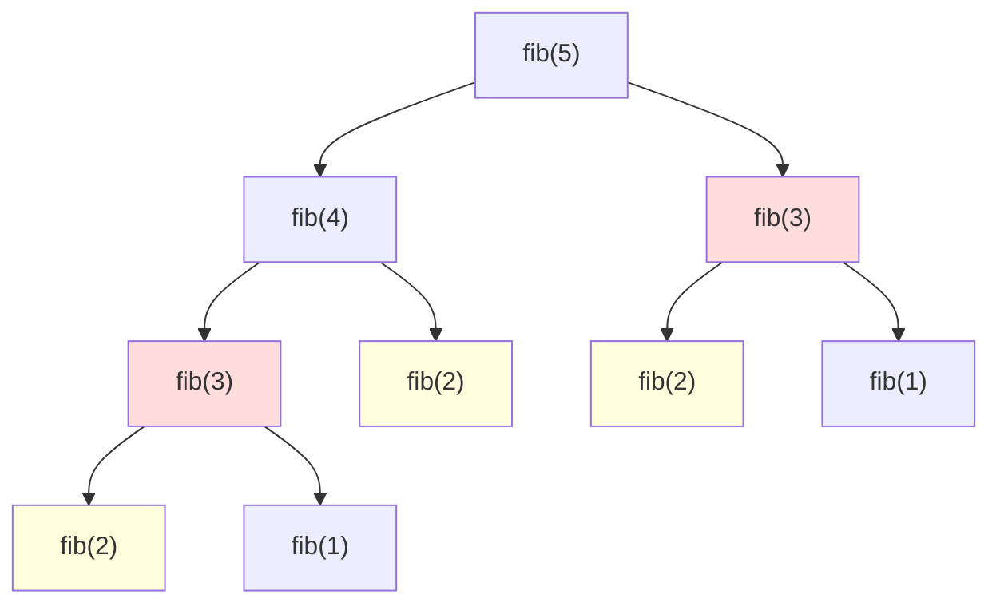

# Dynamic Programming

**Dynamic programming (DP)** solves a problem by combining answers to smaller **subproblems**, computing each subproblem **once**. It applies when there are:

1. **Optimal substructure**: the best answer is built from the best answers of subproblems.
2. **Overlapping subproblems**: the same subproblems come up again and again.

Fibonacci shows why it matters. Naive recursion recomputes the same values exponentially often:



| Approach | How | Fibonacci cost |
|---|---|---|
| naive recursion | recompute everything | $O(2^n)$ |
| **top-down** (memoization) | recursion + cache | $O(n)$ |
| **bottom-up** (tabulation) | fill a table from small to large | $O(n)$, and often $O(1)$ space |

<details>
<summary>Implementation — the three versions of Fibonacci</summary>

```python
from functools import cache

def fib_naive(n):
    return n if n < 2 else fib_naive(n - 1) + fib_naive(n - 2)

@cache
def fib_memo(n):
    return n if n < 2 else fib_memo(n - 1) + fib_memo(n - 2)

def fib_table(n):
    a, b = 0, 1                 # only the last two values are needed
    for _ in range(n):
        a, b = b, a + b
    return a

assert fib_naive(15) == fib_memo(15) == fib_table(15) == 610
assert fib_table(90) == 2880067194370816120
```

</details>

# The 4-step recipe

1. **State**: what does `dp[i]` (or `dp[i][j]`) mean? Say it in one sentence.
2. **Transition**: how is `dp[i]` computed from smaller states?
3. **Base cases**: the smallest states you know directly.
4. **Answer and order**: which state is the answer, and in which order do you fill the table so dependencies are ready?

| Family | State | Examples |
|---|---|---|
| 1D linear | `dp[i]` = answer for the first `i` items | climbing stairs, house robber, coin change |
| subsequence | `dp[i]` = best ending at `i` | longest increasing subsequence |
| two strings | `dp[i][j]` = answer for prefixes `a[:i]`, `b[:j]` | LCS, edit distance |
| grid | `dp[r][c]` = answer to reach cell `(r, c)` | unique paths, min path sum |
| knapsack | `dp[i][w]` = best using the first `i` items with capacity `w` | 0/1 knapsack, partition sum |

# Practice: 1D

## 1. Climbing Stairs — Easy

You climb 1 or 2 steps at a time. How many distinct ways to reach step `n`?

```text
n = 3 → 3       (1+1+1, 1+2, 2+1)
```

<details>
<summary>Hint</summary>

To arrive at step `i`, the last move came from `i - 1` or `i - 2`: `ways[i] = ways[i - 1] + ways[i - 2]`. It's Fibonacci.

</details>

<details>
<summary>Implementation — O(n) time, O(1) space</summary>

```python
def climb_stairs(n):
    a, b = 1, 1              # ways to reach step 0 and step 1
    for _ in range(n - 1):
        a, b = b, a + b
    return b

assert climb_stairs(1) == 1
assert climb_stairs(3) == 3
assert climb_stairs(5) == 8
```

</details>

## 2. House Robber — Medium

Houses in a row with amounts of money; you can't rob two adjacent houses. Maximum total?

```text
Input:  [2, 7, 9, 3, 1]
Output: 12          (2 + 9 + 1)
```

<details>
<summary>Hint</summary>

`dp[i]` = best for the first `i` houses. Either skip house `i` (`dp[i - 1]`) or rob it (`dp[i - 2] + nums[i]`).

$$
dp[i] = \max(dp[i-1],\ dp[i-2] + nums[i])
$$

</details>

<details>
<summary>Implementation — O(n)</summary>

```python
def rob(nums):
    prev, curr = 0, 0                 # dp[i-2], dp[i-1]
    for x in nums:
        prev, curr = curr, max(curr, prev + x)
    return curr

assert rob([2, 7, 9, 3, 1]) == 12
assert rob([1, 2, 3, 1]) == 4
assert rob([]) == 0
```

</details>

## 3. Coin Change — Medium

Fewest coins to make `amount` (unlimited coins of each type), or `-1`.

```text
Input:  coins = [1, 2, 5], amount = 11
Output: 3           (5 + 5 + 1)
```

<details>
<summary>Hint</summary>

`dp[a]` = fewest coins for amount `a`. Try every coin as the last one: `dp[a] = 1 + min(dp[a - c])`. Greedy (always the biggest coin) fails for coins like `[1, 3, 4]` and amount 6.

</details>

<details>
<summary>Implementation — O(amount · coins)</summary>

```python
def coin_change(coins, amount):
    INF = float("inf")
    dp = [0] + [INF] * amount
    for a in range(1, amount + 1):
        for c in coins:
            if c <= a and dp[a - c] + 1 < dp[a]:
                dp[a] = dp[a - c] + 1
    return dp[amount] if dp[amount] != INF else -1

assert coin_change([1, 2, 5], 11) == 3
assert coin_change([2], 3) == -1
assert coin_change([1, 3, 4], 6) == 2      # 3 + 3, greedy would give 4 + 1 + 1
assert coin_change([1], 0) == 0
```

</details>

## 4. Longest Increasing Subsequence — Medium

Length of the longest strictly increasing subsequence (not necessarily contiguous).

```text
Input:  [10, 9, 2, 5, 3, 7, 101, 18]
Output: 4           (2, 3, 7, 101)
```

<details>
<summary>Hint</summary>

$O(n^2)$: `dp[i]` = LIS ending at `i` = `1 + max(dp[j])` for `j < i` with `nums[j] < nums[i]`.

$O(n \log n)$: keep `tails[k]` = smallest possible tail of an increasing subsequence of length `k + 1`; for each number, binary-search its place in `tails` and replace.

</details>

<details>
<summary>Implementation — O(n²) and O(n log n)</summary>

```python
from bisect import bisect_left

def lis_quadratic(nums):
    if not nums:
        return 0
    dp = [1] * len(nums)
    for i in range(len(nums)):
        for j in range(i):
            if nums[j] < nums[i]:
                dp[i] = max(dp[i], dp[j] + 1)
    return max(dp)

def lis_fast(nums):
    tails = []
    for x in nums:
        i = bisect_left(tails, x)
        if i == len(tails):
            tails.append(x)          # extends the longest subsequence
        else:
            tails[i] = x             # better (smaller) tail for length i + 1
    return len(tails)

for f in (lis_quadratic, lis_fast):
    assert f([10, 9, 2, 5, 3, 7, 101, 18]) == 4
    assert f([0, 1, 0, 3, 2, 3]) == 4
    assert f([7, 7, 7]) == 1
```

</details>

## 5. Word Break — Medium

Can `s` be split into words from the dictionary?

```text
s = "leetcode", words = ["leet", "code"]  → True
```

<details>
<summary>Hint</summary>

`dp[i]` = can the prefix `s[:i]` be split? `dp[i]` is true if some `j < i` has `dp[j]` true and `s[j:i]` is a word.

</details>

<details>
<summary>Implementation — O(n² · L)</summary>

```python
def word_break(s, words):
    words = set(words)
    dp = [True] + [False] * len(s)
    for i in range(1, len(s) + 1):
        dp[i] = any(dp[j] and s[j:i] in words for j in range(i))
    return dp[len(s)]

assert word_break("leetcode", ["leet", "code"])
assert word_break("applepenapple", ["apple", "pen"])
assert not word_break("catsandog", ["cats", "dog", "sand", "and", "cat"])
```

</details>

# Practice: 2D

## 6. Unique Paths — Medium

A robot in the top-left of an `m × n` grid moves only right or down. How many paths to the bottom-right?

```text
m = 3, n = 7 → 28
```

<details>
<summary>Hint</summary>

`dp[r][c] = dp[r - 1][c] + dp[r][c - 1]`, with 1 on the first row and column. One row of memory is enough.

</details>

<details>
<summary>Implementation — O(m · n) time, O(n) space</summary>

```python
def unique_paths(m, n):
    row = [1] * n
    for _ in range(1, m):
        for c in range(1, n):
            row[c] += row[c - 1]        # from above (old row[c]) + from left
    return row[-1]

assert unique_paths(3, 7) == 28
assert unique_paths(3, 2) == 3
assert unique_paths(1, 1) == 1
```

</details>

## 7. Longest Common Subsequence — Medium

```text
a = "abcde", b = "ace" → 3     ("ace")
```

<details>
<summary>Hint</summary>

`dp[i][j]` = LCS of `a[:i]` and `b[:j]`. If the last characters match: `dp[i-1][j-1] + 1`; otherwise `max(dp[i-1][j], dp[i][j-1])`.

```text
      ""  a  c  e
  ""   0  0  0  0
  a    0  1  1  1
  b    0  1  1  1
  c    0  1  2  2
  d    0  1  2  2
  e    0  1  2  3
```

</details>

<details>
<summary>Implementation — O(m · n)</summary>

```python
def lcs(a, b):
    m, n = len(a), len(b)
    dp = [[0] * (n + 1) for _ in range(m + 1)]
    for i in range(1, m + 1):
        for j in range(1, n + 1):
            if a[i - 1] == b[j - 1]:
                dp[i][j] = dp[i - 1][j - 1] + 1
            else:
                dp[i][j] = max(dp[i - 1][j], dp[i][j - 1])
    return dp[m][n]

assert lcs("abcde", "ace") == 3
assert lcs("abc", "def") == 0
```

</details>

## 8. Edit Distance — Hard

Minimum insertions, deletions and replacements to turn `a` into `b`.

```text
"horse" → "ros" = 3     (horse → rorse → rose → ros)
```

<details>
<summary>Hint</summary>

`dp[i][j]` = distance between `a[:i]` and `b[:j]`. Base: `dp[i][0] = i`, `dp[0][j] = j`. If the last characters are equal, `dp[i-1][j-1]`; else `1 + min(delete dp[i-1][j], insert dp[i][j-1], replace dp[i-1][j-1])`.

</details>

<details>
<summary>Implementation — O(m · n)</summary>

```python
def edit_distance(a, b):
    m, n = len(a), len(b)
    dp = [[0] * (n + 1) for _ in range(m + 1)]
    for i in range(m + 1):
        dp[i][0] = i
    for j in range(n + 1):
        dp[0][j] = j
    for i in range(1, m + 1):
        for j in range(1, n + 1):
            if a[i - 1] == b[j - 1]:
                dp[i][j] = dp[i - 1][j - 1]
            else:
                dp[i][j] = 1 + min(dp[i - 1][j], dp[i][j - 1], dp[i - 1][j - 1])
    return dp[m][n]

assert edit_distance("horse", "ros") == 3
assert edit_distance("intention", "execution") == 5
assert edit_distance("", "abc") == 3
```

</details>

## 9. 0/1 Knapsack — Medium

Items with `weights` and `values`, a bag of capacity `W`; each item taken at most once. Maximum value?

```text
weights = [1, 3, 4, 5], values = [1, 4, 5, 7], W = 7 → 9   (items 3 + 4)
```

<details>
<summary>Hint</summary>

$$
dp[i][w] = \max\big(dp[i-1][w],\ dp[i-1][w - wt_i] + val_i\big)
$$

With a 1D array, loop `w` **downwards** so each item is used at most once (upwards would allow reuse: that's the unbounded knapsack).

</details>

<details>
<summary>Implementation — O(n · W) time, O(W) space</summary>

```python
def knapsack(weights, values, W):
    dp = [0] * (W + 1)
    for wt, val in zip(weights, values):
        for w in range(W, wt - 1, -1):          # downwards: item used once
            dp[w] = max(dp[w], dp[w - wt] + val)
    return dp[W]

assert knapsack([1, 3, 4, 5], [1, 4, 5, 7], 7) == 9
assert knapsack([5], [10], 4) == 0
```

</details>

## 10. Partition Equal Subset Sum — Medium

Can the array be split into two subsets with equal sums?

```text
[1, 5, 11, 5] → True     ([1, 5, 5] and [11])
```

<details>
<summary>Hint</summary>

It's a 0/1 knapsack on booleans: can some subset reach `total / 2`? Keep the set of reachable sums.

</details>

<details>
<summary>Implementation — O(n · sum)</summary>

```python
def can_partition(nums):
    total = sum(nums)
    if total % 2:
        return False
    target = total // 2
    reachable = {0}
    for x in nums:
        reachable |= {s + x for s in reachable if s + x <= target}
        if target in reachable:
            return True
    return False

assert can_partition([1, 5, 11, 5])
assert not can_partition([1, 2, 3, 5])
```

</details>

# Self-check

<details>
<summary>How do you recognize a DP problem?</summary>

The question asks for a **count** ("how many ways"), an **optimum** ("min cost", "max profit", "longest") or a **yes/no** ("is it possible"), and a brute force would make a sequence of choices whose sub-results repeat. If you need to list every solution, it's backtracking instead.

</details>

<details>
<summary>Top-down or bottom-up in an interview?</summary>

Top-down (recursion + `@cache`) is usually faster to write correctly because it follows the recurrence directly. Bottom-up avoids recursion limits and makes space optimization (keeping only the previous row) easy. Start with whichever you can explain, then mention the other.

</details>
