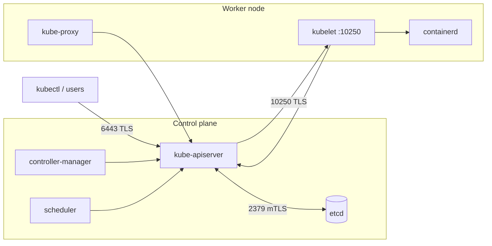
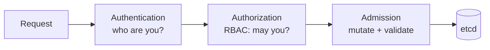

## Cluster Setup

This section covers the initial setup of a Kubernetes cluster with a focus on security.

### Securing the Underlying Infrastructure

The security of your Kubernetes cluster is only as strong as the security of the underlying infrastructure. It is essential to secure the infrastructure that your cluster runs on, whether it is in the cloud or on-premise.

-   **Cloud Provider**: If you are running your cluster in the cloud, you should follow the security best practices of your cloud provider.
-   **On-Premise**: If you are running your cluster on-premise, you should ensure that your servers are physically secure and that the operating system is hardened (see [System Hardening](./system-hardening.md)).

### Cluster Architecture



Everything talks to the **API server**; only the API server talks to **etcd**. Protecting those two is most of cluster security.

- **Control plane components**: `kube-apiserver`, `etcd`, `kube-controller-manager`, `kube-scheduler`.
- **Worker node components**: `kubelet`, container runtime (containerd), `kube-proxy` (or CNI dataplane).
- **Config/manifests paths**:
  - Control plane static pods: `/etc/kubernetes/manifests/`
  - Kubelet config: `/var/lib/kubelet/config.yaml`
  - PKI: `/etc/kubernetes/pki/`
  - Kubeconfigs (credentials): `/etc/kubernetes/` (e.g., `admin.conf`, `kubelet.conf`)

Editing a file in `/etc/kubernetes/manifests/` makes the kubelet **restart that static pod**. If the API server doesn't come back, check:

```bash
watch crictl ps                                       # is kube-apiserver running?
sudo crictl logs $(sudo crictl ps -a --name kube-apiserver -q | head -1)
sudo journalctl -u kubelet | tail -50                 # YAML errors show up here
ls /var/log/pods/ | grep apiserver
```

Always back up a manifest before editing: `cp kube-apiserver.yaml /root/kube-apiserver.yaml.bak` (not inside `manifests/`, or the kubelet will try to run the backup too).

### The life of an API request



Each stage is a place to enforce security: certificates/OIDC at authentication, RBAC at authorization, Pod Security Admission and policy engines at admission.

### Network Security

Network security is a critical part of Kubernetes security. By default **every pod can talk to every pod**. Use a CNI plugin that enforces NetworkPolicies (Calico, Cilium, ...) and start from **default deny**.

#### Default deny all traffic in a namespace

```yaml
apiVersion: networking.k8s.io/v1
kind: NetworkPolicy
metadata:
  name: default-deny
  namespace: prod
spec:
  podSelector: {}          # all pods in the namespace
  policyTypes:
    - Ingress
    - Egress
```

#### Allow DNS again

With egress denied, pods can't resolve names. Re-allow DNS to kube-dns:

```yaml
apiVersion: networking.k8s.io/v1
kind: NetworkPolicy
metadata:
  name: allow-dns
  namespace: prod
spec:
  podSelector: {}
  policyTypes:
    - Egress
  egress:
    - to:
        - namespaceSelector:
            matchLabels:
              kubernetes.io/metadata.name: kube-system
          podSelector:
            matchLabels:
              k8s-app: kube-dns
      ports:
        - protocol: UDP
          port: 53
        - protocol: TCP
          port: 53
```

Policies are **additive** (a union of allows): once any policy selects a pod, only traffic that some policy allows gets through. More examples are in [Network Security](./minimize-microservice-vulnerabilities.md#network-security), and blocking the cloud metadata endpoint is in [System Hardening](./system-hardening.md#block-the-cloud-metadata-endpoint).

```bash
# test from a throwaway pod
kubectl -n prod run tmp --rm -it --image=busybox -- wget -qO- -T 2 http://web
```

### CIS Benchmark with kube-bench

**kube-bench** checks a node against the CIS Kubernetes Benchmark and prints how to fix each failure.

```bash
# on a control plane node
kube-bench run --targets master

# on a worker node
kube-bench run --targets node

# only one check
kube-bench run --targets master --check 1.2.16
```

Sample output:

```text
[FAIL] 1.2.16 Ensure that the --profiling argument is set to false
== Remediations master ==
1.2.16 Edit the API server pod specification file
/etc/kubernetes/manifests/kube-apiserver.yaml on the control plane node and set:
--profiling=false
```

Fix it, wait for the static pod to restart, run the check again. More on the benchmark in [Cluster Hardening](./cluster-hardening.md#cis-benchmark-for-kubernetes).

### Verify platform binaries

Before installing or upgrading, make sure `kubectl`, `kubeadm` and `kubelet` binaries weren't tampered with:

```bash
VERSION=v1.34.1
curl -LO "https://dl.k8s.io/release/${VERSION}/bin/linux/amd64/kubectl"
curl -LO "https://dl.k8s.io/release/${VERSION}/bin/linux/amd64/kubectl.sha256"
echo "$(cat kubectl.sha256)  kubectl" | sha256sum --check
# kubectl: OK
```

For binaries already installed, compare against the published hash:

```bash
sha512sum $(which kubelet)
```

### RBAC (Role-Based Access Control)

Roles are namespace-scoped; ClusterRoles are cluster-scoped. RoleBindings bind users/groups/serviceaccounts to Roles or ClusterRoles.

| Object | Scope | Grants |
|---|---|---|
| **Role** | namespace | permissions within one namespace |
| **ClusterRole** | cluster | permissions cluster-wide, or on cluster-scoped resources (nodes, PVs) |
| **RoleBinding** | namespace | a Role **or a ClusterRole**, limited to its namespace |
| **ClusterRoleBinding** | cluster | a ClusterRole in all namespaces |

A RoleBinding to a ClusterRole is a common pattern: define the permissions once, grant them per namespace.

#### Examples

Create a Role in a namespace:

```bash
kubectl -n my-namespace create role secret-reader --verb=get,list --resource=secrets
```

Bind a user to that Role:

```bash
kubectl -n my-namespace create rolebinding secret-reader-binding --role=secret-reader --user=alice@example.com
```

The same as YAML:

```yaml
apiVersion: rbac.authorization.k8s.io/v1
kind: Role
metadata:
  name: secret-reader
  namespace: my-namespace
rules:
  - apiGroups: [""]
    resources: ["secrets"]
    verbs: ["get", "list"]
---
apiVersion: rbac.authorization.k8s.io/v1
kind: RoleBinding
metadata:
  name: secret-reader-binding
  namespace: my-namespace
subjects:
  - kind: User
    name: alice@example.com
    apiGroup: rbac.authorization.k8s.io
roleRef:
  kind: Role
  name: secret-reader
  apiGroup: rbac.authorization.k8s.io
```

#### Check permissions (simulate user)

```bash
kubectl auth can-i get secrets --as=alice@example.com -n my-namespace
kubectl auth can-i --list --as=system:serviceaccount:prod:default -n prod
kubectl auth can-i create pods --as=bob --as-group=dev -n dev
```

**Dangerous permissions** to watch for: `*` verbs or resources, `get/list secrets`, `create pods` (can mount any secret in the namespace), `escalate`, `bind`, `impersonate`, and `nodes/proxy`.

### Users and certificates

Kubernetes has **no user objects**: a user is whoever presents a certificate signed by the cluster CA. The certificate's `CN` is the username and each `O` is a group.

```bash
# 1. key + CSR for user "alice" in group "dev"
openssl genrsa -out alice.key 2048
openssl req -new -key alice.key -out alice.csr -subj "/CN=alice/O=dev"

# 2. submit it to the cluster
cat <<EOF | kubectl apply -f -
apiVersion: certificates.k8s.io/v1
kind: CertificateSigningRequest
metadata:
  name: alice
spec:
  request: $(base64 -w0 alice.csr)
  signerName: kubernetes.io/kube-apiserver-client
  expirationSeconds: 86400
  usages: ["client auth"]
EOF

# 3. approve and fetch the certificate
kubectl certificate approve alice
kubectl get csr alice -o jsonpath='{.status.certificate}' | base64 -d > alice.crt

# 4. add to kubeconfig
kubectl config set-credentials alice --client-key=alice.key --client-certificate=alice.crt --embed-certs
kubectl config set-context alice --cluster=kubernetes --user=alice
kubectl --context alice get pods     # works only once RBAC allows it
```

Certificates **can't be revoked** in Kubernetes, so keep `expirationSeconds` short, and remove access through RBAC.

Inspect a certificate:

```bash
openssl x509 -in /etc/kubernetes/pki/apiserver.crt -noout -subject -issuer -dates -ext subjectAltName
kubeadm certs check-expiration
```

### etcd (secure storage)

etcd stores cluster state, including every Secret. Whoever can read etcd owns the cluster, so protect it with TLS and restrict network access.

- **Configuration file**: `/etc/kubernetes/manifests/etcd.yaml` (static pod manifest)
- Ensure the etcd data directory (`/var/lib/etcd`) is owned by `etcd` and mode `700`.
- Use TLS for encryption in transit (`--cert-file`, `--key-file`, `--client-cert-auth=true`, `--peer-client-cert-auth=true`).
- Enable encryption at rest.

Talk to etcd directly:

```bash
ETCDCTL_API=3 etcdctl \
  --endpoints=https://127.0.0.1:2379 \
  --cacert=/etc/kubernetes/pki/etcd/ca.crt \
  --cert=/etc/kubernetes/pki/etcd/server.crt \
  --key=/etc/kubernetes/pki/etcd/server.key \
  endpoint health
```

#### Encryption at Rest

Etcd stores sensitive data, so it's important to encrypt it at rest. You can enable encryption at rest by creating an `EncryptionConfiguration` object.

```yaml
apiVersion: apiserver.config.k8s.io/v1
kind: EncryptionConfiguration
resources:
  - resources:
    - secrets
    providers:
    - aescbc:
        keys:
        - name: key1
          secret: <base64-encoded-32-byte-key>
    - identity: {}
```

**Provider order matters**: the **first** provider encrypts new writes; all of them are tried for reads. Putting `identity: {}` first means "store in plain text".

| Provider | Notes |
|---|---|
| `identity` | no encryption |
| `aescbc` / `aesgcm` | local key in the file; `aesgcm` needs frequent key rotation |
| `secretbox` | XSalsa20 + Poly1305, local key |
| `kms` (v2) | key held by an external KMS (Vault, cloud KMS): **recommended for production** |

Step by step:

```bash
# 1. generate a key
head -c 32 /dev/urandom | base64

# 2. save the config
sudo mkdir -p /etc/kubernetes/enc
sudo vi /etc/kubernetes/enc/enc.yaml
```

3. Point the API server at it and **mount the directory** in `/etc/kubernetes/manifests/kube-apiserver.yaml`:

```yaml
spec:
  containers:
  - command:
    - kube-apiserver
    - --encryption-provider-config=/etc/kubernetes/enc/enc.yaml
    # ...
    volumeMounts:
    - name: enc
      mountPath: /etc/kubernetes/enc
      readOnly: true
  volumes:
  - name: enc
    hostPath:
      path: /etc/kubernetes/enc
      type: DirectoryOrCreate
```

4. Encryption only applies to **new writes**. Rewrite existing secrets, then verify in etcd:

```bash
kubectl get secrets -A -o json | kubectl replace -f -

ETCDCTL_API=3 etcdctl --cacert=... --cert=... --key=... \
  get /registry/secrets/default/my-secret | hexdump -C | head
# encrypted: starts with "k8s:enc:aescbc:v1:key1"
# not encrypted: you can read the secret value in plain text
```

### API server: auth, audit and flags

The API server runs with many flags. Check the static pod manifest at `/etc/kubernetes/manifests/kube-apiserver.yaml`.

#### Important flags for security:

| Flag | Secure value | Why |
|---|---|---|
| `--authorization-mode` | `Node,RBAC` | never `AlwaysAllow` |
| `--anonymous-auth` | `false` (where possible) | no unauthenticated requests |
| `--enable-admission-plugins` | includes `NodeRestriction` | kubelets can only modify their own node and pods |
| `--audit-policy-file`, `--audit-log-path` | set | audit logging (see [Auditing](./monitoring-logging-runtime-security.md#auditing)) |
| `--etcd-cafile`, `--etcd-certfile`, `--etcd-keyfile` | set | TLS to etcd |
| `--profiling` | `false` | no debug endpoint |
| `--kubelet-certificate-authority` | set | verify kubelet serving certs |
| `--service-account-issuer`, `--service-account-key-file` | set | signing service account tokens |

Quick check of what is set:

```bash
ps -ef | grep kube-apiserver | tr ' ' '\n' | grep -E "authorization|anonymous|admission|profiling"
```

### Authentication and Authorization

-   **Authentication**: The process of identifying a user. Kubernetes supports a variety of authentication methods, including:
    -   **Client certificates**: The most common authentication method for system components (see [Users and certificates](#users-and-certificates)).
    -   **Bearer tokens**: A common authentication method for users and service accounts.
    -   **OpenID Connect (OIDC)**: A popular authentication method for integrating with third-party identity providers.
-   **Authorization**: The process of determining whether a user is allowed to perform a particular action. Kubernetes uses Role-Based Access Control (RBAC) for authorization, plus the **Node** authorizer for kubelets.

### Ingress with TLS

Terminate TLS at the Ingress so traffic from clients is encrypted:

```bash
openssl req -x509 -nodes -days 365 -newkey rsa:2048 \
  -keyout tls.key -out tls.crt -subj "/CN=app.example.com"
kubectl -n prod create secret tls app-tls --cert=tls.crt --key=tls.key
```

```yaml
apiVersion: networking.k8s.io/v1
kind: Ingress
metadata:
  name: app
  namespace: prod
spec:
  ingressClassName: nginx
  tls:
    - hosts: ["app.example.com"]
      secretName: app-tls
  rules:
    - host: app.example.com
      http:
        paths:
          - path: /
            pathType: Prefix
            backend:
              service:
                name: web
                port:
                  number: 80
```

```bash
curl -kv https://app.example.com --resolve app.example.com:443:<ingress-ip>
```

### Kubernetes Dashboard

The Dashboard has been a classic entry point for attackers (Tesla's cluster was used for crypto mining through an exposed Dashboard). If you install it:

- Don't expose it publicly; reach it through `kubectl proxy` or `kubectl port-forward`.
- Never run it with a `cluster-admin` service account or `--enable-skip-login`.
- Log in with a token for a service account that has only the access that user needs.

### Secrets Management

Secrets are sensitive pieces of data, such as passwords, API keys, and certificates. Kubernetes provides a built-in `Secret` object for storing and managing secrets.

-   **Secrets are not encrypted by default**: Secrets are stored in etcd as base64-encoded plain text. It is essential to enable encryption at rest for secrets.
-   **Restrict access**: `get`/`list`/`watch` on secrets, and `create pods` in the namespace, are all ways to read them. Grant them sparingly.
-   **Prefer volume mounts over env vars**: environment variables leak into logs, crash dumps and `kubectl describe`.
-   **External secret stores**: For enhanced security, you can use an external secret store, such as [HashiCorp Vault](https://www.vaultproject.io/) or [AWS Secrets Manager](https://aws.amazon.com/secrets-manager/), synced with the Secrets Store CSI Driver or External Secrets Operator.

```bash
# where is a secret used?
kubectl get pods -A -o json | jq -r '.items[] | select(.spec.volumes[]?.secret.secretName=="db-pass") | .metadata.name'
```

### Checklist

- [ ] Default-deny NetworkPolicies in every application namespace (plus DNS)
- [ ] kube-bench run on control plane and workers; failures fixed
- [ ] Binaries verified against published checksums
- [ ] RBAC least privilege; no wildcard rules; `can-i --list` reviewed
- [ ] User certificates short-lived; access removed through RBAC
- [ ] etcd: TLS + client cert auth, data dir `700`, encryption at rest verified
- [ ] API server: `Node,RBAC`, `NodeRestriction`, audit logging, `--profiling=false`
- [ ] Ingress uses TLS; Dashboard not exposed
