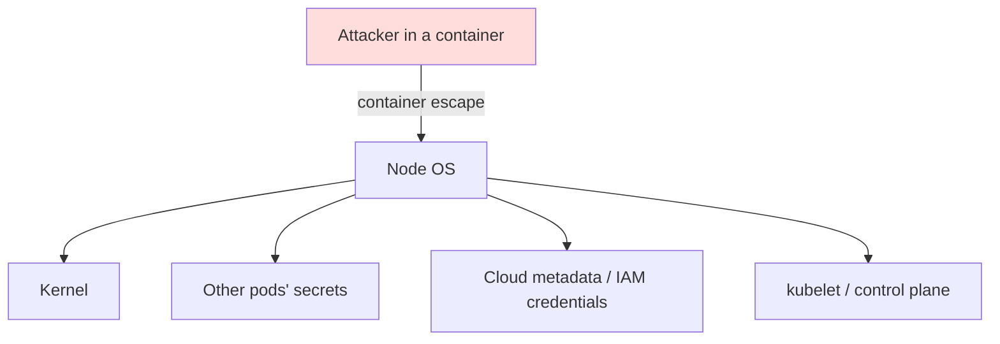
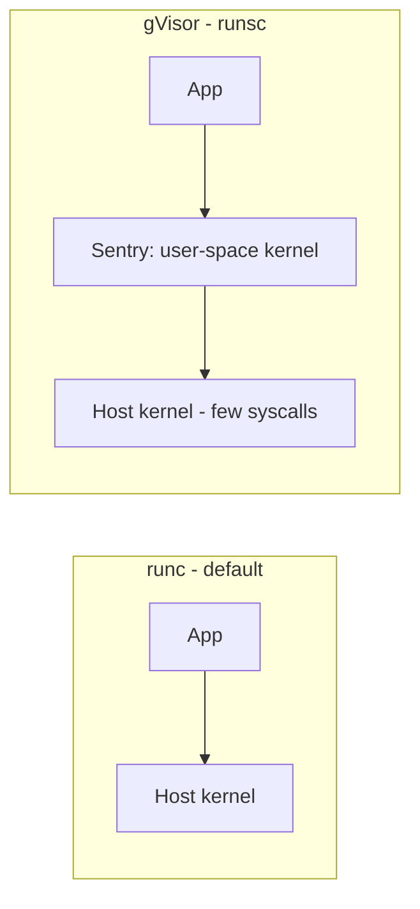

## System Hardening

System hardening is the process of securing a server by reducing its surface of vulnerability. This is a critical part of securing a Kubernetes cluster, as the security of the cluster depends on the security of the underlying nodes: anyone who is root on a node can read every Secret mounted on it, talk to the kubelet, and (on a control plane node) read etcd.

The exam domain covers four ideas:

| Idea | In practice |
|---|---|
| **Minimize the host OS footprint** | fewer packages, services, users and open ports |
| **Least-privilege IAM** | nodes and pods get only the cloud permissions they need |
| **Minimize external network access** | host firewall, block the cloud metadata endpoint |
| **Kernel hardening tools** | sysctl, kernel modules, AppArmor, seccomp, sandboxed runtimes |



Every layer below removes one of those paths.

### Minimize the host OS footprint

Each package, service and account is something that can have a vulnerability. Kubernetes nodes should run almost nothing but the kubelet and the container runtime.

#### Remove unneeded packages

```bash
# what is installed?
apt list --installed | wc -l
dpkg -l | grep -E "telnet|ftp|rsh|nfs"

# remove it (purge also deletes config)
sudo apt purge -y telnetd vsftpd
sudo apt autoremove -y
```

#### Disable unneeded services

```bash
systemctl list-units --type=service --state=running
sudo systemctl disable --now snapd cups apache2
systemctl is-enabled apache2      # should print "disabled"
```

`stop` alone is not enough: the service comes back at the next boot. Use `disable --now`.

#### Find what is listening

```bash
sudo ss -tlnp                     # listening TCP ports + process
sudo lsof -i :21                  # who owns port 21?
sudo netstat -plnt                # older tools, same info
```

Typical exam task: *"a service is listening on port X, find it and remove it"*:

```bash
sudo ss -tlnp | grep :21
# LISTEN 0 32 *:21 *:* users:(("vsftpd",pid=812,fd=3))
systemctl list-units | grep vsftpd
sudo systemctl disable --now vsftpd
sudo apt purge -y vsftpd
```

#### Users and groups

```bash
# accounts with a login shell
grep -vE "nologin|false" /etc/passwd

# who can use sudo?
getent group sudo
sudo cat /etc/sudoers /etc/sudoers.d/*

# lock or remove an account
sudo usermod -L -s /usr/sbin/nologin olduser
sudo userdel -r olduser

# remove a user from a group
sudo gpasswd -d bob docker
```

Members of the `docker` group are effectively **root**: they can start a privileged container that mounts `/`. See [Supply Chain Security → Docker Daemon Access](./supply-chain-security.md#docker-daemon-access).

#### SSH hardening

Edit `/etc/ssh/sshd_config` (or a drop-in file in `/etc/ssh/sshd_config.d/`):

```text
PermitRootLogin no
PasswordAuthentication no
PubkeyAuthentication yes
MaxAuthTries 3
AllowUsers ubuntu ops
X11Forwarding no
```

```bash
sudo sshd -t                      # validate the config first!
sudo systemctl restart ssh        # "sshd" on RHEL
```

#### File permissions on sensitive files

```bash
# setuid binaries: each one runs as root
find / -perm -4000 -type f 2>/dev/null

# world-writable files
find / -xdev -type f -perm -0002 2>/dev/null

# Kubernetes files should not be world-readable
ls -l /etc/kubernetes/pki/ /etc/kubernetes/*.conf /var/lib/kubelet/config.yaml
```

### Kernel Hardening

The Linux kernel is the core of the operating system, and it is essential to harden it to protect against a variety of attacks. All containers on a node **share the same kernel**, so a kernel bug can turn into a container escape.

#### sysctl

`sysctl` is a tool for modifying kernel parameters at runtime. You can use it to configure a wide range of security-related kernel parameters.

To set a kernel parameter, you can use the `sysctl` command:
```bash
sudo sysctl -w kernel.pids_max=4194304
```

To make the changes persistent across reboots, add them to `/etc/sysctl.conf` or a file in `/etc/sysctl.d/`:

```bash
cat <<EOF | sudo tee /etc/sysctl.d/90-hardening.conf
net.ipv4.tcp_syncookies = 1
net.ipv4.conf.all.accept_redirects = 0
net.ipv4.conf.all.send_redirects = 0
net.ipv4.conf.all.rp_filter = 1
kernel.kptr_restrict = 2
kernel.dmesg_restrict = 1
fs.protected_symlinks = 1
fs.protected_hardlinks = 1
EOF
sudo sysctl --system
```

**Important Kernel Parameters for Security:**

| Parameter | Recommended | Why |
|---|---|---|
| `kernel.pids_max` | sized for the node | caps the number of PIDs (fork bombs) |
| `net.ipv4.tcp_syncookies` | `1` | protects against SYN flood attacks |
| `net.ipv4.ip_forward` | `0` unless needed | the node shouldn't route; **Kubernetes nodes need `1`** for pod networking |
| `net.ipv4.conf.all.accept_redirects` | `0` | ignore ICMP redirects (MITM) |
| `net.ipv4.conf.all.rp_filter` | `1` | drop spoofed source addresses |
| `vm.mmap_min_addr` | `65536` | blocks NULL-pointer dereference exploits |
| `kernel.kptr_restrict` | `2` | hides kernel addresses from users |
| `kernel.dmesg_restrict` | `1` | only root can read the kernel log |

Pods can set **namespaced** sysctls with `securityContext.sysctls`. Only a "safe" set is allowed by default; the kubelet must allow-list anything else with `--allowed-unsafe-sysctls`.

```yaml
apiVersion: v1
kind: Pod
metadata:
  name: sysctl-demo
spec:
  securityContext:
    sysctls:
      - name: net.ipv4.ip_local_port_range
        value: "32768 60999"
  containers:
    - name: app
      image: nginx
```

#### Kernel modules

Unused modules are extra kernel code an attacker can load (for example rarely used network protocols with known bugs). Blacklist them:

```bash
lsmod                                      # loaded modules
cat <<EOF | sudo tee /etc/modprobe.d/blacklist-hardening.conf
blacklist sctp
blacklist dccp
install sctp /bin/false
install dccp /bin/false
EOF
sudo rmmod sctp 2>/dev/null                # unload now if loaded
```

`blacklist` stops automatic loading; `install <mod> /bin/false` also makes manual `modprobe` fail. Reboot, then check with `lsmod | grep sctp`.

### Reducing network exposure

-   **Minimize running services**: Only run the services that are absolutely necessary.
-   **Close open ports**: Use a firewall to block all incoming traffic except for the ports that are required for Kubernetes to function.

| Port(s) | Component | Node |
|---|---|---|
| `6443` | kube-apiserver | control plane |
| `2379-2380` | etcd client / peer | control plane |
| `10250` | kubelet API | all nodes |
| `10257` | kube-controller-manager | control plane |
| `10259` | kube-scheduler | control plane |
| `30000-32767` | NodePort services | workers |

#### Host-based Firewall

You can use `ufw` (Uncomplicated Firewall) or `iptables` to configure a host-based firewall.

**Example with ufw:**
```bash
# default: deny incoming, allow outgoing
sudo ufw default deny incoming
sudo ufw default allow outgoing

# SSH only from the admin network
sudo ufw allow from 10.0.0.0/24 to any port 22 proto tcp

# Allow Kubernetes API server
sudo ufw allow 6443/tcp

# Allow etcd only from other control plane nodes
sudo ufw allow from 10.0.1.0/24 to any port 2379:2380 proto tcp

# Allow kubelet
sudo ufw allow 10250/tcp

# Enable ufw
sudo ufw enable
sudo ufw status numbered
```

#### Block the cloud metadata endpoint

On AWS, GCP and Azure, `169.254.169.254` hands out the **node's IAM credentials** to anyone who asks, including any pod. Block pod egress to it with a NetworkPolicy:

```yaml
apiVersion: networking.k8s.io/v1
kind: NetworkPolicy
metadata:
  name: deny-metadata
  namespace: default
spec:
  podSelector: {}
  policyTypes:
    - Egress
  egress:
    - to:
        - ipBlock:
            cidr: 0.0.0.0/0
            except:
              - 169.254.169.254/32
```

Also follow **least-privilege IAM**: give the node role only what the kubelet needs, and give pods their own identity (IRSA on EKS, Workload Identity on GKE/AKS) instead of borrowing the node's.

### Kernel security modules: AppArmor and seccomp

Both restrict what a containerized process may do, even if it runs as root inside the container.

| | AppArmor | seccomp |
|---|---|---|
| Restricts | file paths, capabilities, network access | **system calls** |
| Profile lives in | loaded into the kernel on each node | JSON file under `/var/lib/kubelet/seccomp/` |
| Pod field | `securityContext.appArmorProfile` | `securityContext.seccompProfile` |
| Default | `RuntimeDefault` (container runtime's profile) | `RuntimeDefault` |

Node-side AppArmor commands:

```bash
sudo aa-status                                  # loaded profiles and their mode
sudo apparmor_parser -q /etc/apparmor.d/k8s-deny-write   # load a profile
sudo apparmor_parser -R /etc/apparmor.d/k8s-deny-write   # unload it
sudo aa-complain /etc/apparmor.d/k8s-deny-write          # log only
sudo aa-enforce  /etc/apparmor.d/k8s-deny-write          # block
```

The profile must be loaded **on every node** where the pod may be scheduled, otherwise the pod fails to start. Profile syntax and pod examples are in [Minimize Microservice Vulnerabilities → AppArmor](./minimize-microservice-vulnerabilities.md#apparmor) and [→ Seccomp](./minimize-microservice-vulnerabilities.md#seccomp).

### Sandboxed runtimes: gVisor and RuntimeClass

A normal container makes system calls straight to the host kernel. **gVisor** (`runsc`) puts a user-space kernel in between, so a kernel exploit hits gVisor instead of the host. **Kata Containers** go further and run each pod in a lightweight VM.



1. Install `runsc` on the node and register it in containerd (`/etc/containerd/config.toml`):

```toml
[plugins."io.containerd.grpc.v1.cri".containerd.runtimes.runsc]
  runtime_type = "io.containerd.runsc.v1"
```

```bash
sudo systemctl restart containerd
```

2. Create a `RuntimeClass` whose `handler` matches the name in containerd:

```yaml
apiVersion: node.k8s.io/v1
kind: RuntimeClass
metadata:
  name: gvisor
handler: runsc
```

3. Use it in a pod:

```yaml
apiVersion: v1
kind: Pod
metadata:
  name: sandboxed
spec:
  runtimeClassName: gvisor
  containers:
    - name: app
      image: nginx
```

Verify: inside a gVisor pod, `dmesg` prints gVisor's own boot messages instead of the host kernel's:

```bash
kubectl exec sandboxed -- dmesg
# [   0.000000] Starting gVisor...
```

Trade-off: extra isolation costs some performance and syscall compatibility, so use it for untrusted or multi-tenant workloads.

### Secure Boot

Secure Boot is a UEFI feature that makes sure a device boots using only software signed by a trusted key. When the machine starts, the firmware checks the signature of each piece of boot software (firmware drivers, the bootloader and the kernel). If a signature is invalid, the machine refuses to boot, which stops **bootkits** and tampered kernels that would otherwise run below every other control on this page.

```bash
mokutil --sb-state        # SecureBoot enabled?
```

### CIS Benchmarks for the OS

In addition to the CIS Kubernetes Benchmark, there are CIS Benchmarks for a wide variety of operating systems, including Ubuntu, RHEL and Windows Server. Harden the node OS according to the relevant benchmark, for example with automated tools:

```bash
# OpenSCAP scan against a CIS profile (RHEL family)
sudo oscap xccdf eval --profile cis --results results.xml \
  /usr/share/xml/scap/ssg/content/ssg-rhel9-ds.xml

# Lynis: quick general audit
sudo lynis audit system
```

Related node-level topics:

-   **AppArmor / seccomp**: confine container processes (above).
-   **containerd and runc**: keep them patched, and protect `/run/containerd/containerd.sock` like the Docker socket.
-   **gVisor and RuntimeClass**: sandbox untrusted workloads (above).
-   **Immutable nodes**: rebuild from a hardened image instead of patching by hand (see [Monitoring, Logging and Runtime Security](./monitoring-logging-runtime-security.md#immutable-infrastructure)).

### Checklist

- [ ] Unneeded packages purged and services `disable --now`'d
- [ ] Only required ports listening; host firewall default-deny
- [ ] No unexpected users with login shells; `docker` / `sudo` groups reviewed
- [ ] SSH: no root login, no passwords
- [ ] sysctl hardening applied and persisted in `/etc/sysctl.d/`
- [ ] Unused kernel modules blacklisted
- [ ] Pod egress to `169.254.169.254` blocked; least-privilege IAM
- [ ] AppArmor/seccomp `RuntimeDefault` (or stricter) on workloads
- [ ] Untrusted workloads on a sandboxed `RuntimeClass`
